# Cardio Regulations 1: Study Notes

**Course:** Personal Training Certification

**Topic:** Cardio Regulations, part 1 of 2

**About these notes:** Short revision version of the Cardio Regulations 1 lecture. For the full explanation of every concept, example and class question, see the Detailed Notes. Sources: the lecture recording, the course slides ("Cardio Regulations"), the board photos and the E-book chapters on the cardiorespiratory system and cardiovascular training techniques.

**Big idea:** Cardio is about building **endurance**. Cardiorespiratory endurance (heart and lungs) is built with any aerobic activity. Muscular endurance is task specific, so most clients need **comprehensive** muscular endurance, built with **aerobic cross training**. Aerobic activities are classified by joint stress into three categories using three simple rules, and cardio workload is measured with **distance, speed and time**.

---

## 1. Endurance: who, what, how

Endurance (stamina) = the ability of **someone (who)** to do **something (what)** for a long duration without fatigue.

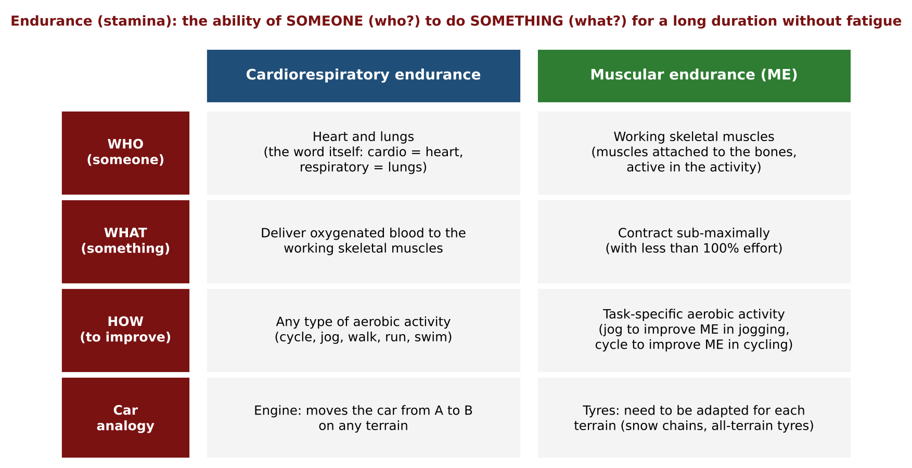

- **Aerobic** = in the presence of oxygen. Aerobic activities can be done for **more than 3 minutes non-stop**. They create a demand for oxygen, so the supply (heart and lungs) gets better.
- Muscular endurance is **task specific**: jog to improve jogging, cycle to improve cycling. (Bolt versus Phelps: both have top cardiorespiratory endurance, but muscular endurance only in their own field.)
- **Car analogy:** engine = heart and lungs (same job on any terrain), tyres = muscles (must be adapted for each terrain).
- Fat loss needs a balanced nutrition plan. Cardio and weight training only facilitate it.

---

## 2. Comprehensive muscular endurance and aerobic cross training

- **Task-specific ME** suits people who repeat one movement pattern (batsman, tennis player, carpenter, chef).
- **Most clients** are general lifestyle people, so they need **comprehensive** (overall, "360 degree") ME.
- **Aerobic cross training** = multiple aerobic activities, not just one (no weights, purely aerobic).

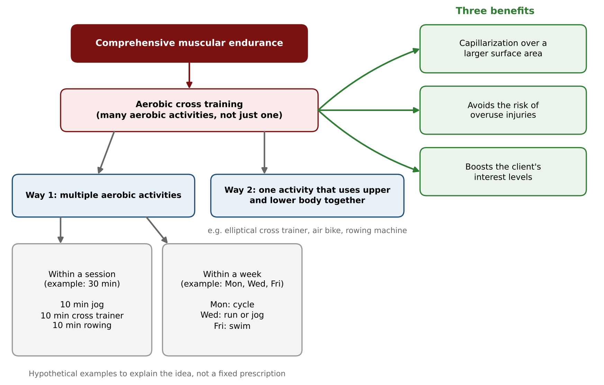

| Way | Example (hypothetical) |
|---|---|
| Multiple activities **in a week** | Mon cycle, Wed run or jog, Fri swim |
| Multiple activities **in a session** | 10 min jog, 10 min cross trainer, 10 min rowing (30 min) |
| One activity using **upper and lower body together** | Elliptical cross trainer (also air bike, rowing machine) |

| Benefit | Key point |
|---|---|
| Capillarization over a **larger surface area** | Spread capillaries evenly, like mobile towers spread across a city |
| Avoids **overuse injuries** | Load shared across many joints and tissues (wear and tear) |
| Boosts **interest levels** | Surprise in the week, change in the session, fewer skipped cardio days |

---

## 3. Classification of aerobic activities by joint stress

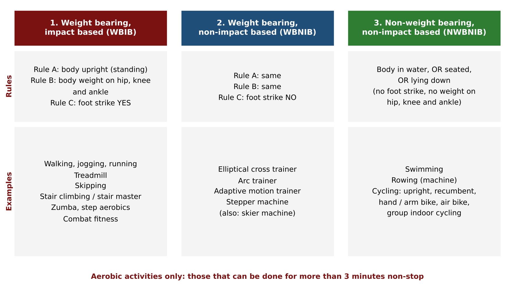

| Category | A: body upright | B: weight on hip, knee, ankle | C: foot strike |
|---|---|---|---|
| **WBIB** weight bearing, impact based | Yes | Yes | **Yes** |
| **WBNIB** weight bearing, non-impact based | Yes | Yes | **No** |
| **NWBNIB** non-weight bearing, non-impact based | Body in **water, seated or lying down** (no foot strike, no weight on the joints) | | |

- A and B make an activity **weight bearing**. C decides **impact based** or not. **All** rules must be met.
- **Foot strike** = the foot leaves and makes contact with the surface again and again. The surface does not matter (road, beach, park, treadmill belt).
- Not purely aerobic (so not used): jumping jacks, burpees, high knees, high jumps, HYROX.

| Category | Examples |
|---|---|
| WBIB | Walking, jogging, running, treadmill, skipping, stair climbing or stair master, zumba, step aerobics, combat fitness |
| WBNIB | Elliptical cross trainer (oval path, from ellipsoid), arc trainer (arc path), adaptive motion trainer ("all in one"), stepper machine, skier machine |
| NWBNIB | Swimming, rowing machine, cycling (upright, recumbent, hand or arm bike, air bike, group indoor cycling) |

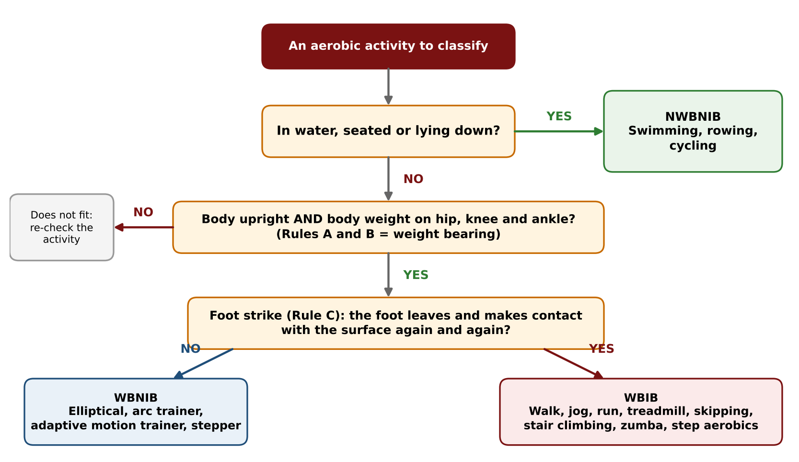

| Bike | Who or what it suits |
|---|---|
| Upright | Regular gym bike |
| **Recumbent** | Low seat for balance problems (vertigo, epilepsy), back rest for lower back, wide seat takes away groin discomfort |
| **Hand or arm bike** | Leg disability (polio), severe knee arthritis. Upper limbs contribute less, but something is better than nothing |
| **Air bike** | Fan and wind resistance: resistance adjusts with effort. Handles move, so it is cross training |
| Group indoor cycling | Spinning classes |

- The same classification can help choose activities by **personality**: solo activities for introverts, group activities for extroverts.
- The rules never change, so any future machine can be classified.

---

## 4. Blood circulation revision

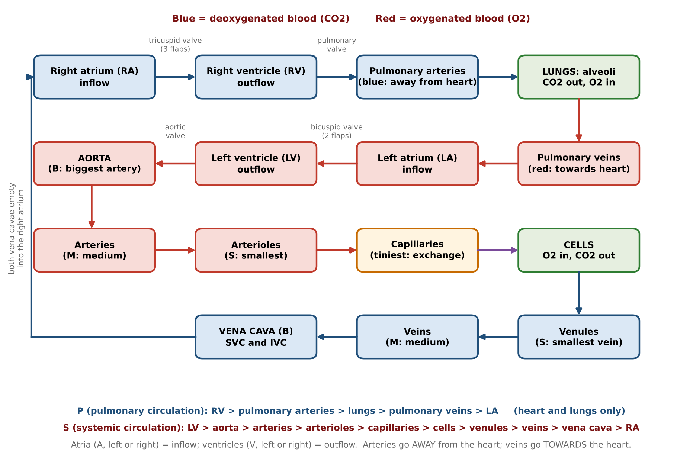

- **Atria = inflow, ventricles = outflow** (left or right). **Arteries go away from the heart. Veins come towards the heart.**
- Oxygenated side: lungs, pulmonary veins, LA, bicuspid valve (2 flaps), LV, aortic valve, aorta (B), arteries (M), arterioles (S), capillaries.
- Capillaries exchange: they give O2 to the cells and take CO2 back.
- Deoxygenated side (reverse sequence, small to big): venules (S), veins (M), vena cava (B) split into SVC (above the heart) and IVC (below the heart, thicker), RA, tricuspid valve (3 flaps), RV, pulmonary valve, pulmonary arteries, lungs (alveoli).
- **Exceptions:** pulmonary arteries carry blue blood, pulmonary veins carry red blood. "Pulmonary" appears wherever the lungs are directly involved.
- **Valves** stop backflow.
- **Pulmonary circulation (P)** = heart and lungs. **Systemic circulation (S)** = heart and cells (from "system").

---

## 5. Key terminologies and formulas

| Term | Meaning and value |
|---|---|
| **HR** | Number of heartbeats per minute |
| **RHR** | HR at rest. Normal range **60 to 80 bpm**, average **72 bpm** |
| **MHR** | Maximum HR = **220 minus age** |
| **HRR** | **MHR minus RHR** (explained in Cardio Regulations 2) |
| **SV** | Blood pumped by the **left ventricle in one beat**. Average **70 ml per beat** |
| **Q** | Blood pumped by the left ventricle **per minute**. **Q = SV x HR**. At rest 70 x 72 = 5,040 ml, about **5 L per minute** |
| **Acute response** | HR rises and Q rest is **speeded up 5 times**, 5 x 5 = **25 L per minute** (slide: sportsman 30 to 32 L at maximal exercise) |
| **VO2** | Volume of oxygen consumed by the body to produce energy (ATP) |
| **VO2 rest** | **3.5 ml of O2 per kg of body weight per minute** = **1 MET**. Example: 80 kg x 3.5 = **280 ml per minute** |
| **MET** | Metabolic equivalent of task: the energy cost of activity. Rises with effort (1 at rest) |
| **VO2 max** | Maximal oxygen consumption during incremental exercise (near MHR). The person's **maximum aerobic capacity** (tested in fitness testing) |

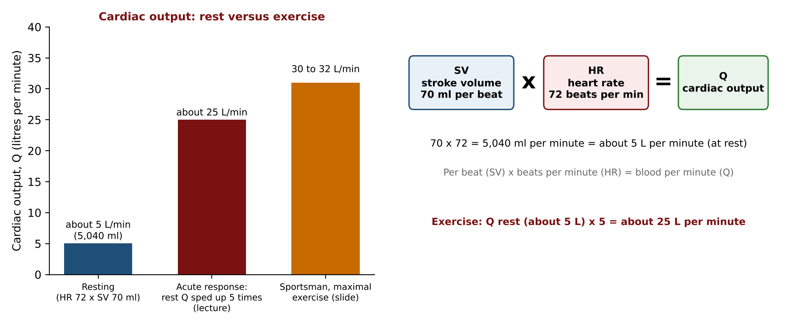

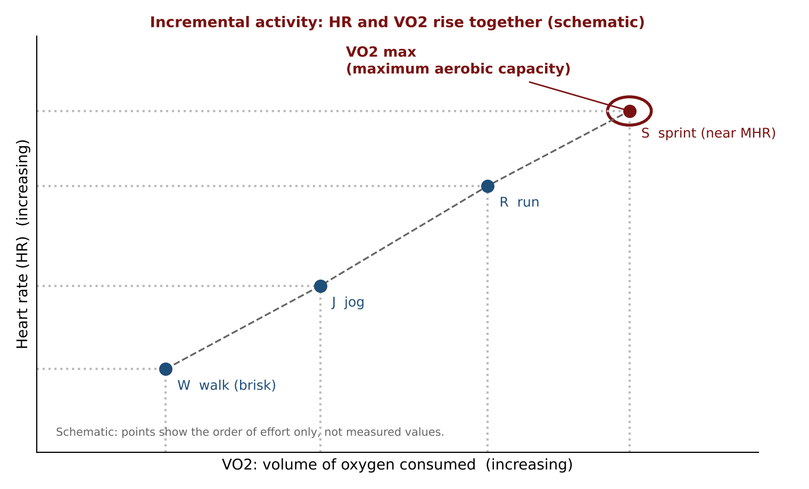

---

## 6. Workload in cardio

| Weight training (4 factors) | Cardio (3 factors) |
|---|---|
| Range of motion, poundage, speed, reps | **Distance, speed, time** |

| Factor changed | Example |
|---|---|
| Distance | 2 km to 2.5 km |
| Speed | 7 km/h to 7.5 km/h |
| Time | 10 min cycling plus 10 min run plus 10 min swim (also cross training) |

**Case study.** D fixed at 2 km. T old = 15 min, T new = 12 min. S = D / T, with minutes divided by 60.

| | Hours | Speed |
|---|---|---|
| Old | 15/60 = 0.25 h | 2 / 0.25 = **8 km/h** |
| New | 12/60 = 0.20 h | 2 / 0.20 = **10 km/h** |

Same distance in less time means the speed must **increase**.

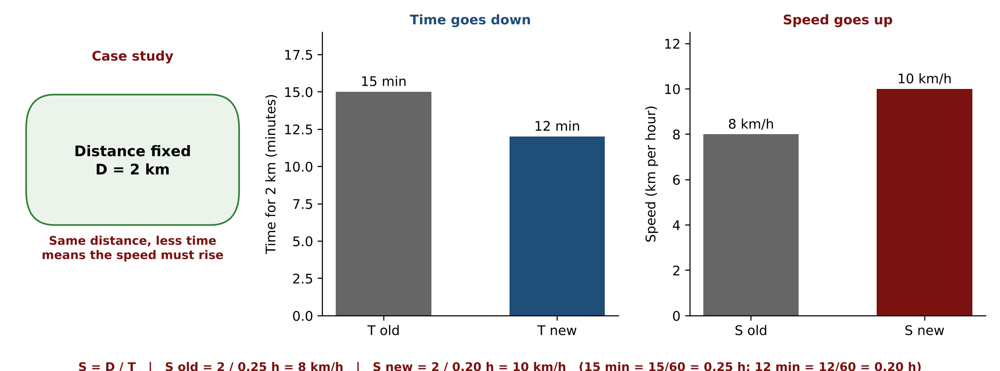

---

## 7. Chronic adaptations (long-term benefits of cardio)

| Cardiovascular system | Respiratory system |
|---|---|
| Better contractility of the myocardium | Respiratory muscles (diaphragm, intercostals) get stronger |
| Increased SV and exercise Q | Increased lung volume and capacity to breathe air |
| Decreased RHR (lower is better; reason in Cardio Regulations 2) | Improved blood flow to the lobes of the lungs |
| Increased RBC count | Improved utilisation of the alveoli |
| Neocapillarization | Increased gaseous exchange |
| Increased elasticity of blood vessels | Improved recovery from exercise |
| Increased mitochondrial density | |
| Increased resistance to fatigue | |
| Increased endurance | |

---

## 8. Key terms

| Term | Meaning |
|---|---|
| Endurance (stamina) | Ability to do something for a long duration without fatigue |
| Cardiorespiratory endurance | Heart and lungs delivering oxygenated blood to working skeletal muscles |
| Muscular endurance | Working skeletal muscles contracting sub-maximally (under 100% effort), task specific |
| Comprehensive ME | Overall muscular endurance, not tied to one task |
| Aerobic cross training | Doing multiple aerobic activities, or one that uses upper and lower body together |
| Foot strike | Foot repeatedly leaving and touching the surface |
| WBIB / WBNIB / NWBNIB | The three joint-stress categories of aerobic activity |
| Pulmonary / systemic circulation | Heart and lungs / heart and cells |
| Alveoli | Tiny air sacs where gas exchange happens |
| Capillaries | Tiniest vessels; exchange with cells |
| Workload | Amount of work done (cardio: distance, speed, time) |
| Chronic adaptations | Long-term benefits of training |
| Acute response | Immediate effect of exercise |

---

## 9. Where the sources differ

- **Cardiac output in exercise:** lecture 5 x 5 = 25 L per minute; slide: sportsman 30 to 32 L at maximal exercise.
- **SV and Q:** lecture and slides say left ventricle; E-book says each ventricle.
- **RHR:** lecture and slide 60 to 80 normal, average 72; E-book also gives 40 to 100 as the general range.
- **Cross training benefits:** lecture has three; E-book has four (adds recruiting more muscles, and lacks capillarization).
- **Examples of cross training schedules:** slide and E-book use 60 and 20 minute blocks; the lecture's examples were hypothetical.
- **Combat fitness** was marked with a question mark in the lecture but is in the WBIB list on the board and slides.
- **MET values** (3 to 4 for jogging and running, 9 to 10 for sprinting) were illustrations and are not on the slides.
- Slide-only items (blood flow percentage chart, E-book VO2 max formula) were not discussed in the lecture. See Points to Confirm in the Detailed Notes for the complete list.

---

## 10. Quick revision questions

1. What is the main purpose of cardio, and where does the word "cardio" come from?
2. Define endurance using "who" and "what".
3. Give the who, what and how of cardiorespiratory endurance.
4. Give the who, what and how of muscular endurance, and explain why it is task specific.
5. Explain the car analogy for the two types of endurance.
6. What is comprehensive muscular endurance, and which clients mainly need it?
7. What is aerobic cross training, and why are weights not included here?
8. Give two ways to apply multiple activities, with an example of each.
9. Name the three benefits of aerobic cross training and explain the mobile tower analogy.
10. State the three rules of the WBIB category.
11. How do the rules change for WBNIB and for NWBNIB?
12. Why does the treadmill count as WBIB? Why are jumping jacks and HYROX not used?
13. Give four WBNIB machines and explain why the cross trainer is called elliptical.
14. Why was the recumbent bike invented, and who benefits from a hand or arm bike?
15. Trace the path of blood from the lungs to the cells and back, naming the valves.
16. Which vessels are the exceptions to "arteries carry red, veins carry blue", and why?
17. Write the formulas for MHR, HRR and cardiac output, and give the resting averages for RHR, SV and Q.
18. What is VO2 rest in ml per kg per minute? Calculate it for an 80 kg person and state its MET value.
19. What are the cardio workload factors? A client covers 2 km in 15 minutes and must now do it in 12 minutes. Calculate the old and new speeds.
20. List four cardiovascular and three respiratory chronic adaptations of cardio.

---

## 11. Answers

1. Building endurance (stamina). It comes from the Greek *cardium*, meaning heart.
2. The ability of someone (who) to do something (what) for a long duration without getting fatigued.
3. Who: heart and lungs. What: deliver oxygenated blood to the working skeletal muscles. How: any type of aerobic activity.
4. Who: working skeletal muscles. What: contract sub-maximally (less than 100% effort). How: task-specific aerobic activity. It is task specific because each activity uses a different movement pattern, so training one pattern does not prepare the muscles for another (jog to improve jogging, cycle to improve cycling).
5. The engine (heart and lungs) gives the power to go from A to B on any terrain. The tyres (muscles) must be adapted for each terrain (for example snow chains), just as muscles must be trained for each activity.
6. Overall (360 degree) muscular endurance, not specific to one task. General lifestyle clients (homemaker, business owner, student, office worker) mainly need it.
7. Doing multiple aerobic activities instead of one, to build comprehensive ME. Weights are not included because adding them moves into the anaerobic zone, and the cardio lectures stay purely aerobic.
8. In a week: for example Monday cycle, Wednesday run or jog, Friday swim. In a session: for example 10 min jog, 10 min cross trainer, 10 min rowing. (Also: one activity using upper and lower body together, such as the elliptical cross trainer.)
9. Capillarization over a larger surface area, avoiding overuse injuries, boosting interest levels. Capillaries (like mobile towers) should be spread evenly across the body, not clustered in one area, for the best coverage.
10. A: body upright (standing). B: body weight on hip, knee and ankle. C: foot strike (yes).
11. WBNIB: A and B are the same, and C is no foot strike. NWBNIB: the body is in water, seated or lying down (no foot strike and no weight on hip, knee and ankle).
12. Because foot strike is foot strike on any surface (the belt is the platform), with an upright body and weight on hip, knee and ankle. Jumping jacks and HYROX are not purely aerobic (they contain anaerobic work), and the activities must be possible for more than 3 minutes non-stop.
13. Elliptical cross trainer, arc trainer, adaptive motion trainer, stepper (also the skier machine). The pedals move in an oval path, from the word ellipsoid (the oval socket of the condyloid joint).
14. For people with vertigo or balance problems (low seat, more confidence), lower back stress (back rest) and groin discomfort (wide cushioned seat). The hand or arm bike suits people with leg disabilities such as polio or severe knee arthritis.
15. Lungs, pulmonary veins, LA, bicuspid valve, LV, aortic valve, aorta, arteries, arterioles, capillaries (exchange with cells), venules, veins, vena cava (SVC and IVC), RA, tricuspid valve, RV, pulmonary valve, pulmonary arteries, lungs (alveoli).
16. The pulmonary arteries (away from the heart but carry blue, deoxygenated blood) and the pulmonary veins (towards the heart but carry red, oxygenated blood).
17. MHR = 220 minus age. HRR = MHR minus RHR. Q = SV x HR. Resting averages: RHR 72 bpm (normal 60 to 80), SV 70 ml per beat, Q about 5 L per minute (70 x 72 = 5,040 ml).
18. 3.5 ml of oxygen per kg of body weight per minute. For 80 kg: 3.5 x 80 = 280 ml per minute. It equals 1 MET.
19. Distance, speed and time. Old speed = 2 / (15/60) = 2 / 0.25 = 8 km/h. New speed = 2 / (12/60) = 2 / 0.20 = 10 km/h.
20. Cardiovascular (any four): better myocardial contractility, increased SV and Q, decreased RHR, increased RBC count, neocapillarization, increased elasticity of vessels, increased mitochondrial density, increased resistance to fatigue, increased endurance. Respiratory (any three): stronger respiratory muscles, increased lung volume and capacity, improved blood flow to the lobes of the lungs, improved use of the alveoli, increased gaseous exchange, improved recovery.

---

# Board Photos from the Lecture

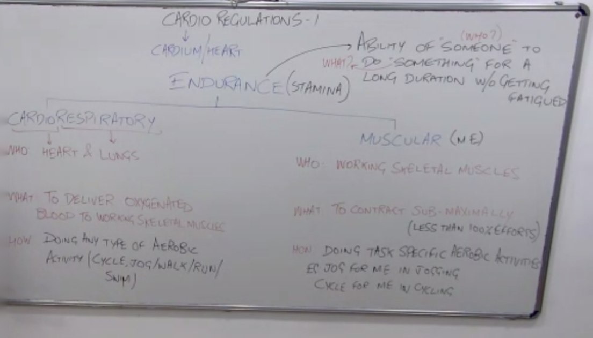

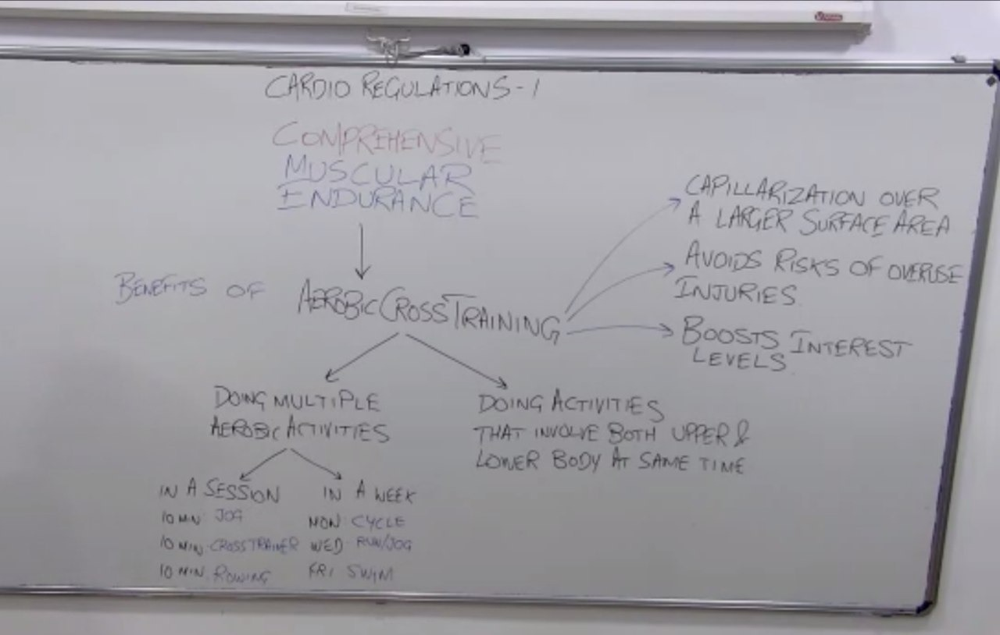

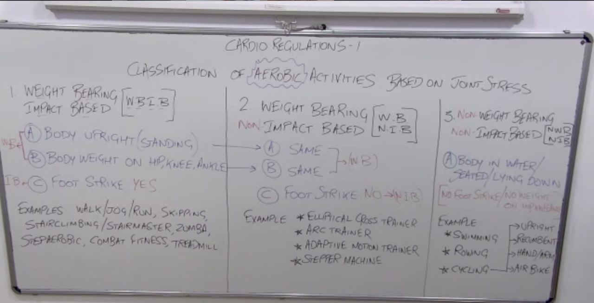

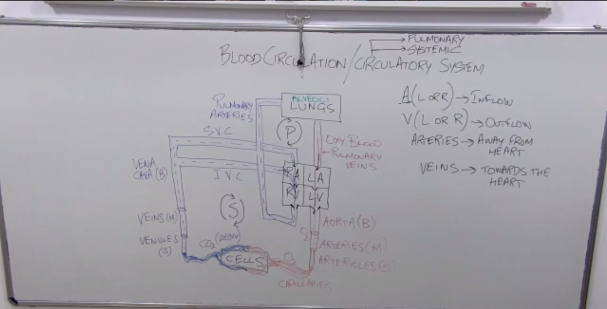

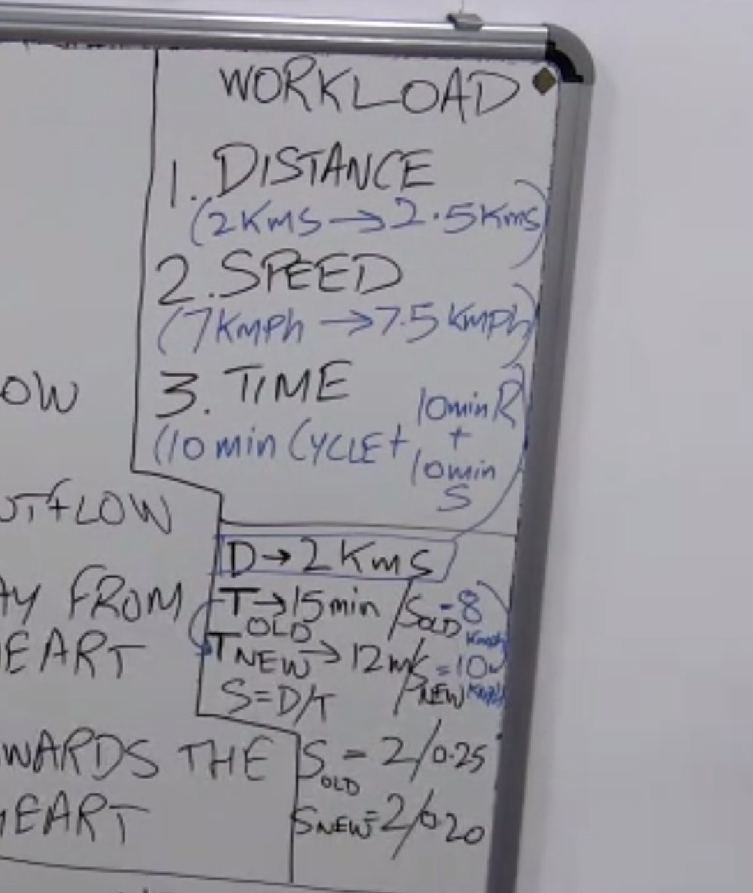

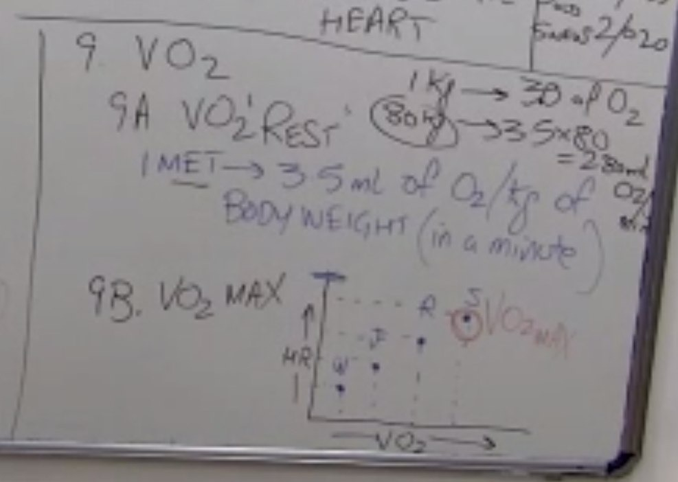

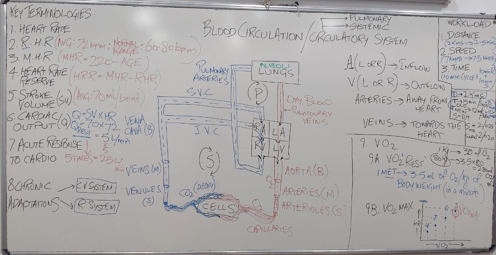
