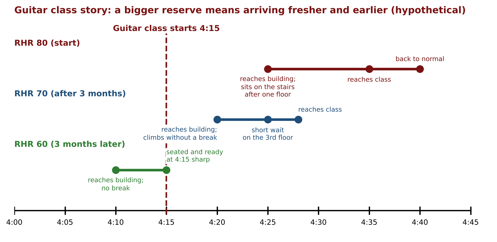
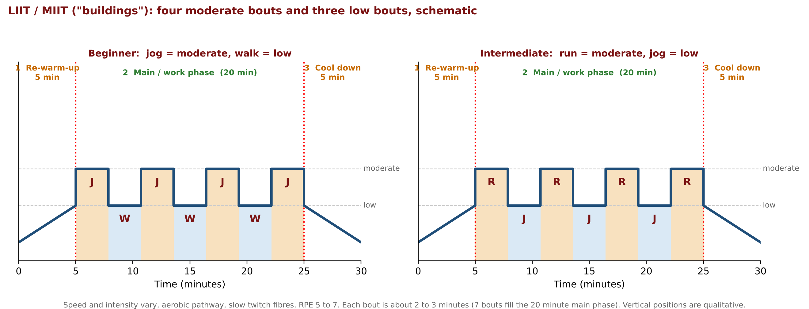
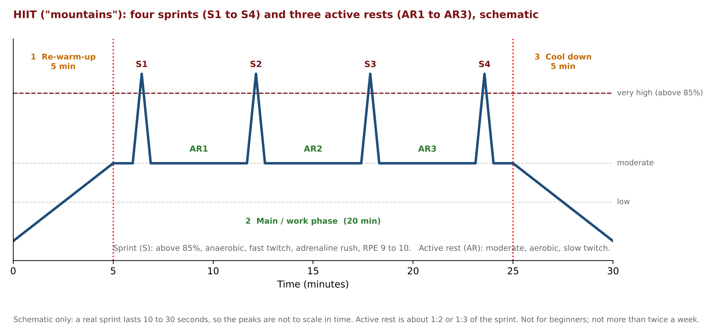

# Cardio Regulations 2: Detailed Notes

**Course:** Personal Training Certification

**Topic:** Cardio Regulations, part 2 of 2

**About these notes:** Detailed notes from the Cardio Regulations 2 lecture, written so the whole lecture can be studied without watching the recording. Every concept, example, analogy and class question is covered. For a short revision version see the Study Notes. The first part, Cardio Regulations 1, covers endurance, the classification of aerobic activities, blood circulation, key terminologies and workload.

---

## Abbreviations used in these notes

| Short form | Meaning |
|---|---|
| HR | Heart rate (beats per minute, bpm) |
| RHR | Resting heart rate |
| MHR | Maximum heart rate (220 minus age) |
| HRR | Heart rate reserve (MHR minus RHR) |
| THR | Target heart rate (written as a lower limit and an upper limit) |
| THR (L) / THR (U) | Lower limit / upper limit of the THR |
| RM | Repetition maximum (the most reps possible before failure) |
| RPE | Rating of perceived exertion (Gunnar Borg scale, 0 to 10) |
| GPP | General physical preparedness |
| LIIT / MIIT / HIIT | Low / moderate / high intensity interval training |
| RWU / M/W / CD | Re-warm-up / main (work) phase / cool down |
| S / AR | Sprint / active rest (the two parts of a HIIT main phase) |
| PPG | Photoplethysmography (the light-based sensing used in smartwatches) |
| WBIB / WBNIB / NWBNIB | Weight-bearing impact-based / weight-bearing non-impact-based / non-weight-bearing non-impact-based (aerobic activity categories) |
| Q / SV | Cardiac output / stroke volume |
| bpm | Beats per minute |

## Before this lecture

This is the second half of the cardio topic. You should already know, from Cardio Regulations 1 and earlier lectures:

- **Workload in cardio** is the amount of work done, and it is changed with three factors: **speed, distance and time**.
- The key terminologies **RHR** (normal range 60 to 80 bpm, average 72), **MHR = 220 minus age**, **HRR = MHR minus RHR**, stroke volume and cardiac output (**Q = SV × HR**).
- One chronic adaptation of cardio is a **lower RHR**. How this happens was covered earlier. **Why** a lower RHR is better is explained in this lecture.
- The three categories of aerobic activity (WBIB, WBNIB, NWBNIB), the **3 minute rule** (aerobic activities can be done non-stop for more than 3 minutes), and the idea of the aerobic and anaerobic energy pathways, slow twitch and fast twitch muscle fibres.
- From weight training: **intensity and the RM method**, the classification of intensity with training levels, the **warm-up** (dynamic stretching and mobility drills), and rating of perceived exertion, which was mentioned long ago and is shown here on its cardio scale.

## Outline of the lecture

| Part | Topic |
|---|---|
| 1 | Intensity in cardio: heart rate as the deciding factor and the case study client |
| 2 | Classification of cardio intensity and how trainees are promoted |
| 3 | Factors to consider while prescribing cardio intensity |
| 4 | Calculating the target heart rate: age-predicted method, heart rate reserve (Karvonen) method, why a lower RHR is better |
| 5 | Monitoring heart rate with electronic devices |
| 6 | Estimating intensity without electronic devices: RPE and the talk test |
| 7 | Types of training methods: continuous, LIIT/MIIT, HIIT, Fartlek, and ways to progress |
| 8 | Class questions and closing |

---

# Part 1: Intensity in Cardio

## 1.1 Workload versus intensity

Cardio Regulations 1 ended with **workload**: the **amount of work done**, which in cardio is determined by speed, distance and time. This lecture starts with **intensity**, this time in terms of cardio. (The earlier intensity lecture was entirely about weight training.)

**Class question: What is intensity, if workload is the amount of work done?**

One answer ("the amount of work done with respect to time, distance and speed") was in fact the definition of workload. The correct idea:

- **Intensity is the level of effort applied** while doing that work, or the **difficulty level** of the work, within a time frame.

**Analogy: an exam.** Thirty students sit an exam with 30 multiple-choice questions. Solving 30 questions is the **workload** and it is the same for everyone. But the questions are not equally easy for everyone:

- Students who have prepared well put in a low level of effort, so the **intensity is low** for them.
- Students who have not prepared well put in a high level of effort, so the **intensity is high** for them.

Workload is equal for all, but **intensity may vary**. Intensity is nothing but the **level of effort applied**.

## 1.2 How intensity was decided in weight training

In weight training, intensity was determined with the **RM method** (and the RIR method). The logic: **RM is the number of repetitions a person can do at most before failure.** When comparing two people, or the same person in two different sets, the set in which fewer reps could be done before failure was the more intense one. So the RM number was the key deciding value:

- **Lower the RM, higher the intensity.**

Cardio also needs a number that decides whether intensity is low or high.

| | Weight training | Cardio |
|---|---|---|
| Deciding value | RM (reps before failure) | **HR during the cardio activity** |
| Relationship | **Lower** RM means **higher** intensity | **Higher** HR means **higher** intensity |

## 1.3 Heart rate: the deciding factor in cardio

Two statements were written on the board:

1. Intensity in cardio **is determined by the HR during the cardio activity**. (In brackets: **HR as a percentage of MHR**.)
2. **The higher the HR during cardio, the greater the intensity.**

Note that it is not any random heart rate: it is the **heart rate during cardio activity**, and it must be turned into a **percentage of the person's own MHR**.

## 1.4 The case study: meet Sumit

To understand the topics, one hypothetical client is carried from topic to topic. **Sumit is a new client. He is 20 years old.** That is all that is known at first, and more details are added as the lecture goes on.

A vertical **intensity scale** (also called the heart rate scale) is drawn for Sumit:

- At the **bottom** is the **RHR**: the heart rate from which his day starts, when he wakes up in the morning, with no physical effort and only involuntary metabolic functions taking place. This end is written **0% efforts** (the "no effort" zone).
- At the **top** is the **MHR**: the maximum number of times his heart can beat in a minute. This end is **100% efforts**.

**MHR for Sumit:** 220 minus age = 220 minus 20 = **200 bpm**.

**Analogy: a bottle filled to the brim.** A one litre bottle filled to the brim overflows if more water is added. In the same way a person's heart rate cannot go beyond the MHR (200 for Sumit): it is the maximum, the 100% effort level. (The bottle is then used a second time to practise percentages: if 500 ml is drunk from the full bottle, 500 ml remains, so the bottle is at 50% of its capacity.)

## 1.5 Turning a heart rate into an intensity percentage

Sumit is given an activity on a treadmill and his heart rate is checked after some time. The first statement says intensity is found from the HR during cardio.

- HR = **100** bpm. This is 100 out of 200, so he is working at **50%**. That is Sumit's intensity.
- After 5 minutes HR = **180** bpm. 180 out of 200 is **90%**.
- Later he slows down and HR = **160** bpm. 160 out of 200 is **80%**.

The method is:

> **Intensity (%) = (HR during cardio ÷ MHR) × 100**

Observations from the scale:

- As the HR goes up, the intensity (in percent) goes up. The lower on the scale, the lower the intensity (statement 2).
- The key learning: the **HR during cardio is the main input**, and the only thing done with it is to see **what percentage it is of that person's MHR**.

**Do not copy these numbers.** A client with a heart rate of 100 is not automatically at 50% intensity. The 50% came from using **Sumit's** MHR of 200. For any client, first find that client's own MHR and take the percentage of that, not of 200. The value 200 is only used for the case study so that the calculation is easy to follow (a 20 year old is chosen for an easy MHR).

---

# Part 2: Classification of Cardio Intensity

## 2.1 The classification

In weight training, after the RM method came a chart that gave predefined RM ranges for low, moderate and high intensity and linked each to a training level. For example, beginners (low intensity, so a high RM number) worked in roughly the **15 to 20 RM** range, and as intensity rose the range narrowed, to about **2 to 6 RM** for super advanced, and **1 RM** was the heaviest and most intense. (This is recalled from the earlier lecture.)

The same idea is applied to cardio, but with **percentages of MHR** instead of RM. The same scale is used.

| Intensity | % of MHR | Trainee level |
|---|---|---|
| Low | **50 to 60%** | Beginner |
| Moderate | **60 to 70%** | Intermediate |
| High | **70 to 85%** (pay attention: not 80 to 85) | Advanced |
| Very high | **Above 85%** | Super advanced |

## 2.2 Beginners (low intensity, 50 to 60%)

- Clients with **less than about 2 to 3 months** of cardio training experience are beginners. They start their cardio journey from this level.
- **Restarting clients are also beginners.** Someone who did cardio before but took a gap (personal reasons, an underlying health condition, rehab) cannot be started directly at moderate or high just because of old experience. They go step by step again from the beginning.

## 2.3 Promotion is about performance, not the calendar

Consider a person who followed the prescribed intensity and every instruction for the 2 to 3 month beginner phase. This applies to **weight training as well as cardio**:

- A person is **not** promoted from beginner to intermediate just because three months have passed on the calendar.
- What if the person showed up only about three times in three months, was not consistent or regular, only checked social media during the session, and did not follow the instructions, neither in the one hour with the trainer nor in the remaining 23 hours (nutrition, rest, recovery)? Such a person has not earned the next level.
- This is the reason for the next two lectures, **Fitness Testing 1 and 2**. A fitness test is done on the **first day** and again **after the beginner phase (about 3 months)**, for all five components of fitness. The numbers show whether there is a significant improvement. That is **progress tracking**, and that is how a client is promoted. It is not "you joined on 1 January, now it is 1 April, here is your intermediate certificate".
- When the improvement is seen, the level of effort (the difficulty, in short the **intensity**) is increased to **60 to 70%, moderate**, and the client is called an **intermediate**.

Using time as a rough guide only (performance matters as well):

| Level | Rough experience |
|---|---|
| Beginner | Less than 3 months |
| Intermediate | More than 3 months and less than 1 year |
| Advanced | After a year of consistent performance and progress, when the client is ready for promotion, 70 to 85% |
| Super advanced | Can go above 85% easily, smoothly and safely, and come back **without fatigue and without risk** (athletes and sports people) |

## 2.4 Super advanced, and an unofficial "elite" level

Super advanced means those who can take their intensity above 85% safely and consistently and come back from it. The examples mentioned: top footballers and cricketers (such as Kohli, Messi, Ronaldo).

There is **no official category above super advanced**, but if there were one it would be "elite": people like Usain Bolt and Michael Phelps, who can go not just above 85% but very close to their MHR and come back safely. Their blood circulation system (heart anatomy, blood vessels, stroke volume, cardiac output, VO2 max) works extraordinarily well. The point of mentioning it: it is not everybody's cup of tea to reach there safely and return.

**Safety rule.** Some clients, taking it on their ego, insist "I can go near 100%, even to 200 and come back". Even beginners say this. **Never take that risk, at least under your guidance.** They might reach 200 but then go "somewhere else" and not return from the treadmill. Things have to go step by step, and the client must understand that the whole cardiorespiratory system has to be made ready to go to a level and return efficiently, smoothly and safely. That is why there are steps to pass before going to the next level.

## 2.5 Student question: can intensity change from day to day?

**Q: Sumit's day-to-day condition may change (for example if he is not healthy). Does his intensity change daily?**

**A:** It is not changed daily. An intensity level is set for the client based on the client's **current training level**, through several factors (covered in Part 3). Once set, the client works at that level. From time to time a **fitness test** is conducted to see how the client performs at the allocated intensity. A task is given at that intensity and the client has to show **consistent performance**. Judging from one day to the next cannot tell whether the level works. The numbers from consistent performance show whether the decided intensity worked.

---

# Part 3: Factors to Consider While Prescribing Cardio Intensity

## 3.1 Why "prescribing"

The word **prescribing** fits: just as a doctor prescribes a medicine, a trainer prescribes (assigns) an intensity level to a client.

Meeting Sumit for the very first time, his **name and age are not enough** to decide at which level to start his cardio. More inputs are needed, which is why there is an **initial client interview** with small forms to fill in. The course's training program delivery module includes a client interview form with questions of this kind (lifestyle, training experience and others). With these answers, one key decision is the **cardio intensity** to start with.

The class was asked to suggest factors one by one. The six factors are shown below with Sumit's values (the values were added to the board later, see 3.9).

## 3.2 Factor 1: Training experience

This tells at a broad level whether the person has ever done cardio. If not, that is a separate case. If yes, a lot can be learned:

- The **type of aerobic activity** done (weight-bearing impact-based, weight-bearing non-impact-based, or non-weight-bearing non-impact-based).
- The **frequency**: how many sessions per week and how much time per session.
- Preferences: morning or evening, outdoor or indoor.

## 3.3 Factor 2: Lifestyle

Lifestyle is a big umbrella. It includes:

- **Food habits and daily nutrition**: someone may follow strict, well balanced nutrition while someone else eats pizzas and burgers daily.
- **Daily routine and nature of the job**, and how much physical activity it involves: a corporate employee on a laptop all day versus an architect moving from site to site and climbing stairs (no lifts installed yet), a salesman or anyone on a field job.
- **Habits**: staying away from smoking and drinking versus daily drinking at a fixed time.
- **Sleep**, which has both **quality and quantity**: good quality sleep of 7 to 8 hours versus 3 to 4 hours at random, inconsistent times.
- **Stress** also comes under this heading.

## 3.4 Factor 3: Medical background

The client may have a heart related, joint related or neurological condition. If the trainer is not aware and straight away gives advanced, high intensity, the client could suffer a severe condition during cardio. Being aware of the medical background is crucial.

## 3.5 Factor 4: Age

Age is sometimes forgotten while looking for something fancy. Why is it needed?

**Student answer:** different intensities are given to children and older people. The lecture pointed out that this reasoning can go wrong, because of **stereotyping**:

- **Stereotyping** means that when a fact is very popular or widely believed, people start assuming it must be true.
- The stereotype here: a 60 year old must be a beginner, while a 20 year old can be given more than beginner, just because of age.

**A hypothetical case (not a generalisation).** Consider only the first three factors. The 20 year old has nil training experience, a sedentary lifestyle (junk food, parties, smoking, drinking, wrecked sleep, hardly moving) and the 60 year old has never missed a session in 30 or 40 years, a very active lifestyle, clean nutrition, no poor habits, perfect sleep, and a clear medical background (no heart or joint issue). Going by age alone would be unfair to the 60 year old, who stands at a much better place. This is not saying all 20 year olds or all 60 year olds are like that.

**The real, basic reason age is needed:** without age the **MHR cannot be calculated** (MHR = 220 minus age), and without MHR the **intensity cannot be determined**.

## 3.6 Factor 5: Resting heart rate (RHR)

RHR is a quantifiable number and an **indicator of a person's cardiorespiratory fitness**, so it shows the person's **current fitness level** on the day of meeting the trainer.

- Normal range: **60 to 80 bpm**. The **lower the better** (promised: why, in Part 4).
- One chronic adaptation of cardio is that it helps in reducing the RHR.

## 3.7 Factor 6: Goal

What does the client want to achieve and why are they doing cardio? Two types of goals:

- A **specific goal**: for example taking part in HYROX, a marathon, or climbing Mount Everest.
- A **basic goal**: just a basic level of fitness so that day-to-day tasks are done efficiently and any emergency can be handled with efficiency. This is the definition of **GPP** (**general physical preparedness**).

## 3.8 All six are equally important

The list is not a rank: it does **not** mean training experience is most important and goal is least important. All six are equally important and have to be **seen collectively** while taking the decision. "Not one but all six."

The slides list the same factors with slightly different names: age, medical background, **past training history (FITT)**, **current fitness level**, lifestyle and goal. Training experience corresponds to past training history, and the RHR corresponds to current fitness level.

## 3.9 Applying the six factors to Sumit

More assumptions are made about Sumit for the case study (written in red on the board):

| Factor | Sumit |
|---|---|
| 1. Training experience | **Nil**. He has never seen a treadmill and does not even know where the park near his home is. |
| 2. Lifestyle | **Average** for a 20 year old student: gets up late, goes to college, eats mostly outside in cafes with friends, junk food, an occasional party, entertainment is Xbox, PlayStation and Netflix, no outdoor activity, no physical activity or workout. |
| 3. Medical background | **Clear**. No condition yet. |
| 4. Age | **20 years** (for MHR), so MHR = 200. |
| 5. RHR | **80 bpm**. With these data his RHR is certainly not in the good zone near 60. It is at the borderline but on the higher, poor side. |
| 6. Goal | **GPP**. No special goal, he only wants general physical preparedness. |

**Decision (made together in class):** Sumit starts as a **beginner**. (If it were up to the lecture, there would be one more category, "pre-beginner", but the course works with what exists.) One topic paves the platform for the next: from here the intensity is **50 to 60%**.

## 3.10 From a percentage to a number the client can use

Imagine Sumit's very first cardio session. The trainer gives a gym tour, familiarises him with the weight training and cardio machines and sections, and then does **mobility drills**. (Before a workout, the stretching to do is **dynamic**, not static.) On the treadmill the trainer shows how it starts and stops, speed up, incline up and down, and the **emergency stop**. Then a task is set: do this for a given number of minutes at a given speed, at an intensity between 50 and 60%. (A beginner is not told "because you are a beginner".)

Sumit will naturally ask: do I have to take a calculator and run on the treadmill and calculate? **No.** The percentages are the background science for the trainer. The client needs **a number that is easy to notice during cardio: a heart rate.** So the percentage is converted into a **target heart rate (THR)**: "T" stands for target, a target that is achievable for the client. The client can then follow a number on a device (a wrist heart rate monitor such as a smartwatch, a chest strap, or others covered later in this lecture) instead of a percentage. The next part shows how to calculate the THR.

---

# Part 4: Calculating the Target Heart Rate (THR)

## 4.1 A single value or a range?

A THR can be given in two formats: a single number (for example **155 bpm**) or a range (for example **150 to 160 bpm**). Which makes more sense?

**It should be a range.**

- Heart rate is not fixed all the time. It **fluctuates**, like room temperature, by plus or minus 1, 2, 3, 4. For a 20 minute activity, reaching 155 is possible, but **maintaining exactly that number is impossible**.
- A range tells the client: do not go below 150 and do not exceed 160, stay in that range.
- **Analogy: buying a shirt.** Walking into a high-end store and asking for a shirt of exactly 4,832 rupees will get a person shown the door. A range works: "between 4,500 and 5,000" or "between 4,000 and 5,000".

(The student reason "beginners do not want to look at a particular number" was not correct, and the answer "an approximate value, not a particular heartbeat for every person" was close to the point.)

So the THR has a **lower limit (L)** and an **upper limit (U)**, and in both methods the formula is calculated **twice**: once for the lower limit and once for the upper limit. (The board shows 155 bpm on one side and 150 to 160 bpm with L and U marked on the other.)

## 4.2 Method 1: The age-predicted method (MHR method)

- Formula: **THR = MHR × intensity**, which is **THR = (220 minus age) × intensity**.
- Nickname: because the formula uses MHR, this is also called the **MHR method**. It is the same method, so do not get confused if an exam, viva, MCQ or interview uses either name.

**Make the formula ready to use** by opening up MHR (breaking a complex formula into its simplest form), then put in values. For Sumit: age 20, beginner (**50 to 60%**), RHR 80 bpm.

- The lower limit uses the lower intensity, 50%, written as 50/100.
- The upper limit uses the upper intensity, 60%, written as 60/100.

| | Calculation | Result |
|---|---|---|
| THR (L) | (220 minus 20) × 50/100 = 200 × 50/100 | **100 bpm** |
| THR (U) | (220 minus 20) × 60/100 = 200 × 60/100 | **120 bpm** |
| THR range | | **100 to 120 bpm** |

The RHR of 80 is not used in this method.

## 4.3 Does this range make sense? The loophole

The lecture then validates the range. There is "something fishy" here, which is why a second method was needed. Draw Sumit's scale again: RHR 80 at the bottom, MHR 200 at the top, and the THR zone **100 to 120** according to this method. A story shows the problem:

| Moment | Heart rate |
|---|---|
| Wakes up in the morning, resting | **80** |
| Morning routine, then a **10 minute walk** to the gym, then **three floors by stairs** (no lift) to the gym door | about **90** |
| Meets the trainer, gym tour, mobility drills, waiting at the treadmill | about **95** |

So the cardio **starts at 95**. If Sumit simply continues to walk casually for a couple of minutes, chatting to a friend on the next treadmill, his heart rate will be in the 100 to 120 THR zone within a couple of minutes. Does he look like someone working at 50% intensity? No. That is the catch.

**The loophole:** this method gives a very **generalised, age-predicted** THR. It considers **only one variable, age**. It never considers Sumit's **current fitness level**, which is exactly what the RHR of 80 indicates. Following the formula, all 20 year old beginners would get the same THR, but not all 20 year olds have the same RHR: one may be near 60, one at 70, one at 80. It is not fair for all three to get the same THR.

**Analogy: buying jeans.** Three friends, all 30 years old, ask for a pair of jeans and the salesman says "30 year old, 36 waist" for all three. The body composition is not the same for all 30 year olds. Sizes vary for shoes, shirts and everything, and so do fitness levels. A **customised** THR is needed that considers the person's current fitness level, not a generalised one. This is why **Karvonen** (an exercise physiologist) came up with a more valid and reliable method.

## 4.4 Method 2: The heart rate reserve (HRR) method (Karvonen's formula)

- This is the **HRR method**, also known by its inventor's name as **Karvonen's formula**. (This is the point where HRR, promised in the previous lecture, is explained in detail.)
- Formula: **THR = HRR × intensity + RHR**.
- Like before, MHR was multiplied with intensity. Here **HRR is multiplied** with intensity and then the **resting heart rate is added**.

**Make it ready to use**, step by step:

| Step | Form |
|---|---|
| 1 | THR = HRR × intensity + RHR |
| 2 | Open HRR: THR = **(MHR minus RHR)** × intensity + RHR |
| 3 | Open MHR: THR = **(220 minus age minus RHR)** × intensity + RHR |

Using the same case data (the previous data was intentionally not erased, so the same client gets a drastically different THR):

| | Calculation | Result |
|---|---|---|
| THR (L) | (220 minus 20 minus 80) × 50/100 + 80 = 120 × 50/100 + 80 = 60 + 80 | **140 bpm** |
| THR (U) | (220 minus 20 minus 80) × 60/100 + 80 = 120 × 60/100 + 80 = 72 + 80 | **152 bpm** |
| THR range | | **140 to 152 bpm** |

**Order of calculation (BODMAS).** Solve the **brackets first**: 220 minus 20 = 200 (the MHR), and 200 minus 80 = **120** (so both brackets are 120). Then **multiplication before addition**: 120 × 50% is half of 120 = 60, and then 60 + 80 = 140. Do not jump to 120 + 80 first, or the answer changes entirely. Likewise 120 × 60% = 72, and 72 + 80 = 152. (The board shows the letters B, O, D, M, A, S written down the side as a reminder.)

**Comparison.** The earlier range was 100 to 120. Now the lower limit (140) is higher than the previous upper limit (120).

| | Age-predicted (MHR) method | HRR (Karvonen) method |
|---|---|---|
| Formula | THR = (220 minus age) × intensity | THR = (220 minus age minus RHR) × intensity + RHR |
| Variables used | Age only | Age **and** RHR (current fitness level) |
| Sumit (20 years, RHR 80, 50 to 60%) | 100 to 120 bpm | 140 to 152 bpm |
| Result | Generalised | **Customised** |

## 4.5 Heart rate reserve: why a lower RHR is better

HRR is more than the number 120. Look at it as a **range, a reserve for the heart to go up**: it starts from the RHR (80 for Sumit) and can go up to the MHR (200). It is like a **reserve meter** or a **reserve tank**: the heart always fluctuates in this meter, it can go up but not beyond 200.

**Analogy 1: the reserve fuel tank of a vehicle.** Cars and bikes have a reserve tank so that when fuel runs low a petrol pump can be found and the rider is not stuck in the middle of nowhere. Is it positive to have one? Yes. The **bigger the reserve, the better**: if 3 litres are not enough to reach a pump, an additional 2 litres (5 litres in total) helps.

**Analogy 2: extra cash.** Someone who travels by metro keeps extra cash in the backpack as well as the wallet, in case the wallet is stolen. If it is only a 100 rupee note, they can only take a cab home. With 500 rupees they could also enjoy a meal and a coffee and then take the cab home. Bigger reserve, better.

**Applying it to the heart.** If a person's heart rate reaches very close to the maximum while doing some amount of work, the person starts to feel exhausted because they are near their all-out level. If Sumit had a bigger reserve (RHR 70 instead of 80), the same type and amount of work leaves him still far from exhaustion, **because he has a bigger tank, thanks to a lower RHR.** This answers why a lower RHR is better:

- As the RHR goes lower, the tank expands.
- **Mathematically:** HRR = MHR minus RHR, so reducing the RHR widens the reserve (the RHR has a minus sign next to it).
- MHR cannot be played with: it is based on age and changes by just one digit every year. But **RHR can be worked on by doing cardio**, because cardio reduces the RHR. When the RHR drops, the capacity of the heart to go up widens.

**The guitar class story (hypothetical).** Sumit finishes college at 4:00 pm and has guitar class at 4:15 nearby, in a building where the class is on a floor reached only by stairs.

| Stage | Story |
|---|---|
| **RHR 80** (current) | Walks to the class but reaches the building at **4:25**, exhausted. After climbing one floor he sits on the stairs gasping for breath. Reaches the class at **4:35**, recovers by **4:40**, and one track has already been taught. |
| **After 3 months of cardio, RHR 70** | Reaches the building around **4:20**, climbs the floors without a break, waits a short time at the third floor at **4:25** (the recovery time has reduced) and reaches the class at **4:28**. |
| **After 3 more months, RHR 60** | His fittest version, with an even bigger reserve. Reaches the building at **4:10**, needs no break, and is seated with his friends at **4:15 sharp**. |

The client sees an actual performance improvement in day-to-day life as well. That is how crucial a bigger reserve is.

## 4.6 Why the HRR method is customised

The HRR method is customised for Sumit because it considers **his current fitness level** as well as his age: **140 to 152** (on the board: THR 140 to 152, marked on the scale between 140 and 152 with HRR as the bracket from RHR to MHR). The age-predicted method would have given **100 to 120 whether Sumit was at his unfit side or at his fittest**, because his age and therefore his MHR stay the same (20, 200).

Now think of three different clients, with RHR **80, 70 and 60** (drawn on the board as three scales with the same MHR of 200; called Client A, B and C here). If all three also got 140 to 152, that would be unfair. Each one's calculation should keep in mind their current fitness level, so the formula uses **their own RHR** (70 and 60 instead of 80). This gives a foolproof, valid, accurate and customised value, and **this is the method accepted worldwide.**

The THR values for Clients B and C in the figure were **computed for these notes** with the same formula, to show the effect (they were not worked out in the lecture):

| Client | RHR | HRR (200 minus RHR) | THR (L) | THR (U) | Range |
|---|---|---|---|---|---|
| Client A (same RHR as Sumit) | 80 | 120 | 120 × 0.5 + 80 = 140 | 120 × 0.6 + 80 = 152 | 140 to 152 |
| Client B | 70 | 130 | 130 × 0.5 + 70 = 135 | 130 × 0.6 + 70 = 148 | 135 to 148 |
| Client C | 60 | 140 | 140 × 0.5 + 60 = 130 | 140 × 0.6 + 60 = 144 | 130 to 144 |

---

# Part 5: Monitoring Heart Rate with Electronic Devices

Once a THR has been calculated for a client (Sumit: 20 years, RHR 80, beginner, 140 to 152), the client needs a way to check whether the heart rate is within the prescribed range. This section covers the case where **electronic devices are used to monitor the calculated THR**. There are three types.

## 5.1 Chest strap

- Known for **high accuracy**: the readings are considered the most accurate.
- **Why it is accurate:** the main device sits just above the sternum, **closest to the heart**. Behind it are electrodes. When the heart beats and sends electric signals, the electrodes on the rear side of the unit receive those signals, and the heart rate is displayed on whichever device is connected to the strap by **Bluetooth** (a phone or a watch).
- Who needs this almost real time, highly accurate heart rate? **Athletes.**
- Popular brands: **Wahoo, Garmin, Polar.**

## 5.2 Smartwatch (wrist-based and finger-based monitors, rings)

- Known for **convenience** and ease of use. Rings are also popular now and use the same technology. There is no hassle of wearing a strap across the chest.
- **Entry level and high-end models:** accuracy varies. The more spent, the more accurate the sensors and the more features. A basic one gives calories burned, steps and heart rate. A more expensive one adds things like VO2 max, sleep quality (it can show when the sympathetic and parasympathetic nervous systems were active, and when you woke in the night), modes that detect whether you are outdoors in the sun or walking in an air conditioned mall, and a GPS tracker.
- Mostly used by **gym goers.**
- Popular brands: **Apple, Samsung, Fitbit, Garmin**, and cheaper Chinese brands such as **Xiaomi**.

**How a smartwatch measures heart rate: PPG (photoplethysmography).** On the rear of the watch there are circles: some are **LEDs** (light emitting devices) and some are **light sensors**. When the watch is asked to monitor heart rate, the LEDs blink (the circles that glow are the LEDs, the ones that do not are sensors).

1. The LEDs send light into the body.
2. When the heart beats, blood flow in the vessels is higher, and the **absorption** of light increases.
3. In the small gap between two beats the blood flow goes lower, so less light is absorbed and more light is **reflected back** by the body.
4. The reflected light is captured by the light sensors. The watch analyses how much was absorbed and how much came back, and the screen displays the heart rate.

Any device with such green or red lights uses this technology.

## 5.3 Grip sensors: not recommended due to inaccuracy

Grip sensors are the built-in heart rate monitors in gym machines (elliptical cross trainer, upright bike, treadmill). On the handles there are **holes** in which the fingers are placed. When the fingers cover those holes, the heart rate light starts blinking on the screen. The sensors are inside the holes, on the handles one grips, hence the name. Many people rely on this because they have paid for a gym membership and ask why they should spend on a smartwatch or chest strap. But it is **not recommended because it is not reliable**, for these reasons:

| Reason | Explanation |
|---|---|
| **Weak signals** | Each heartbeat creates weak electric signals on the skin surface (like the slight current felt on suddenly touching a surface or a person). The sensors detect these. They are very weak, unlike the chest strap that receives directly from the heart. |
| **Motion interference** | Walking gives a consistent contact with the holes, but when **jogging or running** the contact cannot be maintained. With weak signals and continuous motion, the sensors cannot analyse consistently. |
| **Salt accumulation** | Everyone using the machine sweats. The salt from sweat gradually **accumulates on the sensor** as a thin, invisible layer that works as a **barrier**. Housekeeping sanitiser spray also leaves a chemical that piles up on the sensor. |

With weak signals, motion interference and an invisible barrier on top, such a number cannot be relied on.

**Communicating with clients.** The trainer has to convince the client that investing in even a very basic smartwatch is **not an overhead expense but an investment in themselves**, which is crucial.

**Student question: Will the course cover how these devices measure calories?**

**A:** No, that is not part of this curriculum. What was taught about calories in the body composition lecture can be explored further. If a workshop on it takes place later, there will be a notification.

---

# Part 6: Estimating Intensity Without Electronic Devices

## 6.1 For whom?

Here the intensity is **estimated, not calculated**. No THR is involved, so electronic devices are out of the picture. The target group:

- **Patients** (any health condition: heart related, joint related, neurological).
- **Pregnant women.**
- People on **special medication such as beta blockers.**

The slides add cardiac and diabetic patients and clients who do not have access to heart rate monitors.

For these clients, the trainer does not want to take any risk. Imagine giving a heart patient a THR such as "160 is your target for the day": that person may end up "somewhere else". Instead of relying on a THR, such clients are given a flexibility, a luxury: they **self-regulate their intensity**. No doctor, trainer or teacher can judge their condition better than they can while doing the activity. Only they can say "this is still where we can go, after this it is risky". So these clients use one of two methods without electronic devices.

## 6.2 Method I: RPE (Rating of Perceived Exertion), an experience-based method

- Discovered by the exercise physiologist **Gunnar Borg** (mentioned long ago in the intensity lecture, now shown on its cardio scale).
- **R** = Rating (a score), **P** = Perceived (the client's experience), **E** = Exertion (the difficulty or intensity).

Instead of a THR number, the client is given a **rating**, a score indicating the difficulty level being experienced.

**Analogy: the restaurant feedback form.** At a fine dining restaurant a feedback form comes with the bill, asking for a rating from 0 to 5 on food, staff service, ambience and overall experience: 0 is poor and 5 is excellent, and a higher rating is better. The RPE scale (Gunnar Borg) is similar but runs from **0 to 10**, and on the higher side of the scale the difficulty level is maximum.

| RPE | Name (as on the slide) | Board grouping |
|---|---|---|
| 0 | Rest | Rest |
| 1 | Really easy | Easy (1 to 2) |
| 2 | Easy | Easy (1 to 2) |
| 3 | **Moderate** | Moderate |
| 4 | Sort of hard | (not grouped) |
| 5 | Hard | Hard (5 to 6) |
| 6 | Hard | Hard (5 to 6) |
| 7 | Really hard | Very hard (7 to 8) |
| 8 | Really hard | Very hard (7 to 8) |
| 9 | Really really hard | Maximal efforts (9 to 10) |
| 10 | Maximal | Maximal efforts (9 to 10) |

**How it is used.** Instead of a THR the trainer says: do this activity at a rating of **3 (moderate)**. When the activity is over, or during it, the client gives themselves a rating. In an ideal situation the client gives the same number the trainer suggested (3 out of 10, so the client does not cross that treadmill speed). If at a higher speed the client feels more than 3 out of 10, the speed is not correct.

**Shortcoming: rating mismatch.** The trainer suggests 3 but the client ends up giving 5 during or after the activity: they found it hard at a speed that should have been a 3. A mismatch can come from two factors:

- **State of mind.** Analogy: a birthday dinner at a new fine dining restaurant on a busy weekend. The reserved table is not available, the staff are rude, and the guest plans to give zero and write something nasty. But then the food is out of this world, a live band plays, everybody enjoys the evening, and the birthday person is lost for words of thanks. By the time the bill comes there is a positive shift in state of mind (plus some pity for the staff member) and the rating is 2 or 3. In cardio: the client gets a message from the boss ("what kind of report did you submit yesterday, full of errors, come and meet me first thing tomorrow") and is upset. It is not the activity, machine or speed making it seem harder, it is the state of mind.
- **Environment.** The activity may really be moderate, but if the air conditioning is not working, there is heat and the ventilation is poor, the client gives a 5. The environment, not the activity itself, made it feel hard.

**Why a rating is subjective, and why that is the point (class question).** Like rating a movie from 0 to 5, a rating differs from person to person. At 6 km per hour one person may say "moderate, anything beyond is sort of hard", another may say 2 or 3 because it was really easy, and a person with a medical condition may say 8 out of 10. That is why this is called **estimation**. The client is given the **authority to self-regulate**: if the client says that is the speed at which they are at moderate, they stay at that speed.

**What is a beta blocker?** A medication given by cardiologists to heart patients whose heart rate usually stays on the higher end because of their condition. It **artificially brings the heart rate down** to a certain level and never lets it go beyond that. If someone is on a beta blocker that does not let the heart rate cross 100 and is given a THR of 140, their heart rate will never go above 100 on the treadmill, whatever they do. So an experience-based method helps in such cases.

## 6.3 Method II: The talk test, an observation-based method

Intensity is classified into three levels (low, moderate, high). The trainer observes **two things** in the person doing cardio: the **pattern of breathing** and the **pattern of talking**.

| Intensity | Breathing | Talking |
|---|---|---|
| Low | Normally | Yes |
| Moderate | Deep and often (deep breaths, not once or twice but quite often) | Yes (still able to talk) |
| High | Deep and quick (deep breaths coming very fast) | **Briefly**: words do not come out properly, "half air, half word" |

**Where it helps: avoiding risky situations.** Imagine two clients being trained at the same time, one on cardio and one on weight training. The cardio client is a heart patient. The trainer has to spend more time with the weight training client (form, technique, guidance) and cannot stand beside the cardio client all the time. So the trainer goes to the **general trainer** on duty in the cardio section and asks them to keep an eye on the client on, say, treadmill number three, who has been told to stay at low intensity. The general trainer strikes up a random conversation (for example about yesterday's cricket match) and observes whether the client can reply normally with a normal breathing pattern and whether the words come out clearly. If anything looks suspicious, the general trainer informs the personal trainer, who takes the necessary action.

---

# Part 7: Types of Training Methods in Cardio

The last segment answers the question: should I do a cardio activity **non-stop at the same activity for a duration**, or should I do one activity at a pace for some duration and then switch to something else for another duration? There are two broad categories.

## 7.1 Continuous versus interval

- **Continuous**: something happening **non-stop**. Also called **steady state**.
- **Interval**: something happening **in phases**.

**Analogy: driving.** Driving in a city has traffic jams, signals and speed breakers, so it happens in phases. A highway is non-stop (leaving aside present-day construction jams). Interval has subtypes: **LIIT/MIIT**, **HIIT**, and **Fartlek** (the board draws Fartlek as an arrow out of interval; the first mention in the recording was misheard as "smart").

## 7.2 A common framework for the graphs

The slides have graphs for these, but to avoid overwhelming a first-timer simpler graphs are drawn, one each for continuous, LIIT/MIIT and HIIT.

- The **vertical axis** is the intensity scale (heart rate). The **horizontal axis** is the **time** of the cardio activity.
- Every graph is divided into three phases, drawn with red dotted lines between them:

| Phase | Name | Shape | Short form |
|---|---|---|---|
| 1 | **Re-warm-up** | Incline (rise) | RWU |
| 2 | **Main phase** or **work phase** | Different in each method | M/W |
| 3 | **Cool down** | Decline (fall) | CD |

Only the main phase is different in each method.

**Why "re-warm-up"?** Before getting onto the treadmill, the client has already done mobility drills (dynamic stretching), which is the general warm-up. The warm-up on the treadmill is a **cardio-specific warm-up** done to reach the heart rate zone, so it is called a re-warm-up.

**Example used for all graphs:** re-warm-up about **5 minutes**, main phase **20 minutes**, cool down about **5 minutes**. The 20 minutes is the main phase only: the incline and decline are **not included**, so the total is **30 minutes**. (The 20 is only an example; it does not always have to be 20.)

**Why a re-warm-up is needed.** Sumit starts at 95 and cannot straight away enter the THR zone. He has to progress step by step: for example speed 2, 4, 6, 8. When the speed became 8 he noticed on his smartwatch that he had entered his THR. It took about 5 minutes to gradually reach the THR zone. This is the reason for the incline phase, and the reason for the warm-up and cool-down is the same in all three graphs.

**Why a cool down is needed: syncope.** At the end of the main phase the heart rate is still in the THR zone, so Sumit cannot just go home. The heart rate has to come back down to normal **step by step**, as it went up step by step. He should not press the emergency stop at speed 7 or 8: the speed is reduced gradually. This is done **to avoid a medical condition known as syncope**: **dizziness or a blackout** that some people experience when the activity or machine is stopped abruptly.

**Why it happens.** There is a saying, "**calves are the second heart of the body**". During cardio the heart pumps blood from the upper body to the lower body, and the calves pump the blood back up: deoxygenated blood has to go back via venules, veins and the vena cava to the heart. When the activity stops abruptly, the calf "engine" is switched off and, for a fraction of a second, the pumping of blood back from the lower body to the upper body halts. When the heart and brain do not receive that blood, the dizziness and blackout occur. So: bring it down slowly and gradually.

## 7.3 Continuous (steady state) training

The main phase is a **flat line**. What is continuous? **The THR is maintained** in the THR zone throughout the main phase (Sumit's zone: 140 to 152).

On Sumit's scale: RHR 80, the day's rise 80, 90, 95, MHR 200 at the top, and the THR zone **140 to 152**. From the moment the main phase starts to the moment it ends he cannot go lower than 140 or higher than 152. That is what the flat line shows.

Key points about the main phase (written on the board):

- **Speed and intensity remain fixed.** If speed 8 got him into the THR zone, he cannot reduce the speed (the heart rate would drop below the THR) or increase it (it could go above the THR). So the speed and intensity are fixed so that he never leaves the zone, for 20 or 30, 40, 50 minutes.
- **Aerobic pathway of energy.** Something done non-stop for more than 3 minutes uses the aerobic energy pathway. (The class exchange here was muddled, but the answer is aerobic: the 3 minute rule from earlier.)
- **Slow twitch (type 1) muscle fibres.**
- RPE for this type: about **3 to 4**, since the intensity is controlled and maintained (see 7.8).

## 7.4 LIIT and MIIT (the "buildings")

- **L** = low, **M** = moderate, **I** = intensity, **I** = interval, **T** = training. (Do not confuse "LIT" with the slang word.) MIIT, the moderate version, is the more popular one that people do.
- In the main phase, instead of a flat line the graph looks like **buildings**: the **top of a building is a moderate intensity zone** and the **gap between two buildings (the base) is the low intensity zone**. Work happens in phases: moderate, low, moderate, low, moderate, low, moderate.

**Example for a beginner.** For a beginner, **jogging is moderate** and **walking is low**. The task: jog for **2 to 3 minutes**, then walk, jog, walk, jog, walk, jog. That is **four bouts of jog and three bouts of walk** in between, about 2 to 3 minutes each, making the 20 minutes. (The board marks J for jog, W for walk, and "2 to 3" minutes under the walk bouts.)

**For an intermediate.** The person does not stay a beginner. When they become an intermediate, **running is moderate** and **jogging is low**: the four bouts of jogging become four bouts of **running**, and the three bouts of walking become three bouts of **jogging**. The graph changes but **the pattern and training method are the same**.

Key points of the main phase:

- **Speed and intensity will vary** (low, moderate, low, moderate...). In continuous training they were fixed.
- **Aerobic pathway**: walk, jog or run can all be done for more than 3 minutes (even more than 30), so this is still the aerobic pathway.
- **Slow twitch** fibres: the central nervous system can manage with slow twitch fibres.
- **RPE 5 to 7** (hard). In continuous training the rating was about 3 to 4 because the intensity was maintained. Here it goes between 5 and 7.

## 7.5 HIIT (the "mountains")

The main phase (20 minutes in the example) looks like **four mountains**, each with a peak:

- **S1, S2, S3, S4** are the peaks: **S = sprint**.
- The narrow gap between two mountains is an **AR (AR1, AR2, AR3): active rest**.
- In the example: **four sprint bouts and three bouts of active rest**. A HIIT main phase is made of a sprint phase and an AR phase.

**The sprint phase**

- The intensity is taken **above 85%** (very high intensity in the classification).
- The body switches to the **anaerobic** zone: it cannot be done for more than 3 minutes. A sprint is usually **10 to 30 seconds**. It is not purely the ATP-PC system (which covers only about 10 to 12 seconds) and it is not aerobic, but because a sprint can go up to 30 seconds it falls in the middle: **anaerobic**.
- The body uses **fast twitch (type 2) fibres**, because type 1 are not sufficient.
- There is an **adrenaline rush**: adrenaline is a temporary state in which the heart rate is higher, focus is higher, and the sympathetic (fight or flight) nervous system is active.
- RPE is **9 to 10** (maximal efforts).

**The active rest (AR) phase**

- **Active rest means do not rest completely: do something between two sprints**, and that "something" must be set carefully, at **moderate intensity**.
- You cannot come down to **walking**: the heart rate would drop to a very low level and it would take ages to bring it back above 85% for the next sprint.
- You also cannot **continue running**: the intensity only comes down to the 70 to 80% range, which compromises the number of sprints that can be done. So bring it down to something like **jogging**, neither too low nor too high.
- The ratio of sprint to active rest depends on how challenging it should be: **1:2** or **1:3**. For a 30 second sprint, 1 minute of active rest is 1:2, and 1.5 minutes is 1:3.
- In active rest the body switches back to the **aerobic** pathway and uses **slow twitch** fibres only. So the body goes aerobic, anaerobic, aerobic, anaerobic, and so on.

**Guidelines for HIIT**

- **Not for beginners.** A beginner may insist, but they cannot be taken above 85%: beginners have the 50 to 60% range and start there.
- Even when an intermediate or advanced client does HIIT, **not more than twice a week**, so that there is no cardiorespiratory fatigue, no musculoskeletal fatigue, and recovery is kept in mind.

## 7.6 Fartlek

Fartlek comes from Sweden. In the Swedish language **fartlek means "speed play"**, and the graph shows that the speed is literally played with. It is also an interval type (otherwise the line would be flat), but in HIIT and LIIT/MIIT the phases were consistent, with the same durations, whereas here the graph goes up and down **randomly** like a mountain range.

- **Speed and intensity can vary**, as per need, and so can the **direction** (the slide states "variation in direction as per need").
- Why: some sports require it. Athletes and sports people are trained so that speed can go up or be slowed down randomly. Think of someone fielding on a cricket field: you do not know from which direction or at which speed the ball will come.
- The slide graphs: an effort chart that rises and falls irregularly, and a track route that "looks like an F1 race track", with **green for jogging pace, blue for running pace, red for sprints**.
- How it is run: the trainer and athlete are connected by a walkie-talkie device. The athlete wears a **chest strap**, the heart rate data comes into the trainer's phone in real time, and on that basis the trainer instructs "now jog, run, jog, sprint, jog, run", changing the pace as needed.
- It is covered so that students are aware of it.

## 7.7 The three graphs compared

| | Continuous | LIIT / MIIT | HIIT |
|---|---|---|---|
| Main phase shape | Flat line | Buildings | Mountains |
| Speed / intensity | Fixed (THR maintained) | Varies (moderate and low) | Varies (sprint and active rest) |
| Energy pathway | Aerobic | Aerobic | Sprint anaerobic, active rest aerobic |
| Muscle fibres | Slow twitch | Slow twitch | Fast twitch in sprints, slow twitch in active rest |
| RPE | 3 to 4 (moderate to sort of hard) | 5 to 7 | 9 to 10 |
| Notes | THR zone held for the whole main phase | Beginner: jog and walk. Intermediate: run and jog | Not for beginners, not more than twice a week |

## 7.8 How to progress in cardio

There are **six ways** to progress. The first three are the factors of workload (from the previous lecture):

| # | Way | Example |
|---|---|---|
| 1 | Increase **speed** | Treadmill 6.0 to 8.0 (slide) |
| 2 | Increase **distance** | Longer distance |
| 3 | Increase **duration** (time) | 15 to 20 minutes |
| 4 | Increase the **angle** | Change from flat to incline (treadmill) |
| 5 | Increase the **resistance level** | Turn the knob (bike, cross trainer) |
| 6 | Increase the **gradient** | Run **uphill** outdoors instead of flat |

These are "good to know".

---

# Part 8: Class Questions and Closing

**Q: How long should cardio be? (For example, how long should the main phase be?)**

**A:** This depends on the **client's goal**, and it is something to learn by applying these concepts in real life. The Scheduling lecture also will not give a fixed number of minutes for cardio. It teaches the **factors to consider**. If the goal is not bodybuilding or weightlifting but training the cardiorespiratory fitness, for example taking part in long marathons, then cardio sessions are kept **longer**, mimicking what the client wants to achieve. If the goal is strength or hypertrophy, cardio for hours is not needed: it is fitted in only as needed, the focus is weight training, and cardio is added on the **non-weight-training days**. (As in the previous lecture, the question whether to do cardio or weights first is also a Scheduling question.)

**Q: Can an example of giving an RPE rating to a client be given?**

**A:** Covered in 6.2: the rating is **subjective**, like rating a movie out of 5. The client does the activity and says how it feels. At 6 km per hour, one person finds it moderate, another finds it really easy, and a person with a medical condition may find it 8 out of 10. That is how the client self-regulates, and it is the reason this is an estimation method.

**Q: A lower resting heart rate comes with aerobic cardio. Is that because stroke volume increases?**

**A:** Stroke volume and resting heart rate are two different things. **Stroke volume** is the blood pumped **per beat** (about 70 ml on average), and it improves with cardio. **Cardiac output Q = SV × HR**, and the resting value was calculated earlier with a resting HR of 72 and SV of 70. An athlete's Q can be much higher than an average person's because **both** their per-beat output (SV) is higher **and** their heart rate goes up near the MHR. The "Q rest" formula was only for calculating the rest value. If someone's RHR goes down (for example from 72 to 60), that improves too, and the SV does not stay at 70 always (70 is an average). So **doing cardio has two benefits: it reduces the RHR and it increases the stroke volume**, and that is how the overall Q gets better.

**Comment from a student on HIIT group classes.** Many gyms conduct group classes called HIIT. Ideally these are **not actually HIIT**: HIIT is not for beginners, but everybody joins a group class, so the intervals are shorter and the intensity is not at its highest. They are named HIIT as **branding**, because HIIT became popular, and some of the people in the group are really doing **MIIT**.

**What comes next.** The next lecture starts the second main topic of the last module: **fitness testing** (two lectures).

## Slide assignment (not discussed in the lecture)

The last slides of the deck give assignments:

- Visit any 5 commercial gym set-ups and identify the cardio equipment, noting which category each falls under (weight-bearing impact-based, weight-bearing non-impact-based, non-weight-bearing non-impact-based).
- Interview 5 gym members and design a cardio program for each using a comprehensive recall (age, experience, health status, goal, lifestyle). The program is based on the FITT principle, and the THR is prescribed as per Karvonen's formula.
- Observe the cardio programs of 5 gym members and counsel each on the methods that can be used to monitor their intensities.

---

# Points to Confirm

These are places where the recording was unclear or inconsistent, where the lecture differs from the slides or E-book, or where a value could not be checked. The lecture's version is kept in the text above.

1. **RHR as "0% effort".** The board and the lecture place the RHR at the bottom of the scale as "0% efforts", but the percentages used are percentages of **MHR** (100 bpm = 50% of 200). By that rule an RHR of 80 is already 40% of MHR. The scale is treated as a schematic with the RHR as the "no effort" end (the slide also says "Resting heart rate = no effort").
2. **Beginner band and the HRR method.** The classification gives beginners 50 to 60% of **MHR**. In the HRR method the same 50 to 60% is applied to the **HRR**, giving 140 to 152 bpm for Sumit. Converted back to MHR, 140 to 152 bpm is **70 to 76% of 200**, which is in the "high" band of the classification. The recording does not discuss this. The E-book uses 40 to 60% of HRR for its initial conditioning phase.
3. **The 85% boundary.** The lecture and board say high is "70 to 85%" and very high is "above 85%". The slide table writes the very high row as "greater than or equal to 85%", so 85% appears in both rows.
4. **HIIT versus the classification.** The sprint phase is "above 85%", which the classification gives to **super advanced** trainees. The lecture also says intermediate and advanced clients may do HIIT (not more than twice a week) and only beginners are excluded. The recording does not reconcile this.
5. **Time guide for levels.** The lecture says beginners have "less than 2 to 3 months" (and "less than 3 months" in the time-stamp passage), intermediates "more than 3 months and less than 1 year", and advanced "after a year". The slides give no durations. The E-book gives 4 to 8 weeks for initial conditioning, 8 to 20 weeks for improvement and about 24 to 50 weeks for maintenance. The lecture stresses promotion by fitness test results, not by time.
6. **Factor names.** The slide lists age, medical background, past training history (FITT), current fitness level, lifestyle and goal. The lecture used training experience, lifestyle, medical background, age, RHR and goal. These are treated as the same six factors (RHR as the indicator of current fitness level).
7. **Spelling of Karvonen.** The recording and the board spell it in several ways. The slides and the E-book use "Karvonen", which is used here.
8. **Method percentages in the E-book.** The E-book gives the Karvonen target as 50 to 85% of VO2 max (HRR) and gives percentage of MHR ranges of 60 to 90%, and it notes the 220 minus age formula has an error of plus or minus 10% (women show a higher heart rate response). These were not mentioned in the lecture.
9. **Three clients on the board.** The recording is garbled where the three RHR values are named. The three scales are called **Client A (RHR 80), Client B (70) and Client C (60)** in these notes (the board gave them names). The first has the same RHR as Sumit. Their THR values were not calculated in the lecture. The values in 4.6 were computed for these notes.
10. **Guitar class story.** The class is first on "the fourth floor" and later the client is said to climb "three floors" without a break and to wait at the third floor. The story is hypothetical and the times are approximate.
11. **Aerobic and the 3 minute rule.** While discussing continuous training the class exchange about "more than 3 minutes" and "less than 3 minutes" is muddled in the recording. The meaning used here is the rule from earlier lectures: activities that can be done non-stop for more than 3 minutes are aerobic.
12. **Smartwatch details.** The PPG explanation (light absorbed when blood flow is higher, reflected when lower) and the feature lists by price are the lecture's wording and were not checked against the slides or E-book. Garmin was named under both chest straps and smartwatches. The slide shows fitness bands under "heart rate monitor".
13. **Without devices: who.** The lecture lists patients, pregnant women and beta blocker users. The slide adds cardiac and diabetic patients and people without access to heart rate monitors.
14. **RPE labels.** The lecture grouped 9 and 10 as "maximal efforts" and 7 and 8 as "very hard". The slide labels 9 "really really hard", 10 "maximal", and 7 and 8 "really hard". The E-book also shows a 6 to 20 scale and says 4 to 7 on the 0 to 10 scale ("somewhat hard") corresponds to about 60 to 90% MHR and 50 to 85% HRR.
15. **RPE 5 to 7 for LIIT/MIIT.** On the scale 5 to 7 is "hard" and "really hard", while the intervals are described as low and moderate intensity. The slide gives the same 5 to 7. Continuous training was given about 3 to 4 in the lecture only (the slides give no RPE for continuous).
16. **Talk test.** The E-book says the talk test is meant for beginners with low fitness levels and works together with the RPE scale and a heart rate monitor. The lecture presents it as an observation method for the same groups as RPE (patients, pregnant women, beta blockers) and as a supervision aid. The slide table says "Regular" breathing for low and "Often and deep" for moderate, which matches the board's "normally" and "deep and often".
17. **Bout timing in LIIT/MIIT.** Seven bouts of "2 to 3 minutes each" add up to 14 to 21 minutes, and the lecture says they make the 20 minutes. Equal bouts of about 2.9 minutes are drawn.
18. **HIIT time axis.** The board draws four sprints and three active rests inside a 20 minute main phase, but a sprint is 10 to 30 seconds and active rest is 1:2 or 1:3 of it (about 30 to 90 seconds), which adds up to only about 5 to 6.5 minutes. The graph is treated as schematic and is labelled so.
19. **Continuous training example.** The lecture's example is 5 + 20 + 5 = 30 minutes. The slide graph shows a 50 minute session (work phase from 5 to 45 minutes), and the E-book gives 60 to 90% of MHR for 20 to 60 minutes. These are examples, not fixed prescriptions. The slide also lists the fixed-intensity points (THR maintained, no variance in intensity, aerobic, slow twitch).
20. **Cardiac output wording in the class question.** The answer says the overall Q improves because the stroke volume rises and the resting heart rate falls. At rest, a lower heart rate and a higher stroke volume pull in opposite directions in Q = SV × HR, so the benefit shows mainly at high effort when the heart rate is near the MHR. The lecture's wording is kept and the recording was slightly muddled (it said the resting heart rate "will be increasing", which was clearly meant as decreasing).
21. **Fartlek.** The E-book lists Fartlek as a separate modality from interval training (and describes it as developed in the 1930s by the Swedish coach Gosta Holmer). The lecture and board draw it under interval. The slide shows an effort graph and a track route. These slide graphs were not redrawn because the lecture only described them in general terms (no values were read from them).
22. **Slide content not covered in the lecture.** The slide pictures for LIIT (a 20 minute walk-jog workout and a 40 to 45 minute jog-run workout) and the slide assignments were not discussed. The E-book chapter also has progression phases, cross training (covered in Cardio Regulations 1), circuit training, a METs method for monitoring intensity and a note that interval training should be prescribed only to injury-free people. These are not covered in the lecture and are not part of the lecture notes.
23. **Weight training classification numbers.** The RM ranges quoted for the weight training classification (15 to 20 RM for beginners, 2 to 6 RM for super advanced, 1 RM heaviest) were recalled from an earlier lecture and were not checked in this lecture's sources.

---

# Board Photos from the Lecture

