# Cardio Regulations 2: Study Notes

**Course:** Personal Training Certification

**Topic:** Cardio Regulations, part 2 of 2

**About these notes:** Short revision version of the Cardio Regulations 2 lecture. For the full explanation of every concept, example and class question, see the Detailed Notes. Sources: the lecture recording, the course slides ("Cardio Regulations"), the board photos and the E-book chapter on cardiovascular training techniques.

**Big idea:** In cardio, **intensity is the heart rate during the activity, expressed as a percentage of the person's own MHR**. The level (50 to 60%, 60 to 70%, 70 to 85%, above 85%) is chosen from six factors and is converted into a **target heart rate range** with the age-predicted method or, better, the **HRR (Karvonen) method**. The client follows the range with a device, or by RPE and the talk test when numbers are risky. The main phase of a session can be continuous, LIIT/MIIT, HIIT or Fartlek.

---

## 1. Intensity in cardio

- **Workload** = the amount of work done (speed, distance, time). **Intensity** = the level of effort or difficulty of that work. Same workload, different intensity for different people (exam analogy).
- Weight training: **lower RM = higher intensity**. Cardio: **higher HR = higher intensity**.
- The HR is turned into a percentage of that person's MHR:

> **Intensity (%) = (HR during cardio ÷ MHR) × 100**

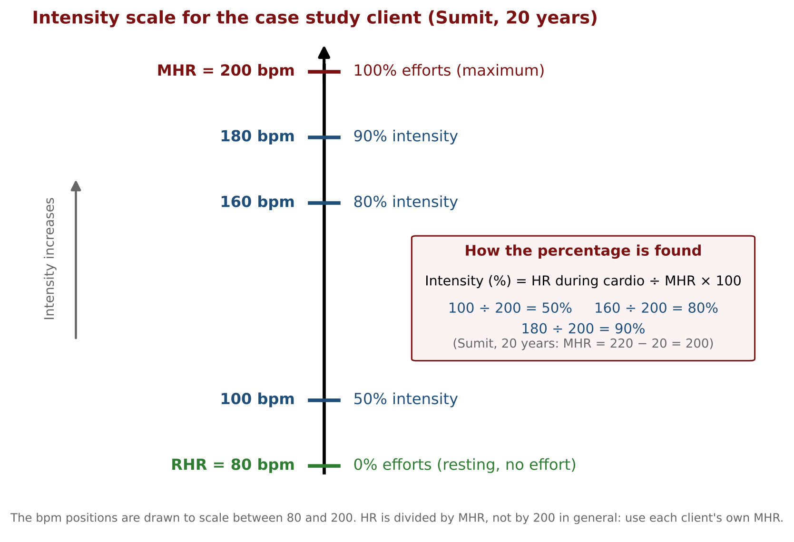

| Sumit (20 years, MHR = 220 minus 20 = 200) | Intensity |
|---|---|
| HR 100 | 100 ÷ 200 = **50%** |
| HR 160 | 160 ÷ 200 = **80%** |
| HR 180 | 180 ÷ 200 = **90%** |

- The bottom of the scale is the **RHR** (the "no effort" end) and the top is the **MHR** (100% effort).
- The numbers are only for the case study. For any client, use **that client's own MHR**.

---

## 2. Classification and promotion

| Intensity | % of MHR | Trainee level |
|---|---|---|
| Low | **50 to 60%** | Beginner |
| Moderate | **60 to 70%** | Intermediate |
| High | **70 to 85%** | Advanced |
| Very high | **Above 85%** | Super advanced |

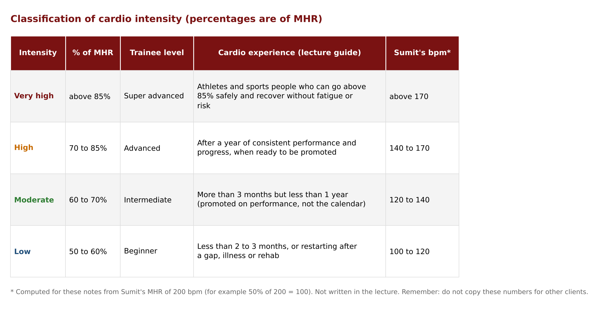

- **Beginner**: less than about 2 to 3 months of experience. **Restarting clients are beginners** too.
- Rough guide: intermediate is more than 3 months and less than 1 year, advanced is after a year of consistent progress.
- **Promotion is by performance, not the calendar.** A fitness test on day one and after the beginner phase (Fitness Testing 1 and 2) shows whether improvement is significant.
- Super advanced = can go above 85% easily and come back safely (athletes). There is no official level above it, but "elite" (Bolt, Phelps) would be very close to MHR.
- **Safety rule:** never let a client take the ego risk of going near 100%. Step by step.
- The intensity is **not changed daily**. It is set from the client's current level and judged by consistent performance and fitness tests.

---

## 3. Six factors for prescribing intensity

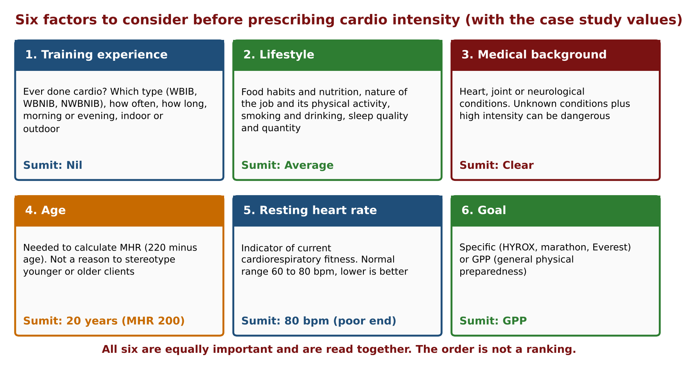

| # | Factor | What it tells | Sumit |
|---|---|---|---|
| 1 | Training experience | Type, frequency, preferences of past cardio | Nil |
| 2 | Lifestyle | Food, job, habits, sleep (quality and quantity), stress | Average, mostly inactive |
| 3 | Medical background | Heart, joint or neurological conditions | Clear |
| 4 | Age | Needed to calculate **MHR** (not for stereotyping) | 20 (MHR 200) |
| 5 | RHR | Current fitness level (normal 60 to 80, lower is better) | 80 |
| 6 | Goal | Specific goal, or GPP (general physical preparedness) | GPP |

- All six are **equally important** and are seen **together**.
- Decision for Sumit: **beginner, 50 to 60%**.
- The client is given a **THR number**, not a percentage, because a number is easy to follow on a device.

---

## 4. Target heart rate (THR)

- The THR is a **range** (lower limit L and upper limit U), because heart rate fluctuates and an exact number cannot be maintained. Calculate the formula **twice**.

| | Age-predicted (MHR) method | HRR (Karvonen) method |
|---|---|---|
| Formula | THR = (220 minus age) × intensity | THR = (220 minus age minus RHR) × intensity + RHR |
| Uses | Age only | Age **and** RHR |
| Sumit, 50% | 200 × 0.5 = **100** | 120 × 0.5 + 80 = **140** |
| Sumit, 60% | 200 × 0.6 = **120** | 120 × 0.6 + 80 = **152** |
| Range | 100 to 120 bpm | **140 to 152 bpm** |
| Nature | Generalised | **Customised** (accepted worldwide) |

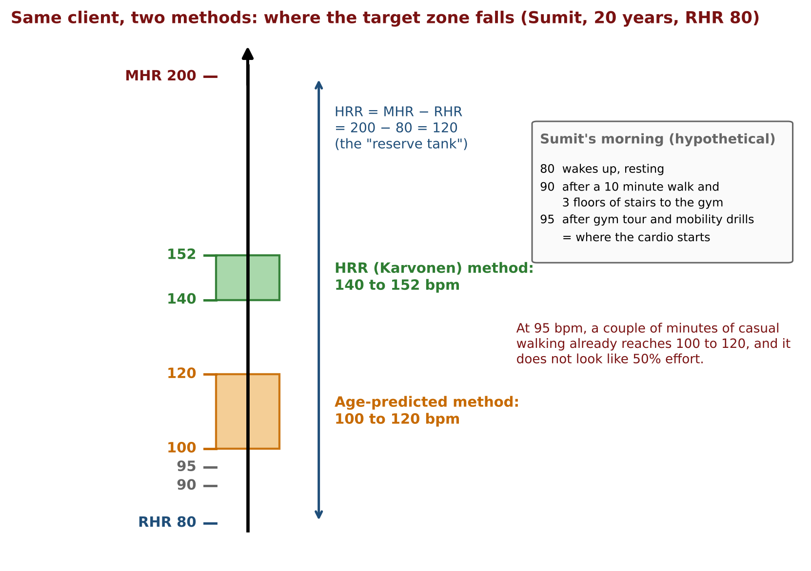

- **BODMAS:** brackets first, then multiplication, then addition. Do 120 × 50% = 60 first, then add 80.
- **The loophole:** Sumit's cardio starts at about 95 bpm (walk, stairs, drills), so 100 to 120 is reached by casual walking. All 20 year olds would get the same THR even with RHR 60, 70 or 80.

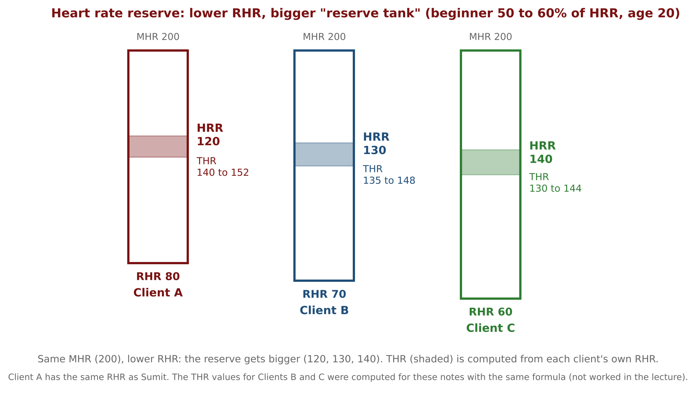

- **HRR = MHR minus RHR** is a **reserve tank** for the heart to go up. A **bigger reserve is better**, so a **lower RHR is better**.
- MHR cannot be changed (age), but **cardio lowers the RHR** and widens the reserve.
- Guitar class story: RHR 80 means arriving exhausted and late, RHR 70 means a short wait, RHR 60 means arriving on time and fresh.
- Computed for the notes (not in the lecture): RHR 70 gives 135 to 148, RHR 60 gives 130 to 144 (age 20, 50 to 60%).

---

## 5. Monitoring with electronic devices

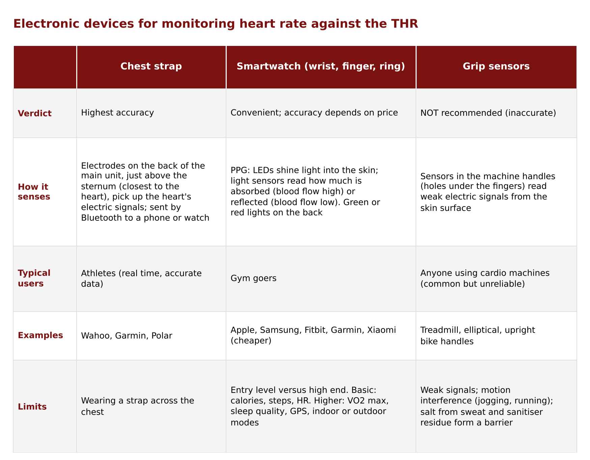

| Device | Strength | How | Who | Brands |
|---|---|---|---|---|
| **Chest strap** | **Most accurate** | Electrodes just above the sternum pick up the heart's electric signals, sent by Bluetooth | Athletes | Wahoo, Garmin, Polar |
| **Smartwatch** (wrist, finger, rings) | **Convenient**, accuracy varies with price | **PPG**: LEDs send light, blood absorbs more at a beat and less between beats, sensors read the reflected light | Gym goers | Apple, Samsung, Fitbit, Garmin, Xiaomi |
| **Grip sensor** (gym machines) | **Not recommended** | Sensors in the handle holes read weak skin signals | Built into machines | None |

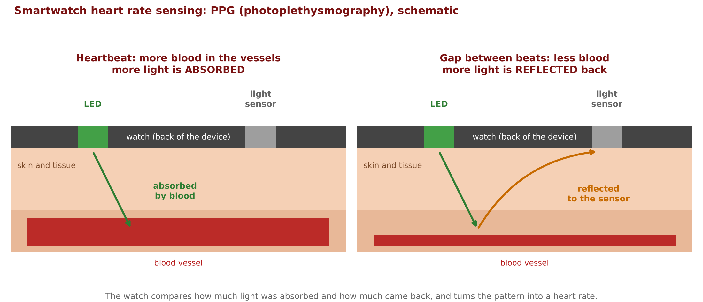

- Grip sensors are unreliable because of **weak signals**, **motion interference** when jogging or running, and **salt and sanitiser build-up** on the sensor.
- A basic smartwatch is an **investment in oneself**, not an overhead.

---

## 6. Estimating intensity without devices

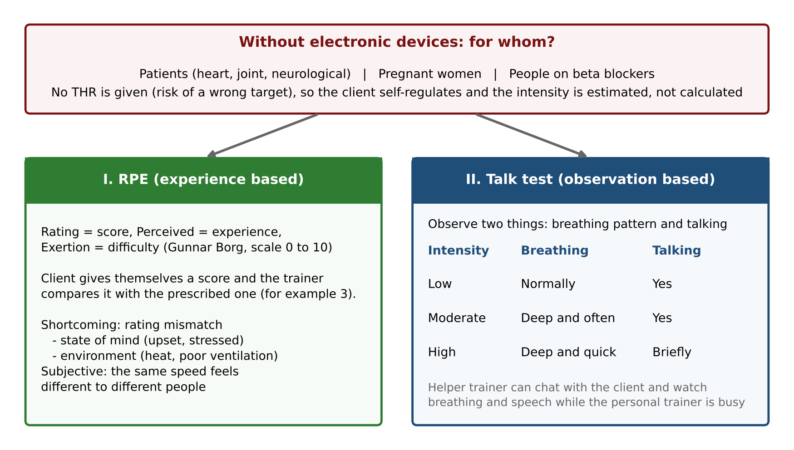

- For **patients, pregnant women and people on beta blockers**. Intensity is **estimated, not calculated**, and the client **self-regulates**.
- **Beta blocker**: a medicine that artificially holds the heart rate down, so a THR cannot be reached.

**RPE (Gunnar Borg, 0 to 10):** Rating, Perceived, Exertion. The trainer gives a rating (for example 3, moderate) and the client checks the same feeling.

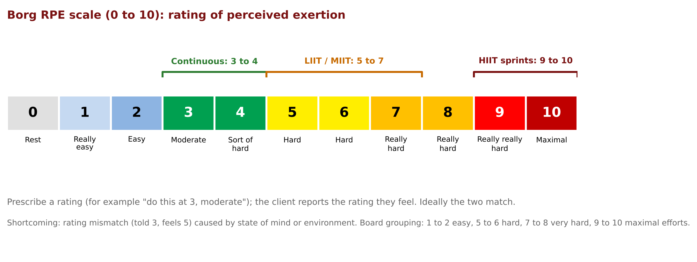

- Rating mismatch comes from **state of mind** (stress, mood) and **environment** (heat, poor ventilation).
- It is subjective, and that is why it is called estimation.

**Talk test:** the trainer observes breathing and talking.

| Intensity | Breathing | Talking |
|---|---|---|
| Low | Normally | Yes |
| Moderate | Deep and often | Yes |
| High | Deep and quick | Briefly (half air, half word) |

- It also lets a general trainer supervise a risk client from a distance.

---

## 7. Training methods

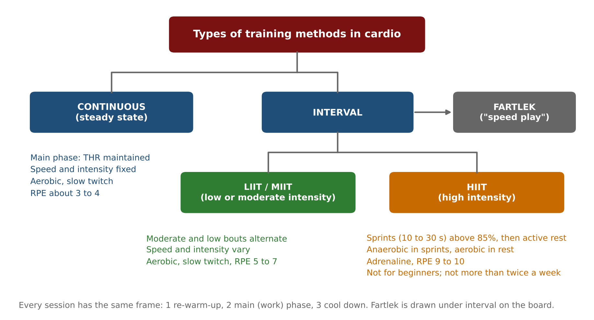

- **Continuous (steady state)** = non-stop. **Interval** = in phases (LIIT/MIIT, HIIT, Fartlek).
- Every session has three phases: **re-warm-up** (rise, cardio specific, about 5 minutes in the example), **main phase** (20 minutes in the example), **cool down** (fall, about 5 minutes).

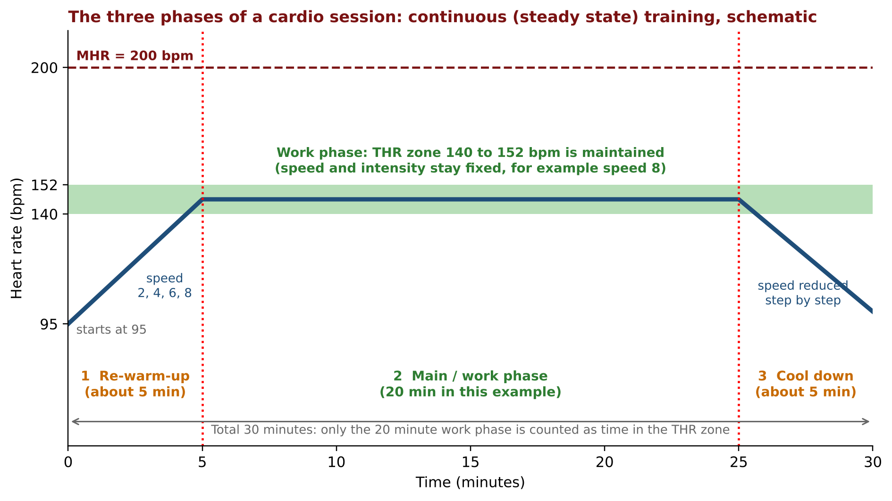

- **Cool down avoids syncope**: dizziness or a blackout when stopping abruptly. "Calves are the second heart": they pump blood back up, and an abrupt stop pauses that return.

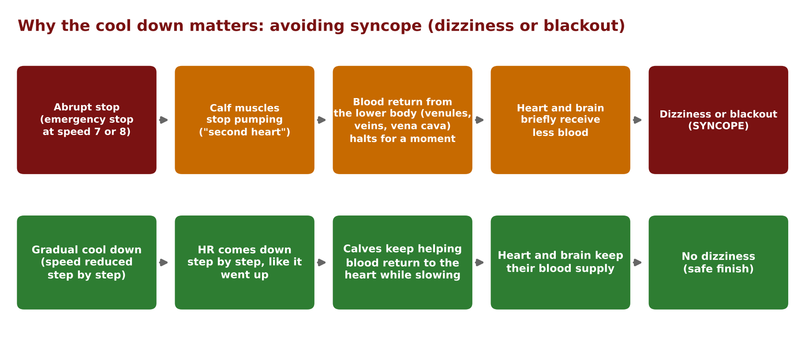

| | Continuous | LIIT / MIIT | HIIT |
|---|---|---|---|
| Main phase shape | Flat line | Buildings | Mountains |
| Speed / intensity | Fixed (THR held) | Varies (moderate and low) | Varies (sprint and active rest) |
| Energy pathway | Aerobic | Aerobic | Sprint anaerobic, active rest aerobic |
| Muscle fibres | Slow twitch | Slow twitch | Fast twitch (sprint), slow twitch (active rest) |
| RPE | 3 to 4 | 5 to 7 | 9 to 10 |

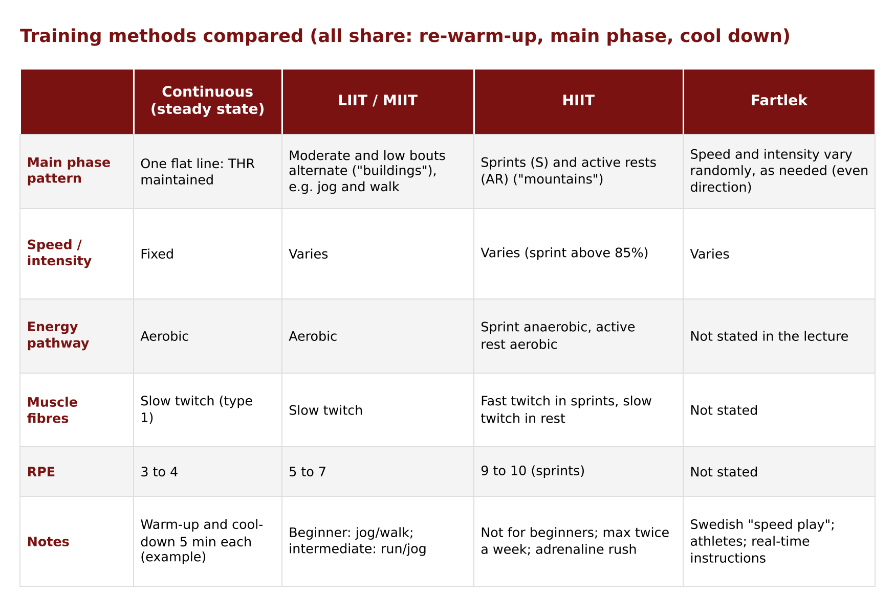

- **LIIT/MIIT**: beginner jog (moderate) and walk (low), four jog bouts and three walk bouts. Intermediate: run (moderate) and jog (low).
- **HIIT**: sprints (S1 to S4, above 85%, 10 to 30 seconds, adrenaline) with **active rest** (AR1 to AR3) at moderate intensity, such as jogging (not walking, not running). Sprint to rest ratio **1:2 or 1:3**. **Not for beginners**, **not more than twice a week**.
- **Fartlek** ("speed play", Sweden): random changes in speed and direction, used for sports. The trainer calls the pace using a chest strap reading.
- **Six ways to progress:** speed, distance, duration, angle, resistance level, gradient.

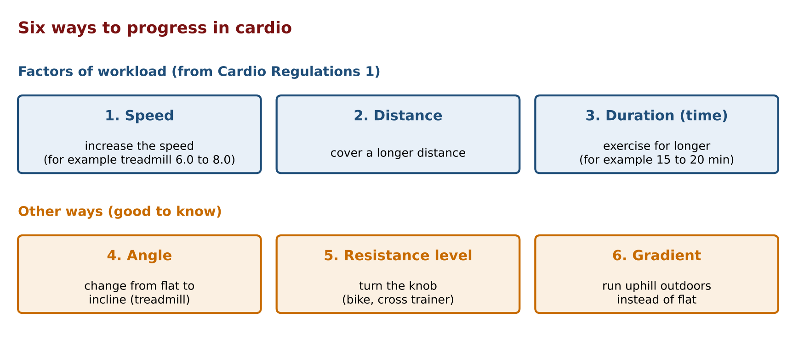

---

## 8. Key terms

| Term | Meaning |
|---|---|
| Intensity (cardio) | HR during cardio as a percentage of MHR |
| MHR | 220 minus age |
| RHR | Heart rate at complete rest (normal 60 to 80) |
| HRR | MHR minus RHR, the heart's reserve |
| THR | Target heart rate range (L and U) |
| Age-predicted (MHR) method | THR = (220 minus age) × intensity |
| HRR / Karvonen method | THR = (220 minus age minus RHR) × intensity + RHR |
| GPP | General physical preparedness (basic fitness goal) |
| PPG | Light-based heart rate sensing in smartwatches |
| RPE | Rating of perceived exertion, Gunnar Borg 0 to 10 |
| Talk test | Judging intensity by breathing and talking pattern |
| Re-warm-up | Cardio-specific warm-up that raises HR to the zone |
| Syncope | Dizziness or blackout after an abrupt stop |
| LIIT / MIIT | Low or moderate intensity interval training |
| HIIT | High intensity interval training (sprints and active rest) |
| Active rest | Moderate activity between sprints, not full rest |
| Fartlek | "Speed play": random changes in speed and direction |

---

## 9. Where the sources differ

- **Beginner band and the HRR method:** 50 to 60% is applied to HRR, giving 140 to 152 bpm for Sumit, which is 70 to 76% of MHR (the high band of the classification). The lecture does not reconcile this.
- **The 85% boundary:** the lecture says high is 70 to 85% and very high is above 85%. The slide writes "greater than or equal to 85%" for very high.
- **HIIT versus classification:** sprints go above 85% (super advanced band), yet the lecture allows intermediate and advanced clients to do HIIT (twice a week at most).
- **Time guide for levels:** the lecture gives months. The slides give none. The E-book gives weeks for its phases.
- **Graph timing:** the HIIT graph is schematic (four sprints and three rests would not fill 20 minutes). LIIT/MIIT bouts of 2 to 3 minutes do not exactly add up to 20.
- **Fartlek** is under interval in the lecture, but the E-book lists it as a separate modality.
- **RPE labels** differ slightly between the lecture grouping and the slide wording.
- The THR values for the clients with RHR 70 and 60 were computed for the notes, not taken from the lecture. See the Detailed Notes, Points to Confirm, for the full list.

---

## 10. Quick revision questions

1. What is the difference between workload and intensity in cardio? Give the exam analogy.
2. What deciding value is used for intensity in cardio, and how does it compare with weight training?
3. A client has an MHR of 200. Find the intensity at HR 100, 160 and 180.
4. State the four cardio intensity levels, their percentage ranges and the matching trainee levels.
5. Why is a client not promoted just because three months have passed? What is used instead?
6. List the six factors used to prescribe cardio intensity.
7. Why is age needed as a factor? What stereotype should be avoided?
8. Why is the THR given as a range and not as a single number?
9. Write the age-predicted (MHR) method formula and calculate the THR for a 20 year old beginner.
10. What is the loophole in the age-predicted method?
11. Write the HRR (Karvonen) formula and calculate the THR for a 20 year old beginner with an RHR of 80.
12. Why must the brackets and multiplication be done before the addition in the Karvonen formula?
13. Why is a lower RHR better? Which part of HRR can be changed, and how?
14. A client is 30 years old with an RHR of 70 and is an intermediate (60 to 70%). Find the THR with both methods.
15. Compare the chest strap, smartwatch and grip sensor on accuracy, who uses them and how they sense the heart rate.
16. Give three reasons grip sensors are not reliable.
17. Who uses estimation methods instead of a THR, and why?
18. What is RPE, and what two factors can cause a mismatch between the trainer's rating and the client's?
19. Describe the talk test for low, moderate and high intensity.
20. Compare continuous, LIIT/MIIT and HIIT (main phase shape, energy pathway, fibres, RPE), and state the HIIT rules. Name the six ways to progress.

---

## 11. Answers

1. **Workload** is the amount of work done (speed, distance, time). **Intensity** is the level of effort or difficulty. In the exam analogy, 30 students solve the same 30 questions (same workload), but a well-prepared student puts in low effort (low intensity) and an unprepared one puts in high effort (high intensity).
2. The **heart rate during the cardio activity, as a percentage of MHR**. In weight training a **lower RM means higher intensity**. In cardio a **higher HR means higher intensity**.
3. Intensity = HR ÷ MHR × 100: 100 ÷ 200 = **50%**, 160 ÷ 200 = **80%**, 180 ÷ 200 = **90%**.
4. **Low 50 to 60% (beginner), moderate 60 to 70% (intermediate), high 70 to 85% (advanced), very high above 85% (super advanced).**
5. Time alone does not show progress. A client may be irregular, inattentive or not following the plan in the other 23 hours. A **fitness test** on day one and after the beginner phase (Fitness Testing 1 and 2) shows significant improvement, and that is when the client is promoted.
6. **Training experience, lifestyle, medical background, age, resting heart rate, goal.** All six are equally important.
7. Age is needed to calculate **MHR (220 minus age)**, and without MHR intensity cannot be found. It should not be used to stereotype (for example assuming every 60 year old is a beginner and every 20 year old is fit).
8. Heart rate **fluctuates** by a few beats, so an exact number cannot be maintained. A range (lower and upper limit) tells the client to stay within it. (Shirt price analogy.)
9. THR = (220 minus age) × intensity. MHR = 200. Lower: 200 × 50/100 = **100**. Upper: 200 × 60/100 = **120**. Range **100 to 120 bpm**.
10. It uses **only age**, ignoring the client's current fitness level (RHR). Sumit's heart rate is already about 95 before cardio, so 100 to 120 is reached by casual walking, and every 20 year old gets the same THR whatever the RHR (jeans analogy).
11. THR = (220 minus age minus RHR) × intensity + RHR. HRR = 220 minus 20 minus 80 = 120. Lower: 120 × 0.5 + 80 = 60 + 80 = **140**. Upper: 120 × 0.6 + 80 = 72 + 80 = **152**. Range **140 to 152 bpm**.
12. BODMAS: brackets first, then multiplication, then addition. Adding 80 to 120 before multiplying would give a completely different (wrong) value. Right order: 120 × 0.5 = 60, then 60 + 80 = 140.
13. HRR = MHR minus RHR is the heart's reserve tank, so a lower RHR means a bigger reserve and the same work feels easier and leaves the client further from exhaustion. MHR depends on age and cannot be changed, but **cardio lowers the RHR**, which widens the HRR.
14. MHR = 220 minus 30 = 190. **Age-predicted:** 190 × 0.6 = 114 and 190 × 0.7 = 133, so **114 to 133 bpm**. **Karvonen:** HRR = 190 minus 70 = 120. Lower: 120 × 0.6 + 70 = 72 + 70 = 142. Upper: 120 × 0.7 + 70 = 84 + 70 = 154. So **142 to 154 bpm**.
15. **Chest strap:** highest accuracy, electrodes just above the sternum read the heart's electric signals and send them by Bluetooth, used by athletes. **Smartwatch:** convenient, accuracy depends on price, uses PPG (LED light absorbed and reflected by blood, read by light sensors), used by gym goers. **Grip sensor:** built into machines, reads weak skin signals through handle holes, not recommended.
16. **Weak signals** at the skin surface, **motion interference** when jogging or running, and **salt from sweat and sanitiser residue** forming a barrier on the sensor.
17. **Patients, pregnant women and people on beta blockers** (the slides add cardiac and diabetic patients and those without monitors). A THR could push them into risk, or a beta blocker holds the heart rate down so the THR is never reached. They **self-regulate** using RPE or the talk test.
18. **RPE** = Rating of Perceived Exertion (Gunnar Borg, 0 to 10): the client rates how hard the activity feels. A mismatch (for example trainer says 3, client says 5) comes from **state of mind** (such as upsetting news) and **environment** (such as heat or poor ventilation).
19. **Low:** breathing normally, can talk. **Moderate:** deep and often, can still talk. **High:** deep and quick, can talk only briefly (half air, half word).
20. **Continuous:** flat line, aerobic, slow twitch, RPE 3 to 4, THR held. **LIIT/MIIT:** buildings (moderate and low), aerobic, slow twitch, RPE 5 to 7. **HIIT:** mountains (sprints above 85% and active rest), sprint anaerobic with fast twitch, active rest aerobic with slow twitch, RPE 9 to 10. HIIT rules: not for beginners, not more than twice a week, sprint to rest ratio 1:2 or 1:3, active rest at moderate intensity (jog). Six ways to progress: **speed, distance, duration, angle, resistance level, gradient**.

---

# Board Photos from the Lecture

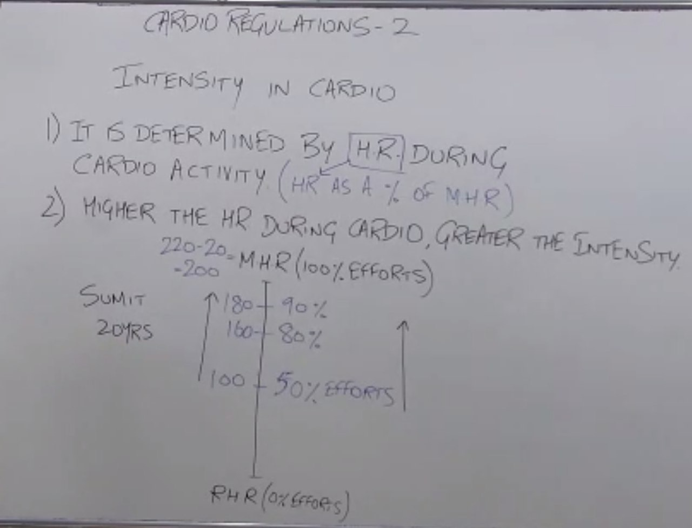

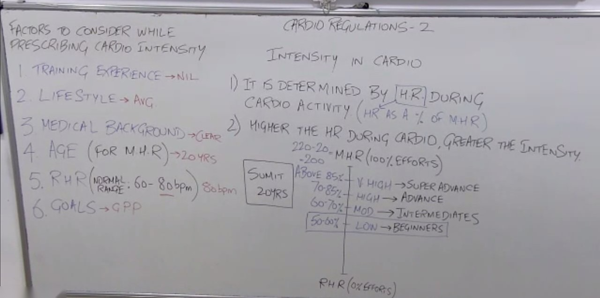

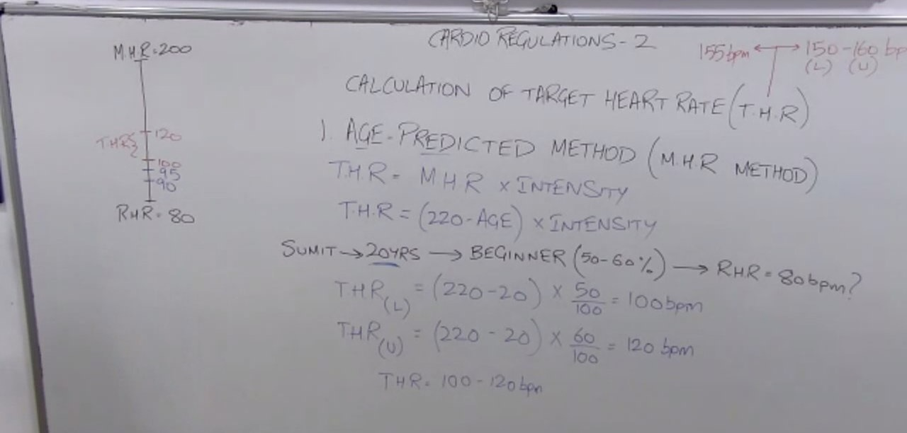

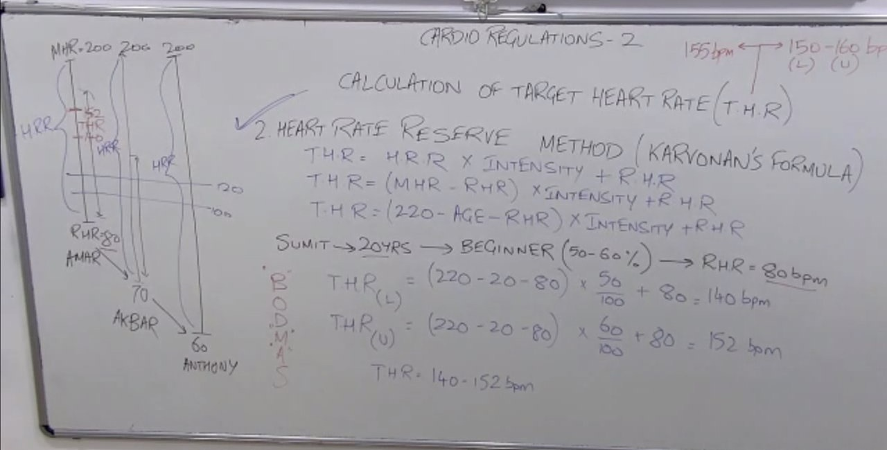

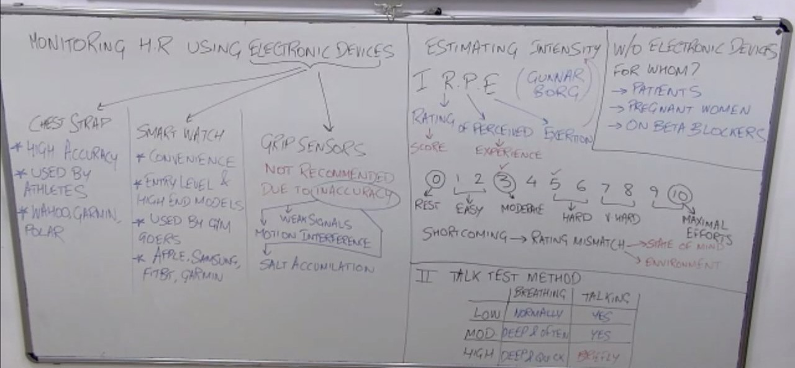

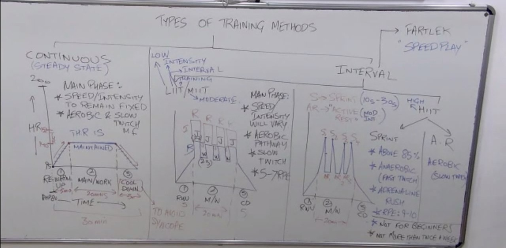
