# Fitness Testing 1: Study Notes

**Course:** Personal Training Certification

**Topic:** Fitness testing, part 1 of 2

**About these notes:** A short revision version of the Fitness Testing 1 lecture: key tables, key terms and 20 revision questions with an answer key. For the full explanation see the Detailed Notes. Sources: the lecture, the course slides ("Fitness Testing 1 & 2"), board photos from the lecture and E-book Chapter VII (Health Screening and Fitness Testing).

**Big idea:** Fitness is tested with standardised, worldwide tests. Before any test, screen the client's health. Then test in an order that protects the accuracy of every result: blood pressure, body composition, cardiorespiratory endurance, muscular strength, muscular endurance, flexibility. Body composition has eight tests, and six of them (waist circumference, waist to hip ratio, BMI, skinfold, BIA and Bod Pod) are covered today.

---

## 1. Why test? Objectives of fitness testing

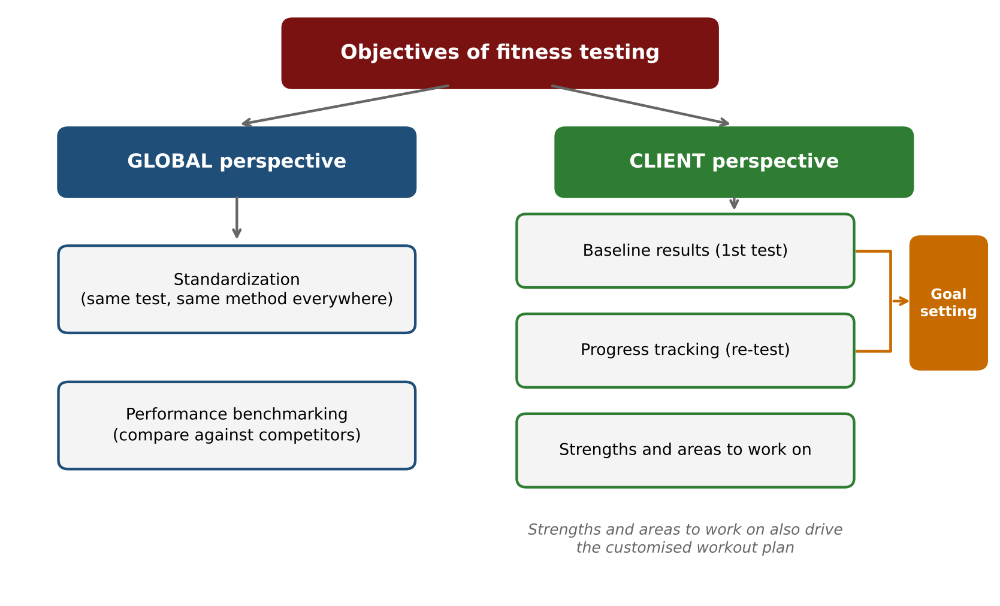

| Perspective | Objective | Meaning |
|---|---|---|
| Global | **Standardisation** | Same test, procedure, method and norms everywhere (for example bench press is the worldwide muscular strength test), so results can be compared |
| Global | **Performance benchmarking** | Shows how far a country's athletes lag or lead, so the standard can be chased or maintained |
| Client | **Baseline results** | First test: where the client stands today |
| Client | **Progress tracking** | Re-test (for example after 3 months): numbers show progress, build confidence and motivation |
| Client | **Goal setting** | From baseline and re-test: short-term, mid-term and long-term milestones, tweaked after the re-test |
| Client | **Strengths and areas to work on** | Customised plan (say "areas to work on", not "weaknesses"); strength can come from any of the five components |

- A **test norm** is a sheet that shows where a score stands for a component.
- All five components must be tested before calling someone fit.
- A **contraindication** is any movement that causes discomfort or pain: choose an alternative exercise to avoid injury.
- Poor flexibility result: stretch every day (mobility drills and static stretching).

---

## 2. Health screening (pre-step)

**Health screening** is a procedure done on people without symptoms to assess the likelihood of a disease. Think of baggage screening at an airport: make sure the client is safe before testing. It uses two forms, filled and signed by the client.

| Form | Key points |
|---|---|
| **PAR-Q** (Physical Activity Readiness Questionnaire) | About 10 close-ended Yes or No questions on medical background (heart, joints, neurological). **All No** means cleared. Any **Yes** means stop, ask, and get a **NOC** (no objection certificate) from the doctor |
| **Informed consent** | A script that informs the client about machines, exercises (strength, cardio, stretching) and risks, for the whole fitness journey, ending with a statement of willing agreement and a signature |

- Document everything and get it signed: it protects the trainer.
- If a gym already has its own forms, follow them. If it has none, introduce them.

---

## 3. Order of fitness testing

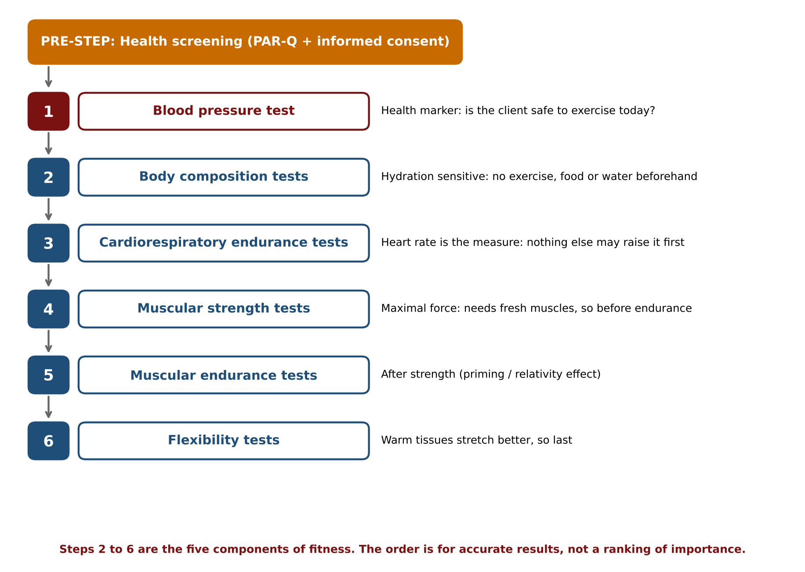

| Step | Test | Why here |
|---|---|---|
| 1 | Blood pressure | Health marker for the day; high BP could shoot up during testing |
| 2 | Body composition | Needs a neutral body (exercise, sweat, food and water change body weight and composition) |
| 3 | Cardiorespiratory endurance | Heart rate must rise only from the cardio task |
| 4 | Muscular strength | Maximum force in one effort needs fresh muscles |
| 5 | Muscular endurance | After strength: priming or relativity effect (the 100 km/h feels slower after 200 km/h) |
| 6 | Flexibility | Tissues are warm after steps 3 to 5, so they lengthen better |

- The order is **not** a ranking of importance.
- **Muscular strength:** maximum force in one single effort. **Muscular endurance:** submaximal contraction for a long time without fatigue.
- **Mobility** (joints moving freely and actively through full range of motion without discomfort) is tested side by side with flexibility.

---

## 4. Test 1: blood pressure

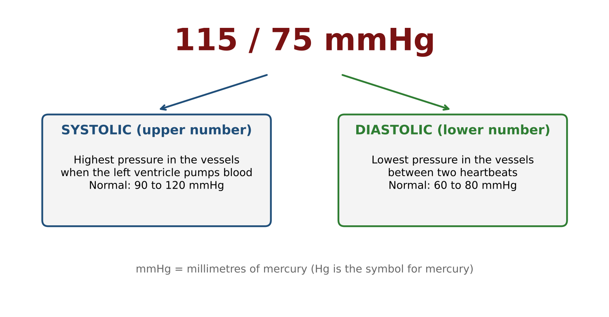

- **Systolic** (upper): highest pressure, when the left ventricle pumps. Normal 90 to 120 mmHg.
- **Diastolic** (lower): lowest pressure, between heartbeats. Normal 60 to 80 mmHg.
- **mmHg** is millimetres of mercury.

| Category | Systolic | | Diastolic |
|---|---|---|---|
| Low (hypotension) | Less than 90 | Or | Less than 60 |
| Normal | 90 to 120 | And | 60 to 80 |
| Elevated | 120 to 129 | And | Less than 80 |
| Hypertension stage 1 | 130 to 139 | Or | 80 to 89 |
| Hypertension stage 2 | 140 or higher | Or | 90 or higher |
| Hypertensive crisis | 180 or higher | And/or | Higher than 120 |

**Seven steps with a digital monitor:** 1 plug the tube into the device; 2 cuff on the upper arm, tube and palm facing up; 3 cuff edge 2 to 3 cm above the elbow; 4 snug (two fingers fit); 5 tube along the medial side of the arm; 6 cuff at heart height (table or armrest); 7 legs uncrossed, feet flat, back supported, no talking.

**If BP is high:** rest, offer water, re-check. If still high, skip the test and try the next day, up to three days. High on all three days: refer to a doctor.

---

## 5. Body composition: the eight tests

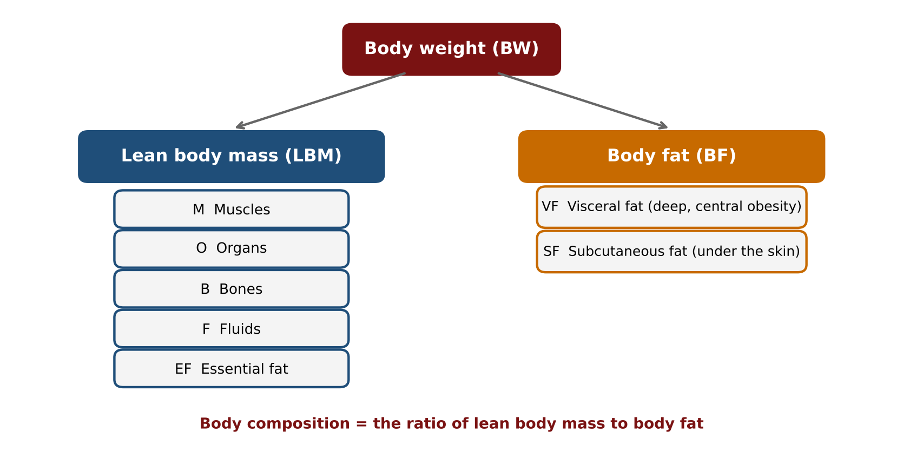

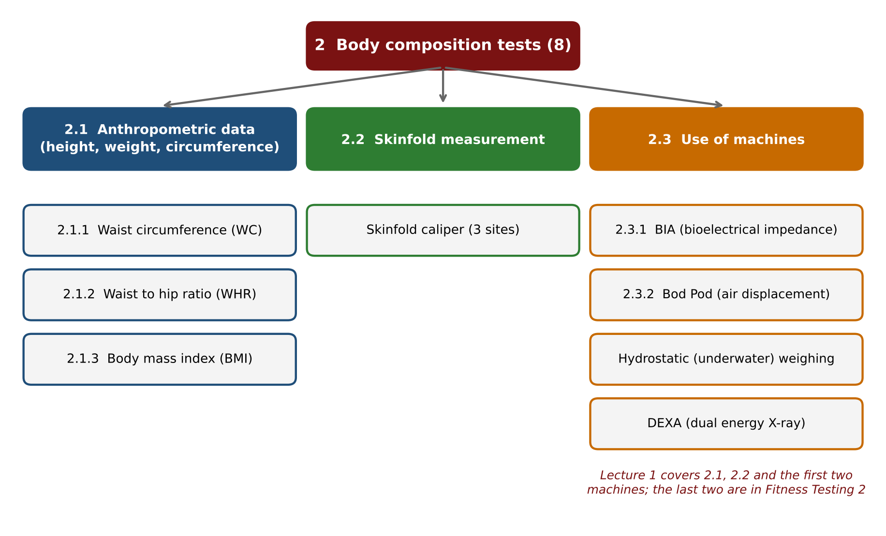

| Category | Tests |
|---|---|
| 2.1 Anthropometric data | WC, WHR, BMI |
| 2.2 Skinfold measurement | Skinfold caliper |
| 2.3 Use of machines | BIA, Bod Pod (today); hydrostatic weighing and DEXA (Fitness Testing 2) |

- **LBM** = muscles, organs, bones, fluids, essential fat (M, O, B, F, EF). **BF** = visceral fat and subcutaneous fat.
- **Anthropometry** = study of measurements and proportions of the human body (height with a stadiometer, weight with a scale, circumference with a tape).
- Body composition is tested **first** (after BP) because weight and fluid change after activity. BIA is best done first thing in the morning.

---

## 6. Anthropometric tests (2.1)

| Test | Objective | Site / formula | Norm (low risk) |
|---|---|---|---|
| **WC** | Health risk from **visceral fat** (central obesity) | Across the **iliac crest**, through the belly button (widest part of the waist) | Men below **35.5 in (90 cm)**, women below **31.5 in (80 cm)** |
| **WHR** | **Overall** health risk | WHR = WC / HC. Waist: narrowest part (midpoint between last rib and iliac crest). Hip: widest part | Men below **0.95**, women below **0.86** |
| **BMI** | Category: underweight, normal, overweight, obese | BMI = weight (kg) / height (m)². Unit kg/m² | See table below |

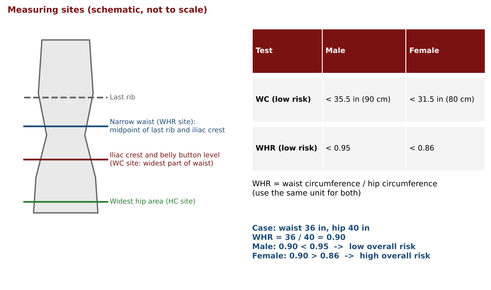

- Ask permission before measuring (or let the client place the tape). Say "widest part of your waist", not "iliac crest".
- WHR case: waist 36 in, hip 40 in gives 0.90. For a man that is low risk (below 0.95). For a woman it is high risk (above 0.86). Use the same unit for waist and hip.
- WC and WHR give risk only, not a body fat percentage.

**BMI classification (Asian criteria, slides):**

| Category | BMI (kg/m²) |
|---|---|
| Underweight | Below 18.5 |
| Normal | 18.5 to 22.9 |
| Overweight | 23 to 24.9 |
| Obese | 25 and above |

**BMI calculation:** 5 ft 8 in = 5 x 12 + 8 = 68 in. Multiply by 0.0254 to get metres (68 x 0.0254 = 1.7272 m; the board used 1.7 m). Lecture example: 90 / (1.7 x 1.7) = 90 / 2.9 = 31.03 kg/m², obese.

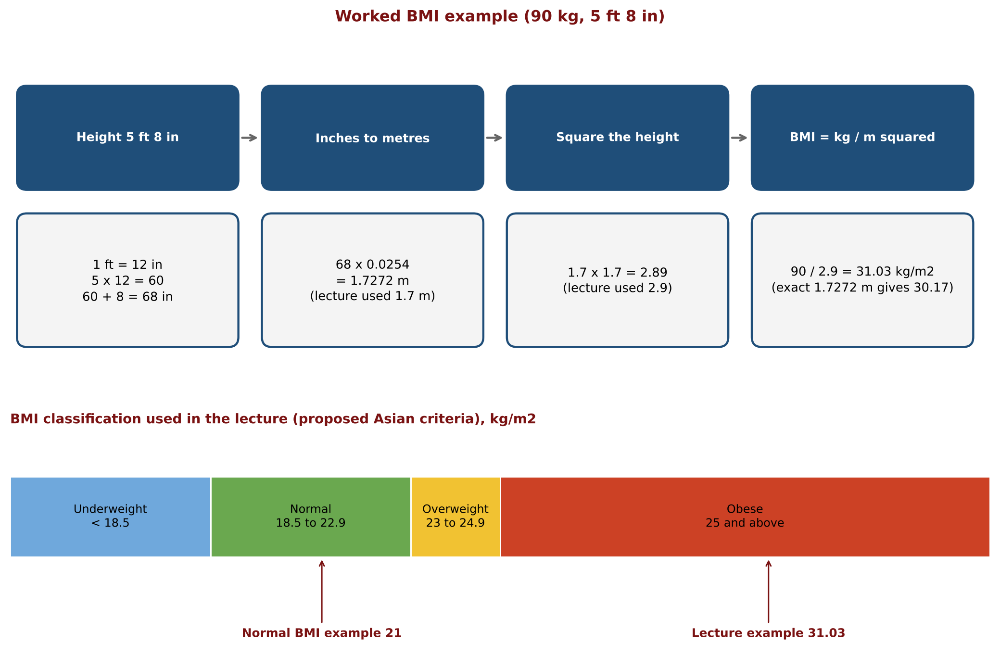

**Shortcomings of BMI:** it does not separate body fat from lean body mass (a muscular person and a fat person of the same height and weight get the same BMI), and it misses "skinny fat" people (BMI normal, for example 21, but fat in the belly).

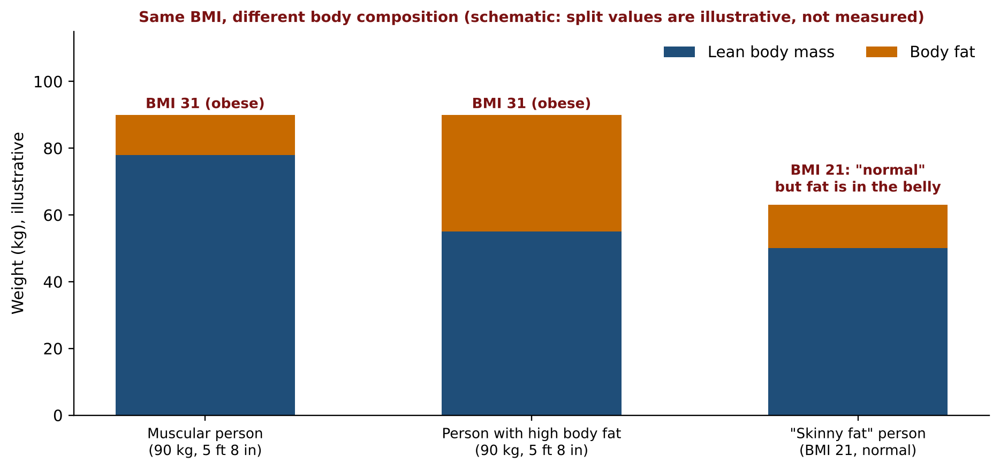

- Ideal body fat: men below 15%, women below 20%. None of the three tests gives this percentage.
- Use them only as short-term or mid-term goals, not to judge body composition.

---

## 7. Skinfold caliper test (2.2)

- A compass-like caliper measures the thickness of a pinched **skin fold**, which is **subcutaneous fat**. More subcutaneous fat means a higher body fat percentage.

| | Women | Men |
|---|---|---|
| Sites | Triceps, suprailiac (just above the iliac crest), mid thigh | Chest (midpoint of armpit top and nipple), abdomen (1 inch from the belly button), mid thigh |

| Advantages | Disadvantages |
|---|---|
| Portable, easy to use, time saving | Only subcutaneous fat (no visceral), standard error of plus or minus 3%, not for the very obese or very lean, pinching discomfort |

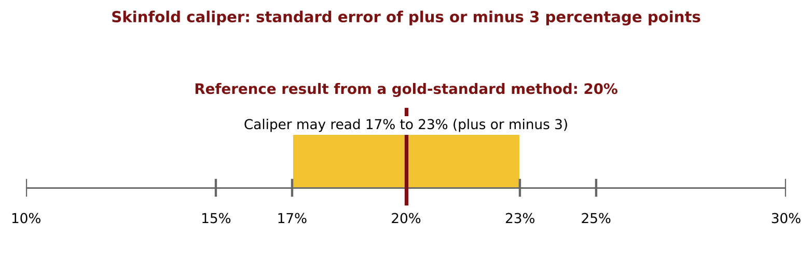

- Price (about Rs 300 to Rs 5,000) does not remove the error. A reference of 20% can read 17% to 23%.

---

## 8. BIA test (2.3.1)

- **Bioelectrical Impedance Analysis:** bio (living organism), electric (current), impedance (resistance), analysis (study). Often wrongly called the "BMI machine" (it also reports BMI).
- **Principle:** water is a good conductor of electricity. A mild current enters through electrodes (metal plates); the machine measures resistance.

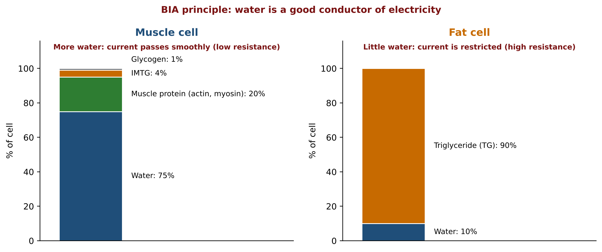

| | Muscle | Fat |
|---|---|---|
| Water | 75% | 10% |
| Current | Passes smoothly | Restricted |

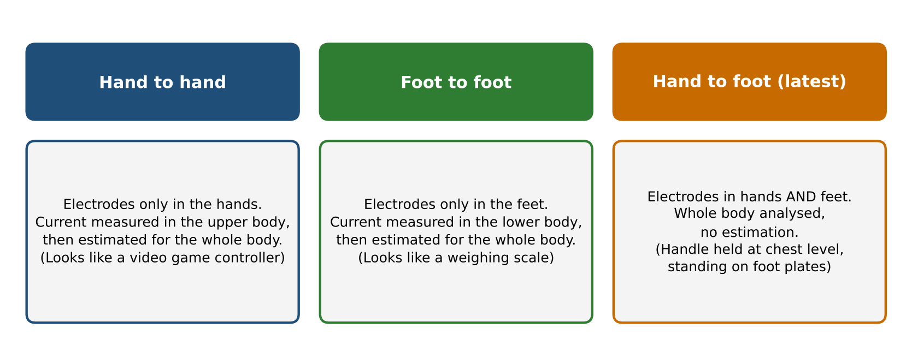

- Types: **hand to hand** (upper body, then estimated), **foot to foot** (lower body, then estimated), **hand to foot** (latest, whole body). Price about Rs 10,000 to Rs 45 lakh; high-end models give segmental analysis and intracellular and extracellular water.
- Results: body fat %, muscle mass, BMI.

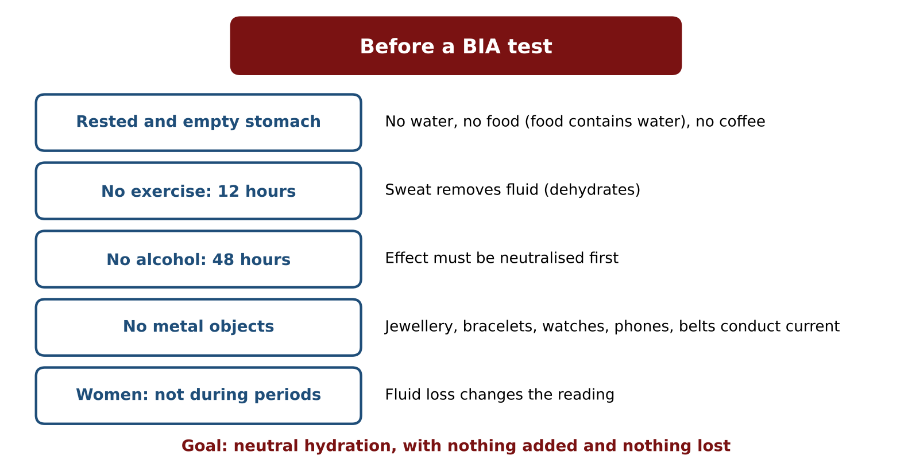

| Advantages | Disadvantages |
|---|---|
| Time saving (about a minute), easy to use (even front desk staff), needs only a switch and socket | Some models show standard error (not as accurate as the gold standard), hydration level changes results |

---

## 9. Bod Pod test (2.3.2)

- **Bod** = body, **Pod** = sealed chamber (egg-shaped). **Air displacement method**, a **densitometry** method.
- **Body density = body mass / body volume.** Volume = air in the empty chamber minus air with the person. A diaphragm measures air volume; a scale in the reference chamber measures weight.
- **Siri equation:** body fat % = (4.95 / body density minus 4.50) x 100 (no need to memorise).
- Wear spandex or a swimsuit and a tight swim cap so no extra air enters. A breathing tube helps account for lung air.

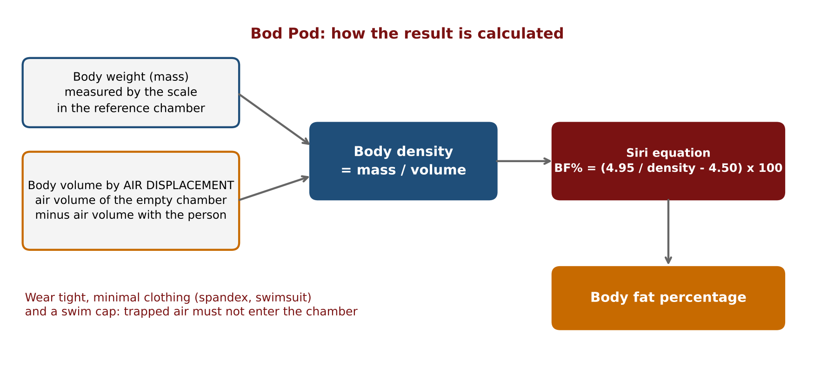

| Advantages | Disadvantages |
|---|---|
| Accurate (comparable to, but not, the gold standard), time saving, no technical expertise, suits all ages, patients, obese, children, elderly and hydrophobic people | Expensive, limited availability (not available in India, as on the board) |

- Example in the video: 97 kg total = 82 kg fat-free mass + 15 kg fat mass (about 15.5% fat, calculated for these notes).
- **Affordability and availability** are also criteria when the best test is chosen in Fitness Testing 2.

---

## 10. Key terms

| Term | Meaning |
|---|---|
| Test norm | Reference sheet showing where a test score stands |
| Standardisation | Same test, method and norms worldwide |
| Benchmarking | Comparing performance against others to find the gap |
| Baseline | Results of the first test |
| Contraindication | Movement that causes discomfort or pain |
| Health screening | Check before testing that the client is safe |
| PAR-Q | Physical Activity Readiness Questionnaire (Yes or No questions) |
| NOC | Doctor's no objection certificate |
| Informed consent | Script plus signed agreement to take part |
| Systolic / diastolic | Highest / lowest pressure in the vessels |
| Hypotension / hypertension | Low / high blood pressure |
| Anthropometry | Study of body measurements and proportions |
| Stadiometer | Device to measure height |
| Visceral fat | Deep fat around the organs (central obesity) |
| Subcutaneous fat | Fat under the skin |
| WC / WHR / BMI | Waist circumference / waist to hip ratio / body mass index |
| Skinfold caliper | Compass-like device that measures a pinched skin fold |
| Standard error | The range a result can differ from the true value (for example plus or minus 3%) |
| Gold standard | The reference test other tests are compared with |
| BIA | Bioelectrical impedance analysis |
| Densitometry | Body fat estimated from body density |
| Siri equation | Converts body density into body fat percentage |
| Fat-free mass | Same as lean body mass |
| Hydrophobic | Afraid of water |

---

## 11. Where the sources differ

| Topic | Lecture | Slides / E-book | What to do |
|---|---|---|---|
| BMI example | 90 kg, 5 ft 8 in, height rounded to 1.7 m, BMI **31.03** (the spoken 1.7526 is wrong; 68 in is 1.7272 m) | Slides: 1.72 m, 2.95, **30.50** | Exact value is about 30.17. All are obese. Use the method, not the rounding |
| BMI categories | Asian criteria: obese at 25 and above | Slides: same. E-book: overweight 25 to 29.9, obese 30 and above | Use the Asian criteria taught in the course |
| Waist limits | 90 cm men, 80 cm women | E-book obesity risk table: 102 cm men, 88 cm women | Use 90 and 80 for Indians and Asians |
| WC site | Across the iliac crest and belly button | Slides: umbilicus level and directly above the iliac crest | Same region: widest part of the waist |
| Skinfold sites | Abdomen 1 inch from the belly button | E-book: abdomen 2 cm to the right of the umbilicus | Use the lecture and slides |
| Gold standard | Not named in the lecture | Slides and E-book: hydrostatic weighing | Confirm in Fitness Testing 2 |
| Order of testing | Six steps incl. muscular endurance | E-book: five steps (no separate muscular endurance) | Use the six steps |
| BIA prerequisites | Empty stomach, no exercise 12 h, no alcohol 48 h | E-book: no food or drink for 4 h, also void the bladder, avoid diuretics | Follow the stricter rule if unsure |
| BP three-day rule | Re-check over up to three days | Not in slides. E-book: average of at least 3 readings | Keep the lecture's rule for high BP on the day |
| Bod Pod accuracy and cost | Comparable to gold standard, expensive, not available in India | E-book: plus or minus 3%, 5 to 8 min, 30,000 to 40,000 US dollars | Treat figures as approximate |

---

## 12. Quick revision questions

1. Name the two global and the four client objectives of fitness testing.
2. What is a test norm?
3. Why are the words "areas to work on" used instead of "weaknesses"?
4. What must the PAR-Q show before testing, and what is needed if there is one Yes?
5. What is the difference between the PAR-Q and the informed consent form?
6. List the six tests in order.
7. Why is blood pressure tested first, and what is done if it is high?
8. Why does the muscular strength test come before the muscular endurance test?
9. Why is flexibility tested last?
10. Why is the cardiorespiratory endurance test done before strength, endurance and flexibility tests?
11. What are the normal systolic and diastolic ranges, and how is a reading of 115/75 classified?
12. Where is the blood pressure cuff placed, and how tight should it be?
13. What does the waist circumference test tell you, where is the tape placed, and what are the male and female limits?
14. A woman has a waist of 30 inches and a hip of 36 inches. Calculate her WHR and give the risk.
15. Calculate the BMI of a person weighing 63 kg and 1.75 m tall, and name the category (Asian criteria).
16. Give two shortcomings of BMI.
17. What does a skinfold caliper measure, and what does a standard error of plus or minus 3% mean for a true value of 20%?
18. Expand BIA, state its principle and give the water percentage of muscle and fat.
19. List the BIA prerequisites with their time gaps.
20. How does the Bod Pod find body volume, and why is a swim cap worn?

### Answers

1. Global: standardisation and performance benchmarking. Client: baseline results, progress tracking, goal setting, strengths and areas to work on.
2. A reference sheet used to check a test score and see where the person stands for that fitness component.
3. A client meeting the trainer for the first time may react badly to being told they have "weaknesses", and the service industry needs polished wording. Strength here can come from any of the five components.
4. All answers must be No. With a Yes the trainer stops and asks, and the client must bring a NOC from their doctor.
5. The PAR-Q is a set of Yes or No medical questions that screens readiness. The informed consent form is a script that informs the client about machines, exercises and risks, ending with willing agreement and a signature.
6. Blood pressure, body composition, cardiorespiratory endurance, muscular strength, muscular endurance, flexibility.
7. It is a health marker: if BP is elevated or high, activity during testing could push it up dangerously. If high, the client rests, drinks water and is re-checked. If it stays high the test is skipped and tried again on the next days; high on three days means referral to a doctor.
8. A fatigued muscle cannot produce maximum force. Strength first also makes the endurance test feel easier (priming or relativity effect), so more repetitions may be done.
9. Warm tissues lengthen better. After the other tests the tissues are warm, so flexibility results are best.
10. Heart rate is the measure, and strength, endurance and stretching tests would also raise it, so the rise must come only from the cardio task.
11. Systolic 90 to 120 mmHg, diastolic 60 to 80 mmHg. 115/75 is within both, so it is normal BP.
12. On the upper arm, with the edge 2 to 3 cm above the elbow, snug but not tight (two fingers fit under it), tube on the medial side, cuff at heart height.
13. It tells whether there is a health risk from visceral fat (central obesity). The tape goes across the iliac crest and belly button (widest part of the waist). Low risk: men below 35.5 in (90 cm), women below 31.5 in (80 cm).
14. WHR = 30 / 36 = 0.83. For a woman the limit is below 0.86, so it is low overall health risk.
15. 63 / (1.75 x 1.75) = 63 / 3.0625 = 20.6 kg/m², which is normal (18.5 to 22.9).
16. It does not separate body fat from lean body mass (a muscular person can be called obese), and it misses skinny fat people (normal BMI but fat in the belly).
17. It measures the thickness of a skin fold, which is subcutaneous fat (no visceral fat). A true 20% may read anywhere from 17% to 23%.
18. Bioelectrical impedance analysis. Water is a good conductor of electricity, so current passes smoothly through muscle (75% water) and is restricted by fat (10% water).
19. Rested and empty stomach (no water, food or coffee), no exercise for 12 hours, no alcohol for 48 hours, no metal objects, and women not during periods.
20. It subtracts the air volume of the chamber with the person from the air volume of the empty chamber (air displacement). A tight cap and swimwear stop air trapped in hair and clothes from entering the chamber.

---

## 13. Board photos from the lecture

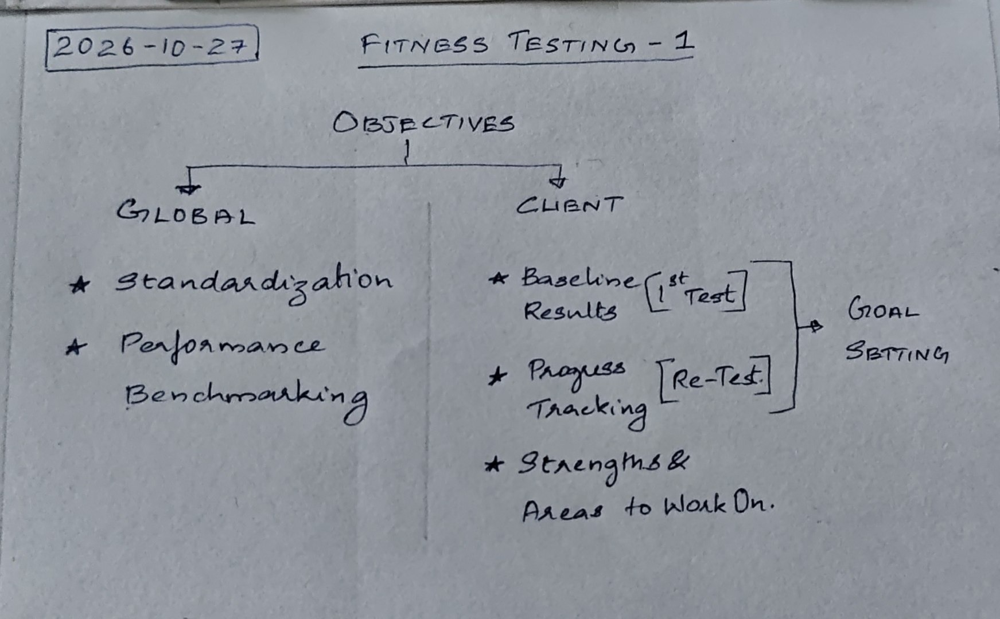

*Objectives: global (standardisation, performance benchmarking) and client (baseline, progress tracking, goal setting, strengths and areas to work on).*

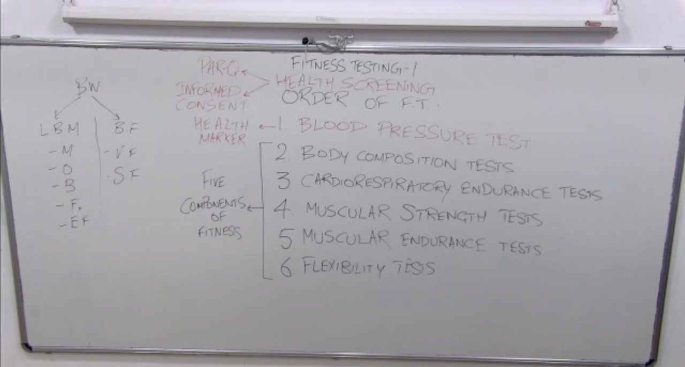

*Health screening (PAR-Q, informed consent), the six-step order of testing, and the lean body mass and body fat memory aid.*

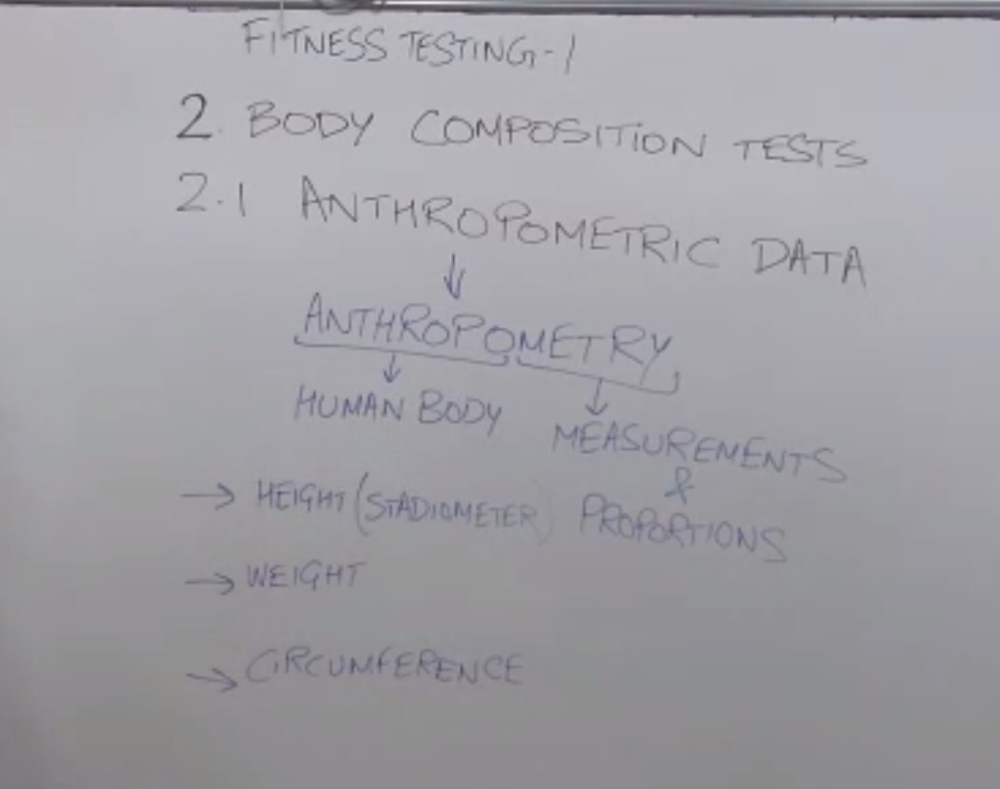

*Anthropometry: human body, measurements and proportions; height (stadiometer), weight, circumference.*

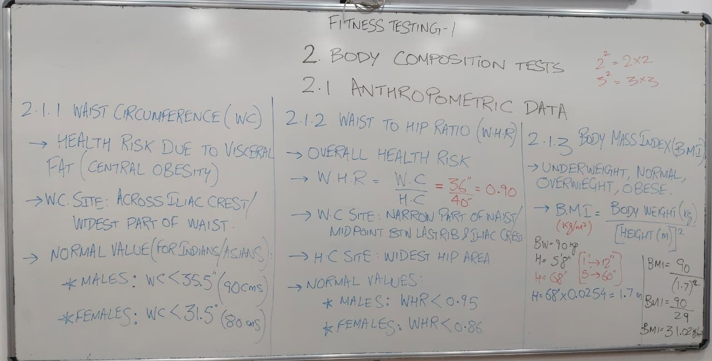

*The three anthropometric tests with sites, norms and the worked WHR and BMI examples.*

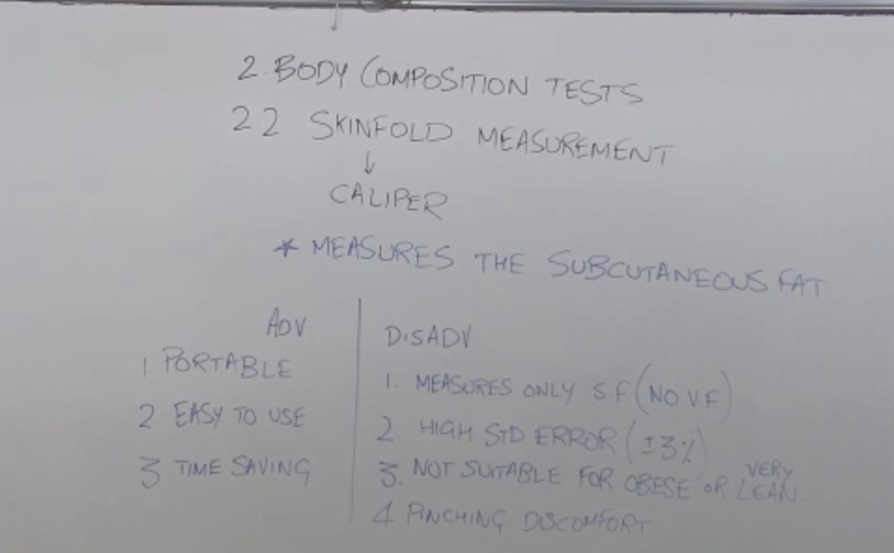

*Skinfold caliper: measures subcutaneous fat, with advantages and disadvantages.*

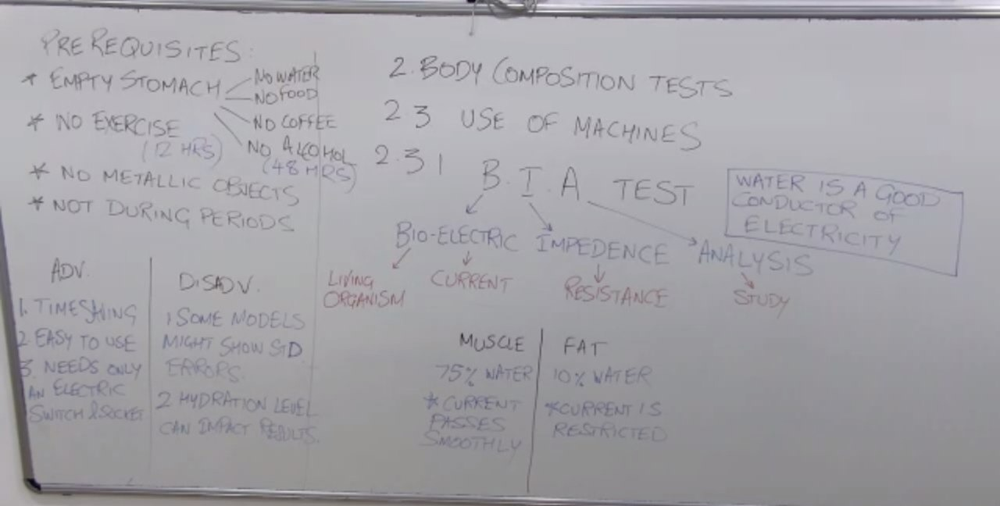

*BIA: meaning of the name, muscle versus fat water content, prerequisites, advantages and disadvantages.*

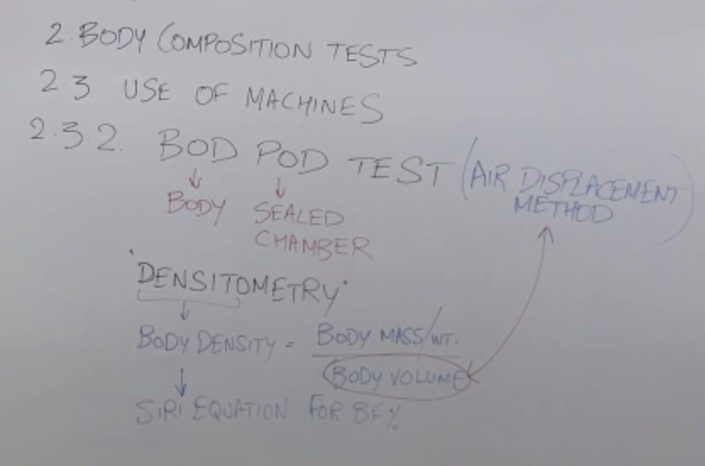

*Bod Pod: densitometry, body density, volume by air displacement, Siri equation.*

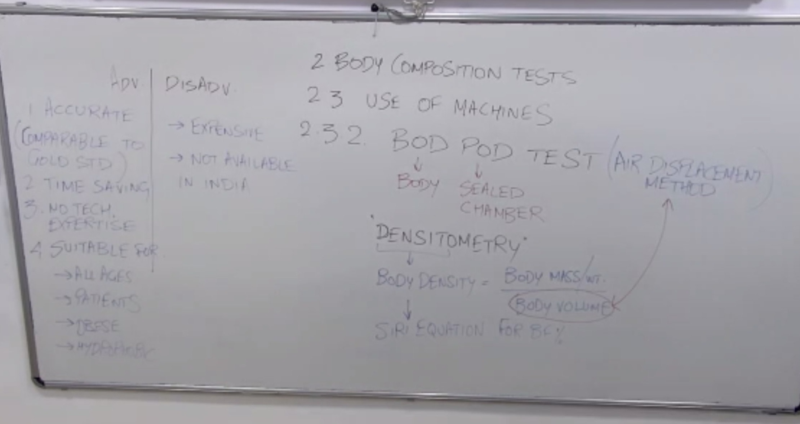

*Bod Pod advantages and disadvantages (full board).*
