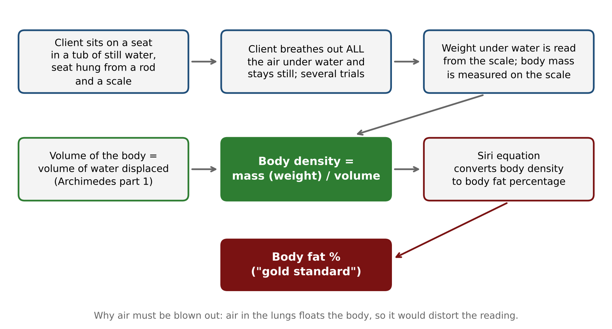
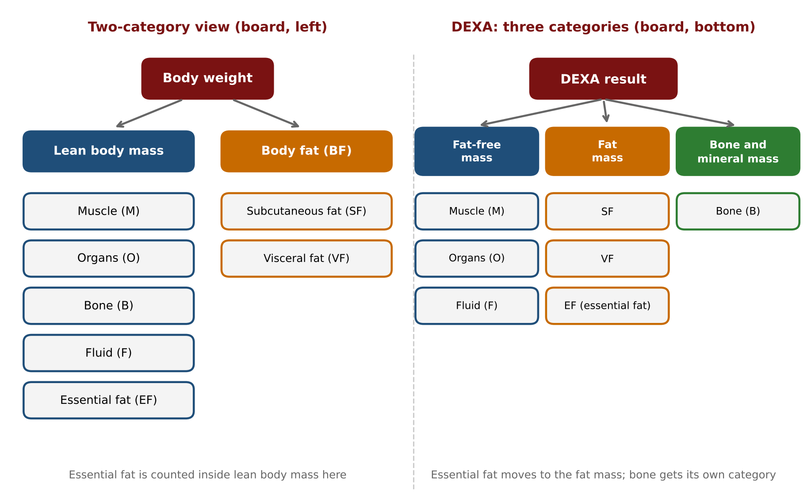

# Fitness Testing 2: Detailed Notes

**Course:** Personal Training Certification

**Topic:** Fitness Testing, part 2 of 2 (hydrostatic weighing and DEXA, then the cardiorespiratory, muscular strength, muscular endurance and flexibility tests)

**About these notes:** Detailed notes from the Fitness Testing 2 lecture, written so the whole lecture can be studied without watching the recording. Every concept, example, analogy and class question is covered. For a short revision version see the Study Notes. The first lecture, Fitness Testing 1, covered health screening, the objectives and order of testing, blood pressure and the first machine-based body composition tests (BIA and Bod Pod).

---

## Abbreviations used in these notes

| Short form | Meaning |
|---|---|
| BIA | Bioelectrical impedance analysis |
| Bod Pod | Air displacement plethysmograph (densitometry by air displacement) |
| DEXA | Dual energy X-ray absorptiometry |
| GS | Gold standard (the reference method other tests are compared with) |
| BF / BFP | Body fat / body fat percentage |
| LBM | Lean body mass |
| FFM | Fat-free mass |
| M, O, B, F, EF | Muscle, organs, bone, fluid, essential fat (the parts of body weight drawn on the board) |
| SF / VF | Subcutaneous fat / visceral fat |
| AP 1 / AP 2 | Archimedes principle, part 1 / part 2 (the lecture's labels) |
| VO2 max | Maximal oxygen consumption (maximum aerobic capacity) |
| HR / MHR | Heart rate / maximum heart rate |
| HRR | Heart rate recovery |
| bpm | Beats per minute (heart beats, or metronome beats, depending on the test) |
| 1 RM | One repetition maximum: the heaviest weight lifted once with correct form and full range of motion |
| ROM | Range of motion |
| YMCA | Young Men's Christian Association, an international body that publishes standardised fitness tests |
| S&R | Sit and reach |

## Before this lecture

This lecture continues the numbered order of fitness testing from Fitness Testing 1. You should already know: the order of testing (1 health screening and blood pressure, 2 body composition, 3 cardiorespiratory fitness, 4 muscular strength, 5 muscular endurance, 6 flexibility), the three categories of body composition tests (2.1 anthropometry, 2.2 skinfold, 2.3 use of machines), how BIA works, how the Bod Pod works (air displacement), the idea of densitometry (body density = mass / volume), the Siri equation, the two-category view of body weight (lean body mass and body fat), and the idea of a **test norms chart** (a table that converts a result into a fitness category for a given gender and age). The cardiorespiratory tests also rely on the VO2 max graph from the cardio lecture, and the strength and endurance tests rely on the leg and abdominal exercises from the body part lectures.

## Outline of the lecture

| Part | Topic |
|---|---|
| 1 | Body composition test 2.3.3: hydrostatic (underwater) weighing |
| 2 | Body composition test 2.3.4: DEXA scan, and the final choice among the eight body composition tests |
| 3 | Test 3: cardiorespiratory fitness tests (VO2 max with Rockport walk test, and heart rate recovery with the YMCA step test) |
| 4 | Test 4: muscular strength tests (bench press and leg press, relative strength) |
| 5 | Test 5: muscular endurance tests (push-up test and curl-up test) |
| 6 | Test 6: flexibility tests (goniometer, visual assessment, sit and reach) |
| 7 | Summary of both lectures and closing questions |

---

# Part 1: Hydrostatic (Underwater) Weighing

## 1.1 Where this fits

The lecture continues from Fitness Testing 1 using the same numbering system. Test type **2 is body composition**, category **2.3 is the use of machines**, and the test now being studied is the third machine, **2.3.3**. The two machines already covered were:

- **BIA**: bioelectrical impedance analysis.
- **Bod Pod**: also called air displacement. It is one of the **densitometry** methods.

There is another densitometry method that uses **water displacement** instead of air displacement. This is the hydrostatic method. Its details involve a lot of physics, so only the essential principles are studied.

## 1.2 Names of the test

The same test has several names, and decoding the names explains the procedure and principle.

| Name | What the name tells you |
|---|---|
| **Hydrostatic test** | Hydro = water, static = still. The water is not moving |
| **Underwater weighing test** | The person is sent underwater and their weight is measured underwater. The person goes into a tub of still water, not a river |
| **Water displacement method** | Water is displaced when the person goes in, and the displaced water gives the volume |

All three names refer to the same test.

## 1.3 The idea behind it: densitometry

Densitometry methods are based on **body density**:

> **Body density = weight (mass) / volume**

In this test the **weight is checked underwater**, using a special apparatus (seen in the demonstration video), and the **volume is found from the water displaced**. Once weight and volume are known, body density is calculated. Body density is then fed into the **Siri equation** (the same equation used for the Bod Pod) to calculate the **body fat percentage**.

## 1.4 Archimedes principle

The method rests on the principle given by the scientist Archimedes. It is explained in the simplest way, for students without a science background.

**Setup.** Imagine a tub filled to the brim with water, and a box (an object) that is lowered into it. As the object goes underwater, some water obviously spills out.

**Part 1 (AP 1).** The **volume of the object that goes underwater is equal to the volume (amount) of water displaced.**

This is why the test can find a person's volume: the displaced water is collected through a proper drainage system (some set-ups use a tank, a tub or a small swimming-pool-like system). Nobody stands outside with a bucket. The displaced water equals the volume of the person's body. This is the same idea as the Bod Pod, where the person takes up space in the chamber and displaces air; here the person takes up space in the tub and displaces water.

**Part 2 (AP 2).** When an object goes underwater, an upward force acts on it. This is the **buoyant force**. **Buoyancy** is the ability of an object to float. Anyone who has been in a swimming pool has felt this upward push from the bottom of the pool. Archimedes also discovered that the **water displaced is equivalent to the buoyant force applied on the object**.

Putting the two parts together: more volume means more water displaced, and more water displaced means a higher buoyant force. Less volume means less water displaced and a lower buoyant force.

## 1.5 Fat versus muscle: why the test is so detailed

Exercise physicists compare fat and muscle to a very deep level to reach the most accurate body fat percentage. The comparison written on the board has four points.

**Q (to the class): Which takes more space, 1 kg of fat or 1 kg of muscle?**

**A:** Fat. The weight is the same, but fat has **more volume** and muscle has **less volume**.

| # | Fat | Muscle | Where it comes from |
|---|---|---|---|
| 1 | More volume | Less volume | Property of the tissues |
| 2 | More water displaced | Less water displaced | Archimedes part 1 |
| 3 | Higher buoyant force | Lower buoyant force | Archimedes part 2 |
| 4 | **Lighter than water** | **Heavier (denser) than water** | A unique property of fat and muscle, not Archimedes |
| Result | Tendency to **float** | Tendency to **sink** | |

**Reading the whole story for fat.** More volume gives more water displacement, so a higher buoyant force pushes the piece up. On top of that, the fat is lighter than water. That is why fat floats.

**Reading the whole story for muscle.** Less volume gives less water displacement, so the buoyant force that could push the piece up is low. On top of that, muscle is heavier than water, so it is even harder for the force to lift it. That is why muscle sinks.

**Important points about this comparison:**

- It compares fat and muscle **as separate tissues**. A real body contains both, so a person does not completely float or completely sink. It is a visual indicator: a person who floats more can be read as having **lower muscle mass** (more fat), and a person with a greater tendency to go down has **more muscle mass**.
- The slides show the same idea for two people. With **low body fat percentage**: less volume (space), displaces less water, less buoyant (heavy), weighs more in water. With **high body fat percentage**: more volume, displaces more water, more buoyant (light), weighs less in water.

| | Low body fat % | High body fat % |
|---|---|---|
| Volume (space) | Less | More |
| Water displaced | Less | More |
| Buoyancy | Less buoyant (heavy) | More buoyant (light) |
| Weight in water | Weighs more | Weighs less |

## 1.6 Gold standard

Because of this level of analysis, hydrostatic weighing is given the title **gold standard of body composition tests**. It is known for the **highest accuracy**, and other machines and tests have their accuracy compared against it.

For comparison, skinfold testing was mentioned in Fitness Testing 1 as having a high standard error of about plus or minus 3 percentage points. For example, if skinfold says 20 percent, the true value may lie anywhere from about 17 to 23 percent. A result from the gold standard method can be relied on far more.

## 1.7 The demonstration video

A video from a university exercise physiology laboratory shows how the test is conducted. The details explain why the test is so accurate and why it is demanding.

1. **Two measurements are needed**: **body mass**, measured easily on a scale, and **body volume**, which is the whole point of putting the person in the tank.
2. The **weighing scale is connected by a rod to a seat**. The client sits on the seat and goes underwater, and that is how the **weight underwater** is measured.
3. The principle is Archimedes' principle: the amount of water displaced equals the volume of whatever is put into the tank.
4. The client sits on the chair with the **water level at the neck**, so she does not have to bend far.
5. **Two things make a person float: fat and air.** Fat floats because of the properties above. Air floats too: this is why life-savers at pools and beaches keep air-filled tubes, and why beginners learning to swim use air-filled floats. The air already in the lungs would influence and distort the reading.
6. So the client is told to **blow out all the air from the lungs under water**. She is told to push out a little more even when she thinks all the air is out, and to be as still as possible (movement makes the needle on the scale hard to read). She comes up when she needs air, nobody signals her.
7. The tester watches the **bubbles**. While bubbles still appear, the client is still exhaling. When the bubbles stop, all the air has gone from the lungs and the reading is taken.
8. **Several trials** are done, so that the reading is the same each time. A single trial may be wrong if the client did not exhale properly or moved a lot.

**Why this is difficult.** Staying under water without breathing is hard for someone who is not used to water. Exhaling under water is even harder: it is an unnatural manoeuvre, because naturally a person going under water holds the breath. A person who is afraid of water cannot be expected to do it. This is why the Bod Pod, which suits all ages and patients, has benefits that this test lacks.

## 1.8 Advantages and disadvantages

| Advantages | Disadvantages |
|---|---|
| **Accuracy**: the reason it is called the gold standard | **Needs technical expertise**: the person conducting the test must be qualified (in the Bod Pod the machine does most of the work) |
| | **Expensive**: the cost of a skilled operator plus the entire set-up |
| | **Not available** to the general public, and not available in India (the board says "not available in India") |

Affordability and availability matter when choosing the best test out of the eight body composition tests. A test cannot be called "the best" if the client has to travel abroad (for example to Australia or New Zealand) to get it done.

## 1.9 Class question: accuracy of the Siri equation

**Q: Body fat percentage is found with the Siri equation. How accurate is the Siri equation itself?**

**A:** The equation is not where accuracy is judged. What matters is **how accurately the body density that goes into the equation is measured**, and the gold standard method measures body density very accurately. The Siri equation is well proven and well tested, and the gold standard method itself uses it, so there is a lot of research showing that it gives the closest, most ideal figures for body fat percentage. Some small error is always present, because no method is 100 percent accurate. But what is fed into the equation decides whether the answer is accurate.

The Siri equation does not need to be memorised for this course. It is good to know that it exists and what it does.

---

# Part 2: DEXA Scan (Test 2.3.4)

## 2.1 The full form and its spelling

**DEXA = Dual Energy X-ray Absorptiometry.**

- **Dual** means two.
- **Energy**: two energies of radiation are used, a **low energy beam** and a **high energy beam**. Hence "dual energy".
- **X-ray**: the radiations.
- **Absorptiometry**: measuring the ability of the body's tissues to **absorb** the radiation.

Note the spelling: the word is **absorptiometry**, not "absorption". The final "n" of "absorption" is missing. This is not a spelling mistake, and it is a detail that tests can use as a trap in answer options.

## 2.2 The principle: density decides absorption

The tissues of the body are drawn as three blocks with different densities (the block that looks the most dense takes the least volume; the least dense takes the most volume):

| Block | Density category | Example tissue |
|---|---|---|
| First (smallest volume) | **High density** | **Bone** |
| Second | **Moderate density** | **Muscle** |
| Third (largest volume) | **Low density** | **Fat** |

**Principle: the higher the density of a tissue, the more radiation it absorbs. The lower the density, the poorer the absorption.**

Two beams (one high energy, one low energy, drawn in two marker colours on the board) are sent into the body.

- **Bone** (high density): absorption is very good. Only a little radiation passes through, because most is absorbed.
- **Fat** (low density): absorption is poor. Most radiation passes through and very little is absorbed.
- **Muscle** (moderate density): absorption is slightly less than bone and slightly more than fat. Some radiation is absorbed and some passes through.

The machine analyses how much of the radiation was absorbed and how much passed through, and from that works out how many tissues of each kind there are. This is also how the **colouring** is done. A DEXA report shows an image of the body with colour coding (three colours for bone, muscle and fat), in the same way that a weather alert highlights a region on a country's map in a different colour. It then gives proper numerical data.

## 2.3 What DEXA reports: three categories instead of two

Body weight, as studied in the body composition lecture, can be split into two divisions:

- **Lean body mass**: muscle (M), organs (O), bone (B), fluid (F) and essential fat (EF).
- **Body fat**: subcutaneous fat (SF) and visceral fat (VF).

The Bod Pod and the water displacement method also gave only two categories: **fat mass** and **fat-free mass**.

**DEXA goes one level further** and gives an in-depth analysis in **three categories**:

| DEXA category | Contains |
|---|---|
| **Fat-free mass** | Muscle, organs and fluid |
| **Fat mass** (purely fat) | Subcutaneous fat, visceral fat **and essential fat** (the fat in myelin sheaths around motor neurons, hormones and so on) |
| **Bone and mineral mass** | Bone, which now has a category of its own |

**Student question: Is fat-free mass the same as lean body mass?**

**Answer:** Not exactly. In the two-category view, lean body mass includes bone and essential fat. In DEXA, bone is separated into its own category and essential fat is counted in the fat mass, so "fat-free mass" in a DEXA report is a narrower group (muscle, organs, fluid).

**Why this matters.** The radiations tell about all types of tissue, not just fat and muscle. For this reason DEXA was **originally used only in orthopaedics**: orthopaedic doctors gave it to patients to check **bone density**. As often happens in medicine, something invented for one purpose later serves several purposes. DEXA was meant for bone density but is now commonly used for **overall body composition analysis**, because it separates fat, fat-free mass and bone mineral so neatly.

The slides state it briefly: DEXA measures **bone mineral mass, fat mass and lean mass**.

## 2.4 Advantages and disadvantages

The board list (with a point added at the end) is:

| Advantages | Disadvantages |
|---|---|
| **Low risk of radiation**: people worry that radiation might be cancerous or cause problems in the long run, but both the low energy and the high energy radiations used are of low risk | **Might be expensive for some** (subjective, depends on the person and on where the test is done) |
| **No special preparation or prerequisite**: no fasting as in BIA, no special clothing as in the Bod Pod (one can lie down on the machine even in a loose Indian outfit) | |
| **Good accuracy** (compared to the gold standard), like the Bod Pod | |
| **Time saving** (short test) | |
| **No technical expertise needed**: lab technicians conduct it easily | |
| **Suitable for all** cases listed for the Bod Pod (all ages, patients and so on) | |
| **Available in India**: it is commonly available (the board shows "Available in India") | |
| **In-depth, well segregated analysis** (the three categories above) | |

**About the cost.** The disadvantage depends on the person and the place. It does not mean the cost of the machine (gyms do not keep this machine; laboratories and health centres do, not fitness centres). It means the cost of one test to the user, like paying a laboratory for an MRI or an X-ray.

| Place | Approximate cost per test |
|---|---|
| Public facility (for example a government hospital) | About 3,000 to 4,000 |
| Premium private hospital | About 12,000 to 15,000 |

The currency was not stated in the recording (taken as rupees). It is described as "might be expensive for some" because it varies with where the test is done.

**How to talk to a client about the cost.** The cost can be explained as an **investment, not an overhead expense**: the client gets a detailed, accurate and in-depth analysis of their body composition. It is **not a recurring monthly cost**, because a fitness test is not done every other month. It can be repeated after about six months.

## 2.5 Class question: entry-level BIA machines and the gym

**Student question: What about the entry-level BIA machines that gyms have?**

**Answer (the practical plan):** Get a **DEXA** done, then compare it with the BIA reading in the gym. If the BIA reading for fat-free mass or fat mass differs from the DEXA by about **plus or minus 5 percent**, the client at least knows how far off the gym machine is and can keep that margin in mind when using it between tests. After about **six months**, when a proper and accurate analysis is needed again, get another DEXA.

## 2.6 Class question: do the machines separate subcutaneous and visceral fat?

**Student question: These testers give a fat percentage, but do they differentiate subcutaneous and visceral fat?**

**Answer (as far as it could be followed in the recording):** In general the testers give a **combined fat figure**. Entry-level BIA machines give a combined figure: visceral fat is still taken into account inside that number, but it is not shown separately. High-end BIA machines (the class discussion mentioned a very expensive model) can show the **subcutaneous versus visceral** figures separately. This passage was unclear in the recording and is listed under Points to Confirm.

## 2.7 The final choice among the eight body composition tests

The eight tests are: **waist circumference, waist-to-hip ratio (WHR), BMI, skinfold, BIA, Bod Pod, hydrostatic weighing and DEXA**. The choice is made step by step, first on the basic factor of **validity**.

**Validity.** A body composition test is valid only if it gives the **body fat percentage**. A test that only talks about health risk or weight category does not meet this.

| Step | Group | Verdict |
|---|---|---|
| 1 | **Anthropometry (2.1)**: waist circumference (health risk from central obesity), WHR (overall health risk), BMI (underweight, normal, overweight, obese) | **Not valid**: none gives a body fat percentage. Reliability, accuracy and expertise do not even need to be discussed |
| 2 | **Skinfold (2.2)** | Gives a percentage, so **valid**, but **not reliable**: it covers only subcutaneous fat and does not factor in visceral fat |
| 3 | **Machines (2.3)**: four options left | Hydrostatic weighing and Bod Pod are **not available** in India. Their good accuracy is of no practical use, so they are out of the picture |
| 4 | **BIA versus DEXA** | **DEXA** has the edge: in-depth analysis, its accuracy is still compared with the gold standard, while BIA's accuracy was never compared directly with the gold standard. All its other benefits apply too |

**Conclusion: DEXA is the most recommended** body composition test, considering all factors. This was described as the longest component of fitness testing; each remaining component has only two or at most three tests.

---

# Part 3: Cardiorespiratory Fitness Tests

Test type **3** in the order of testing. It is also called the **cardiorespiratory endurance** tests. There are two types:

1. **VO2 max test**
2. **Heart rate recovery test**

The slides define them as follows:

| Test | Definition on the slides |
|---|---|
| VO2 max | Measures an individual's aerobic capacity: the maximal oxygen uptake or consumption during incremental exercise or physical activity |
| Heart rate recovery | The ability of the heart to return towards normal heart rate after an activity within a specific amount of time |

## 3.1 The VO2 max test

**Recall from the cardio lecture.** The VO2 max graph was discussed there, with the promise that how VO2 max is measured would be covered in this lecture. When someone does an **incremental activity** (a brisk walk, then a jog, then a run, then a sprint), **heart rate** rises as the intensity rises, and **VO2** (the volume of oxygen consumed to produce energy) rises as well. At the level beyond which the heart rate cannot go up any more, near the **maximum heart rate (MHR)**, the volume of oxygen consumed is the **maximum aerobic capacity**, the **VO2 max**.

The board shows this as a small graph with HR on one axis and VO2 on the other, with points for brisk walk, jog, run and sprint, and the sprint point circled as VO2 max near the MHR line.

**Better VO2 max, better cardio.** A higher VO2 max means higher cardiorespiratory fitness.

### Maximal and sub-maximal tests

The VO2 max test has two sub-categories.

| Category | For whom | Why |
|---|---|---|
| **Maximal** | Athletes | The person is taken all the way to their peak, above 85 percent (the sprinting zone, as in HIT) |
| **Sub-maximal** | General lifestyle clients | Not every client can or should be taken to maximum effort. Most clients are non-athletes (business people, homemakers, students, corporate employees), and they also deserve to know their VO2 max |

### Maximal test: the laboratory set-up

In a laboratory, the athlete does an incremental activity (a treadmill with the **incline increased every minute**, aiming to reach the maximum in about ten minutes) while connected by tubes to a system that measures breathing. The system monitors **in real time, per second**, the volume of oxygen consumed (and CO2 produced). It displays the VO2 max at the end.

The demonstration video (a sports medicine institute) explained that the test finds the body's maximal oxygen consumption and muscle efficiency, the heart rate max, and an estimated **lactate threshold**, so that **heart rate training zones** can be set. It is best used as a **change-over-time measure** to see how a training plan is going.

The screen output shows a **split graph**: one panel for HR rising over time and one for VO2 (in ml per kg) rising over time, with tables of per-second and per-minute data changing continuously. That is how the machine arrives at the final number. The graph drawn on the board earlier combined both on one set of axes.

### Sub-maximal test: Rockport 1 mile walking fitness test

For the sub-maximal category, an organisation in Rockport (United States) created a method. Both the name of the organisation and the task are hidden in the test name: **Rockport one mile walking fitness test**.

**Task:** walk **1 mile (1.6 km)** as fast as possible, non-stop.

A distance of 1.6 km can be marked by setting a vehicle's trip meter to zero at the start and noting the end point at 1.6 km. The start and end points are noted and the client walks that distance.

**The condition: walk as fast as possible.** Even though this is a sub-maximal test, it still estimates VO2 max, so the client must be taken to their level best. The walk must not be like a relaxed post-dinner walk.

**The norms chart.** Many tests use a test norms chart. The score or calculation from the test is looked up in a table for that gender and that age, and the table shows the fitness level (good, bad, average, excellent and so on). In this test, the result to look up is the **VO2 max value** calculated from a formula.

**The formula needs four things** (one formula for males, one for females):

1. **Time taken** to complete the mile (in minutes). The trainer notes it.
2. **Pulse**, noted **immediately** at the end of the mile (not after the client relaxes or has lemon juice). Immediately after the activity the pulse is at its peak, and this test is about VO2 max.
3. **Age.**
4. **Weight in pounds (lbs)**, not kilograms. Multiply the kg weight by **2.2** to get pounds. Example: 60 kg = 60 x 2.2 = 132 lbs.

**Q (to the class): Should the pulse be counted for a full 60 seconds, or counted for 10 seconds and multiplied by 6?**

**A: Count for 10 seconds and multiply by 6** (an aggregate of 60 seconds). The formula asks for the pulse over one minute. If the pulse were counted for a full minute, the heart rate would come back down and recover during that minute, so the figure would not be the peak figure that this test needs. The first 10 seconds are when the heart rate is at its highest. The 10-second count is therefore multiplied by 6.

**Student question: But VO2 max is always a 1-minute volume of oxygen. Why is an aggregate acceptable?**

**Answer:** In the maximal test the machine measures the oxygen consumption live, throughout the activity, on a real-time basis, which is why it can give a per-minute figure. In the sub-maximal test the activity is finished first and the pulse is noted afterwards, so there is no live measurement. The 10-second count multiplied by 6 stands in for the one-minute figure.

### The formulas

Weight is in pounds, time in minutes, pulse in beats per minute (10-second count x 6).

| | Formula |
|---|---|
| **Women** | VO2 max = 132.85 - (0.388 x age) - (0.077 x weight in lbs) - (3.265 x time) - (0.156 x pulse) |
| **Men** | VO2 max = 139.168 - (0.388 x age) - (0.077 x weight in lbs) - (3.265 x time) - (0.156 x pulse) |

The formulas do not need to be memorised. Many online calculators ("Rockport walking fitness test calculator") ask for the same four inputs: **age, weight, time taken and pulse**, and use these formulas. In both formulas **all the variables are multiplied by exactly the same numbers** (0.388 for age, 0.077 for weight, 3.265 for time, 0.156 for pulse). Only the first number differs: 132.85 for women and 139.168 for men. The result is in **ml of oxygen consumed per kg of body weight per minute**.

### Case study 1 (male)

Age 50, weight 60 kg, time 15 minutes, pulse 108 bpm.

- Weight in lbs: 60 x 2.2 = 132.
- VO2 max = 139.168 - (0.388 x 50) - (0.077 x 132) - (3.265 x 15) - (0.156 x 108)

| Term | Value |
|---|---|
| 0.388 x 50 | 19.400 |
| 0.077 x 132 | 10.164 |
| 3.265 x 15 | 48.975 |
| 0.156 x 108 | 16.848 |
| Total subtracted | 95.387 |
| **139.168 - 95.387** | **43.781 (the slide prints 43.79)** |

**43.79 ml O2 per kg of body weight per minute**, fitness category **Very good**.

**How the chart is used.** The chart needs the gender, the age and the final outcome. Go to age 50, take the row for males (M), and find where 43.79 falls: it is in the **Very good** column (44-40). That is how the chart is used.

### Case study 1 (female, on the slides)

Age 38, weight 140 lbs, time 21 minutes, pulse 146 bpm (weight is already in pounds).

- VO2 max = 132.85 - 14.744 - 10.78 - 68.565 - 22.776 = **15.985 ml O2 per kg per minute**, category **Very poor**.

This case was shown on the slide and was not discussed in the lecture.

### Rockport test norms (VO2 max in ml/kg/min)

| Age | Sex | Superior | Excellent | Very good | Good | Fair | Poor | Very poor |
|---|---|---|---|---|---|---|---|---|
| 15 | M | 57+ | 52-56 | 51-47 | 46-42 | 41-37 | 36-32 | <32 |
| 15 | F | 54+ | 53-49 | 48-44 | 43-39 | 38-34 | 33-29 | <29 |
| 20 | M | 56+ | 55-51 | 50-46 | 45-41 | 40-36 | 35-31 | <31 |
| 20 | F | 53+ | 52-48 | 47-43 | 42-38 | 37-33 | 32-28 | <28 |
| 25 | M | 55+ | 54-50 | 49-45 | 44-40 | 39-35 | 34-30 | <30 |
| 25 | F | 52+ | 51-47 | 46-42 | 41-37 | 36-32 | 31-27 | <27 |
| 30 | M | 54+ | 53-49 | 48-44 | 43-39 | 38-34 | 33-29 | <29 |
| 30 | F | 51+ | 50-46 | 45-41 | 40-36 | 35-31 | 30-26 | <26 |
| 35 | M | 53+ | 52-48 | 47-43 | 42-38 | 37-33 | 32-28 | <28 |
| 35 | F | 50+ | 49-45 | 44-40 | 39-35 | 34-30 | 29-25 | <25 |
| 40 | M | 52+ | 51-47 | 46-42 | 41-37 | 36-32 | 31-27 | <27 |
| 40 | F | 49+ | 48-44 | 43-39 | 38-34 | 33-29 | 28-24 | <24 |
| 45 | M | 51+ | 50-46 | 45-41 | 40-36 | 35-31 | 30-26 | <26 |
| 45 | F | 48+ | 47-43 | 42-38 | 37-33 | 32-28 | 27-23 | <23 |
| 50 | M | 50+ | 49-45 | 44-40 | 39-35 | 34-30 | 29-25 | <25 |
| 50 | F | 47+ | 46-42 | 41-37 | 36-32 | 31-27 | 26-22 | <22 |
| 55 | M | 49+ | 48-44 | 43-39 | 38-34 | 33-29 | 28-24 | <24 |
| 55 | F | 46+ | 45-41 | 40-36 | 35-31 | 30-26 | 25-21 | <21 |
| 60 | M | 48+ | 47-43 | 42-38 | 37-33 | 32-28 | 27-23 | <23 |
| 60 | F | 45+ | 44-40 | 39-35 | 34-30 | 29-25 | 24-20 | <20 |
| 65 | M | 47+ | 48-42 | 41-37 | 36-32 | 31-27 | 26-22 | <22 |
| 65 | F | 44+ | 43-39 | 38-34 | 33-29 | 28-24 | 23-20 | <20 |

*Printed as on the slides. In the age 65 male row the Excellent range prints as 48-42 (the pattern suggests 46-42); the same appears in the E-book. See Points to Confirm.*

## 3.2 The heart rate recovery test: YMCA sub-maximal 3 minute step test

Heart rate recovery (HRR): the client does an activity, the heart rate goes up, and the test checks **how well and how soon it recovers**.

**Q (to the class): Whose cardiorespiratory fitness is better: the person whose heart takes more time to recover, or less time?**

**A: Less time.** A faster heart rate recovery means a healthy and fit heart (as stated on the slide). The post-activity heart rate is looked up in a table for the client's gender and age.

**The test name again contains the body and the task**: **YMCA** (the Young Men's Christian Association, a well-known international body that also does fitness testing) and **3 minute step test**. For 3 minutes, non-stop, the client steps up and steps down on a step board. This is not the "step-up" exercise from the legs lecture: this is stepping up and down.

### Standardisation

Fitness tests worldwide are **standardised**: every basic procedure, guideline and step is done in exactly the same way, under the same conditions. Only then are results comparable and only then can a result be looked up in the chart. A modified test, for example one changed because something was not available ("it works if you do this much modification"), gives a number that is not worth looking up, because the table assumes everyone worldwide followed the instructions word by word.

The YMCA presets these conditions:

| Condition | Why it is fixed | Setting |
|---|---|---|
| **Step board height** | If one client gets a higher board and another a lower board, the task differs and the results are not comparable | **12 inches (1 foot)**. Custom-made boards of this height are kept for the test |
| **Speed** | If one client steps fast and another slowly, again not comparable | **96 beats per minute**, set with a **metronome** |

**The metronome.** A metronome (beat counter) is a small device, used by drummers of music bands, that ticks at a set number of beats per minute. At 30 beats per minute the pace would be slow, at 200 both clients would fall down; after much testing the most suitable speed was set at **96**.

**How the beat is used.** One step is up, up, down, down. **A single tick is used for a single move**: tick 1 up, tick 2 up, tick 3 down, tick 4 down. No beat may be missed. The client does not count the beats and just follows the beat.

### Procedure

1. Set the step board (12 inches) and the metronome (96 bpm).
2. The client steps **up, up, down, down** to the beat for **3 minutes non-stop**.
3. When the 3 minutes are over, the client **sits down immediately** (for example on the same board).
4. **Count the pulse for one complete minute.** This 1-minute count is the **recovery heart rate**.
5. Look up the post-exercise heart rate in the chart for the client's gender and age.

**The trainer's role.** The trainer gives commands and cues in rhythm ("up, up, down, down") and motivates the client, because 3 minutes sounds short but feels long. Examples: "good going", "follow the beats", correcting the foot placement (the whole foot on the board), and time cues such as "only 30 seconds remaining" and a countdown from 10. After the 3 minutes the trainer notes the pulse while watching the clock for a full minute. This takes a lot of presence of mind and alertness.

**Why one full minute here, and not 10 seconds x 6?** The purpose of this test is **recovery**. The heart needs time to recover, so the pulse is counted for one complete minute.

**Student question: How is the heart rate "after 1 minute" calculated?**

**Answer:** The pulse is counted over the whole minute (60 seconds) immediately after the exercise. The number of beats counted in those 60 seconds, at the end of the 60th second, is the result that is looked up.

**Summary of the difference between the two pulse methods:**

| Test | Pulse method | Reason |
|---|---|---|
| Rockport walk | 10 seconds x 6, **immediately** at the end | Needs the peak heart rate (VO2 max) |
| YMCA step test | One complete minute, starting at the end of the test | Needs the heart to recover |

### Case study (female, 30 years)

Post-exercise heart rate **85 bpm**. Female, 26-35 years column. In the women's chart anything **less than 88** is **Excellent**, so her heart recovered well within 1 minute: **Excellent**. In this test the charts are separate for men and women (not combined). The slides add: a fast heart rate recovery means a healthy and fit heart.

### 3-minute step test norms (post-exercise heart rate in bpm, lower is better)

**Men**

| Rating | 18-25 years | 26-35 years | 36-45 years | 46-55 years | 56-65 years | 65+ years |
|---|---|---|---|---|---|---|
| Excellent | < 79 | < 81 | < 83 | < 87 | < 86 | < 88 |
| Good | 79-89 | 81-89 | 83-96 | 87-97 | 86-97 | 88-96 |
| Above average | 90-99 | 90-99 | 97-103 | 98-105 | 98-103 | 97-103 |
| Average | 100-105 | 100-107 | 104-112 | 106-116 | 104-112 | 104-113 |
| Below average | 106-116 | 108-117 | 113-119 | 117-122 | 113-120 | 114-120 |
| Poor | 117-128 | 118-128 | 120-130 | 123-132 | 123-132 | 123-132 |
| Very poor | > 128 | > 128 | > 130 | > 132 | > 132 | > 132 |

**Women**

| Rating | 18-25 years | 26-35 years | 36-45 years | 46-55 years | 56-65 years | 65+ years |
|---|---|---|---|---|---|---|
| Excellent | < 85 | < 88 | < 90 | < 94 | < 95 | < 90 |
| Good | 85-98 | 88-99 | 90-102 | 95-104 | 95-104 | 90-102 |
| Above average | 99-108 | 100-111 | 103-110 | 105-115 | 105-112 | 103-115 |
| Average | 109-117 | 112-119 | 111-118 | 116-120 | 113-118 | 116-122 |
| Below average | 118-126 | 120-126 | 119-128 | 121-126 | 119-128 | 123-128 |
| Poor | 127-140 | 127-138 | 129-140 | 127-135 | 129-139 | 129-134 |
| Very poor | > 140 | > 138 | > 140 | > 135 | > 139 | > 134 |

---

# Part 4: Muscular Strength Tests

Test type **4**. **Muscular strength** is the ability of the working skeletal muscles to contract and generate force in **one maximum effort**. The weight used must therefore be the weight with which the person can do only **one repetition, the 1 RM**.

Two tests are conducted: one for **upper body strength** and one for **lower body strength**. The test measures **relative strength**, not absolute strength.

## 4.1 Relative strength and absolute strength

**Q: What is the difference between relative and absolute strength?**

**A:** Absolute strength is just the total weight somebody has lifted. **Relative strength** is the weight lifted in relation to the person's own body weight, as a ratio:

> **Relative strength = weight lifted / body weight**

It is also called the **strength ratio**, because it is a ratio of the weight lifted and the body weight of that person. The same logic is used for the upper body test and the lower body test; only the exercise differs.

| Body region | Test (1 RM) |
|---|---|
| Upper body | **Bench press** |
| Lower body | **Leg press** |

The strength ratio comes out as a **decimal**. Using the ratio, the client's **gender** and **age**, the chart shows the category (good, bad, average, excellent and so on). The charts are percentile based, and there is a **separate table for the leg press**.

## 4.2 Why leg press and not squat

**Q: Why is the leg press used for the lower body and not the squat?**

**A:** The squat is **unsupported** and also engages the **core**. Imagine two people tested with a squat, one with a strong core and one with a weak core. The person with a weak core may have good leg strength but cannot show it because the weak core compromises the squat. The leg press is **supported** by default (just as the bench press is supported for the upper body), so everyone gets a fair, supported version in which they do not depend on the core. Whatever the total weight lifted in one single repetition maximum with correct form, technique and full range of motion, divided by body weight, gives the ratio.

## 4.3 Case studies

The slide uses a shortcut: it states the strength ratio directly. To understand it, suppose (hypothetically) that the weight lifted is 124 kg and the person's body weight is 100 kg. Then 124 / 100 = **1.24**. Only the gender, age and strength ratio are needed to use the chart.

| Case | Calculation | Table row | Category |
|---|---|---|---|
| Male, 30 years, bench press 1.24 x body weight | 124 / 100 = 1.24 (hypothetical numbers) | Bench press, men, 30-39 years: 1.24 is the 90th percentile | **Well above average** |
| Male, 30 years, leg press twice body weight | 200 / 100 = 2.00 (hypothetical numbers; ratio 2 to 1) | Leg press, men, 30-39 years: 2.00 lies between the 80th (1.93) and 90th (2.07) percentile | **Well above average** |

(When the class was asked "what is the strength ratio when he presses twice the body weight?", the first answer heard was "one is to two"; the correct ratio of weight lifted to body weight is 2 to 1, that is 2.)

### Bench press norms (weight lifted divided by body weight)

**Men**

| Category | Percentile | 20-29 yrs | 30-39 yrs | 40-49 yrs | 50-59 yrs | 60+ yrs |
|---|---|---|---|---|---|---|
| Well above average | 90% | 1.48 | 1.24 | 1.10 | 0.97 | 0.89 |
| Well above average | 80% | 1.32 | 1.12 | 1.00 | 0.90 | 0.82 |
| Above average | 70% | 1.22 | 1.04 | 0.93 | 0.84 | 0.77 |
| Above average | 60% | 1.14 | 0.98 | 0.88 | 0.79 | 0.72 |
| Average | 50% | 1.06 | 0.93 | 0.84 | 0.75 | 0.68 |
| Below average | 40% | 0.99 | 0.88 | 0.80 | 0.71 | 0.66 |
| Below average | 30% | 0.93 | 0.83 | 0.76 | 0.68 | 0.63 |
| Well below average | 20% | 0.88 | 0.78 | 0.72 | 0.63 | 0.57 |
| Well below average | 10% | 0.80 | 0.71 | 0.65 | 0.57 | 0.53 |

**Women**

| Category | Percentile | 20-29 yrs | 30-39 yrs | 40-49 yrs | 50-59 yrs | 60+ yrs |
|---|---|---|---|---|---|---|
| Well above average | 90% | 0.90 | 0.76 | 0.71 | 0.61 | 0.64 |
| Well above average | 80% | 0.80 | 0.70 | 0.62 | 0.55 | 0.54 |
| Above average | 70% | 0.74 | 0.63 | 0.57 | 0.52 | 0.51 |
| Above average | 60% | 0.70 | 0.60 | 0.54 | 0.48 | 0.47 |
| Average | 50% | 0.65 | 0.57 | 0.52 | 0.46 | 0.45 |
| Below average | 40% | 0.59 | 0.53 | 0.50 | 0.44 | 0.43 |
| Below average | 30% | 0.56 | 0.51 | 0.47 | 0.42 | 0.40 |
| Well below average | 20% | 0.51 | 0.47 | 0.43 | 0.39 | 0.38 |
| Well below average | 10% | 0.48 | 0.42 | 0.38 | 0.37 | 0.33 |

### Leg press norms (weight lifted divided by body weight)

**Men**

| Category | Percentile | 20-29 yrs | 30-39 yrs | 40-49 yrs | 50-59 yrs | 60+ yrs |
|---|---|---|---|---|---|---|
| Well above average | 90% | 2.27 | 2.07 | 1.92 | 1.80 | 1.73 |
| Well above average | 80% | 2.13 | 1.93 | 1.82 | 1.71 | 1.62 |
| Above average | 70% | 2.05 | 1.85 | 1.74 | 1.64 | 1.56 |
| Above average | 60% | 1.97 | 1.77 | 1.68 | 1.58 | 1.49 |
| Average | 50% | 1.91 | 1.71 | 1.62 | 1.52 | 1.43 |
| Below average | 40% | 1.83 | 1.65 | 1.57 | 1.46 | 1.38 |
| Below average | 30% | 1.74 | 1.59 | 1.51 | 1.39 | 1.30 |
| Well below average | 20% | 1.63 | 1.52 | 1.44 | 1.32 | 1.25 |
| Well below average | 10% | 1.51 | 1.43 | 1.35 | 1.22 | 1.16 |

**Women**

| Category | Percentile | 20-29 yrs | 30-39 yrs | 40-49 yrs | 50-59 yrs | 60+ yrs |
|---|---|---|---|---|---|---|
| Well above average | 90% | 1.82 | 1.61 | 1.48 | 1.37 | 1.32 |
| Well above average | 80% | 1.68 | 1.47 | 1.37 | 1.25 | 1.18 |
| Above average | 70% | 1.58 | 1.39 | 1.29 | 1.17 | 1.13 |
| Above average | 60% | 1.50 | 1.33 | 1.23 | 1.10 | 1.04 |
| Average | 50% | 1.44 | 1.27 | 1.18 | 1.05 | 0.99 |
| Below average | 40% | 1.37 | 1.21 | 1.13 | 0.99 | 0.93 |
| Below average | 30% | 1.27 | 1.15 | 1.08 | 0.95 | 0.88 |
| Well below average | 20% | 1.22 | 1.09 | 1.02 | 0.88 | 0.85 |
| Well below average | 10% | 1.14 | 1.00 | 0.94 | 0.78 | 0.72 |

*Category labels follow the slides, which group the percentiles as 90 and 80 (well above average), 70 and 60 (above average), 50 (average), 40 and 30 (below average), 20 and 10 (well below average).*

## 4.4 Beginners are not tested for strength at the first test

**Q (to the class): Will this test be conducted for beginners?**

**A: No.** For beginners no neural pathways have been formed yet, no form and technique are in place, and there is no **kinetic chain**, no **Valsalva manoeuvre** and no **proprioception**: everything is still in the learning phase.

What to do with a beginner:

1. In the **first test**, skip this test. All the other components are done.
2. In the **retest (test number two)**, when everything is in place, that test is treated as the **first time** muscular strength is tested.
3. From the **third test**, progress in muscular strength can be tracked.

(The recording says "muscular endurance" at the start of this question, but the explanation and the retest rule are about muscular strength. See Points to Confirm.)

---

# Part 5: Muscular Endurance Tests

Test type **5**. Two tests:

1. **Push-up test** (upper body endurance).
2. **Curl-up test** (endurance of the abdominal region).

**Muscular endurance** is the ability of the working skeletal muscles to contract maximally (as stated in the recording, "to contract some maximum") for a long period of time without getting fatigued.

## 5.1 What is common to both tests

**Q (to the class): For an endurance test, do you give a number of repetitions (such as 10 push-ups) or tell the client to do as many as possible until failure?**

**A: Until failure.** Endurance is tested by counting how many repetitions the client can do, so no target number is given. The client is told the correct form and technique and the complete range of motion, and the final count for that gender and age is checked in the chart. **Both tests are conducted till failure.**

## 5.2 Push-up test

The form and the range of motion that count as full are demonstrated in a video. The client must be told **before** the test that repetitions without full range of motion will not be counted.

**Full range of motion (as per the test makers):**

- **In the eccentric phase**, at the bottom, the **chin touches the floor**.
- **On the way up**, the **arms are fully extended**.
- **No half repetitions** are counted.
- Even when the test is done on the knees, the range of motion must be fully met (chin to the floor).

**Males and females do the test differently:**

| | Position |
|---|---|
| **Males** | **On the toes** (palms and toes) |
| **Females** | **On the knees** (palms and knees) |

This is not gender bias: the reference values in the chart were built keeping in mind the genetic differences between the genders. A female who can do it the male way is at the top tier, but for the test the standard way must be followed. The comparison must be like with like ("apples with apples"), otherwise the count cannot be validated against the table. The standard variation must be followed even though a client could do more repetitions the other way.

**Case studies (slides):** a 30-year-old male doing **30 push-ups** is **Excellent** (30 or more is excellent for ages 30-39). A 30-year-old female doing **27 push-ups** is **Excellent** (27 or more). The charts take the gender difference into account, so the female number is lower for the same category.

**Push-up test norms**

*Males*

| Category | 20-29 years | 30-39 years | 40-49 years | 50-59 years | 60-69 years |
|---|---|---|---|---|---|
| Excellent | ≥36 | ≥30 | ≥25 | ≥21 | ≥18 |
| Very good | 29-35 | 22-29 | 17-24 | 13-20 | 11-17 |
| Good | 22-28 | 17-21 | 13-16 | 10-12 | 8-10 |
| Fair | 17-21 | 12-16 | 10-12 | 7-9 | 5-7 |
| Poor | ≤16 | ≤11 | ≤9 | ≤6 | ≤4 |

*Females*

| Category | 20-29 years | 30-39 years | 40-49 years | 50-59 years | 60-69 years |
|---|---|---|---|---|---|
| Excellent | ≥30 | ≥27 | ≥24 | ≥21 | ≥17 |
| Very good | 21-29 | 20-26 | 15-23 | 11-20 | 12-16 |
| Good | 15-20 | 13-19 | 11-14 | 7-10 | 5-11 |
| Fair | 10-14 | 8-12 | 5-10 | 2-6 | 2-4 |
| Poor | ≤9 | ≤7 | ≤4 | ≤1 | ≤1 |

## 5.3 Curl-up test

The curl-up is a **forward crunch**: **spine flexion**, the function of the **rectus abdominis**. In the crunch exercise from the earlier lecture the hands were interlocked behind the head with the elbows facing the ceiling. **In the test the hands are not behind the head.** The body is in a supine position and the **palms are flat on the mat** (palms facing the mat).

**Why the palms are on the mat.** In spine flexion the palms travel to and fro on the mat (they move forward in the concentric phase and back in the eccentric phase). The **distance the palm travels sets the range of motion** for everyone, so the results can be compared. Otherwise one client might go much deeper into spine flexion than another.

### Setting the range of motion: the tape

Two pieces of tape are placed on the mat. Tape A marks the starting position, and a second tape marks how far the **fingertips** must travel. The fingertip of the hand must go and touch the far tape and come back to tape A. Therefore the range of motion is automatically the same for everyone.

The distance between the tapes depends on **age, not on gender**:

| Client's age | Distance between the tapes |
|---|---|
| **Younger than 45** | **12 cm** |
| **Older than 45** | **8 cm** |

Younger clients get the longer distance. The distance is measured from the **inside edge of one tape to the inside edge of the other**. The tape itself is 2 cm wide. For example, for a client over 45 (say 57 years) the inside edge of the second tape is at 8 cm (the tape itself covers 8 to 10 cm), and the distance between the tapes is still 8 cm. For a younger client, a third tape is placed **4 cm further** (4 more cm, making 12).

(The board marks the tapes A, B and C, with A to B = 8 cm and a further 4 cm from B to C.)

**No cheating.** Some people lift the palm off the mat just to make the fingertip reach the tape. That repetition **does not count**. The whole hand must stay grounded while going forward and coming back.

### Setting the speed: the metronome again

Within the same age bracket, speed has to be the same too (someone moving fast and someone slowly would not be comparable). The speed is set with a metronome at **40 beats per minute**. The 96 beats of the step test would be too fast for this.

**How the beat is used (different from the step test).** In the step test one beat is one move. Here **a single beat is used for the concentric phase and a single beat for the eccentric phase**, so **two beats complete one repetition**: tick 1 from tape A to tape B (or C), tick 2 back to tape A.

### Case studies (slides)

- Male, 30 years, **25 curl-ups**: **Below average**.
- Female, 30 years, **25 curl-ups**: **Average**.

For the male, 25 sits just under the 40th percentile value (26) and above the 30th (19): below average. For the female (30-39 years), 25 lies between the 50th percentile (21) and the 60th (28): average. The same number is a better result for the female, based on the charts.

**Curl-up test norms (number of curl-ups)**

*Males*

| Category | Percentile | 20-29 years | 30-39 years | 40-49 years | 50-59 years | 60-69 years |
|---|---|---|---|---|---|---|
| Well above average | 90 | 75 | 75 | 75 | 74 | 53 |
| Above average | 80 | 56 | 69 | 75 | 60 | 33 |
| Above average | 70 | 41 | 46 | 67 | 45 | 26 |
| Average | 60 | 31 | 36 | 51 | 35 | 19 |
| Average | 50 | 27 | 31 | 39 | 27 | 16 |
| Below average | 40 | 23 | 26 | 31 | 23 | 9 |
| Below average | 30 | 20 | 19 | 26 | 19 | 6 |
| Well below average | 20 | 13 | 13 | 21 | 13 | 0 |
| Well below average | 10 | 4 | 0 | 13 | 0 | 0 |

*Females*

| Category | Percentile | 20-29 years | 30-39 years | 40-49 years | 50-59 years | 60-69 years |
|---|---|---|---|---|---|---|
| Well above average | 90 | 70 | 55 | 50 | 48 | 50 |
| Above average | 80 | 45 | 43 | 42 | 30 | 30 |
| Above average | 70 | 37 | 34 | 33 | 23 | 24 |
| Average | 60 | 32 | 28 | 28 | 16 | 19 |
| Average | 50 | 27 | 21 | 25 | 9 | 9 |
| Below average | 40 | 21 | 15 | 20 | 2 | 3 |
| Below average | 30 | 17 | 12 | 14 | 0 | 0 |
| Well below average | 20 | 12 | 0 | 5 | 0 | 0 |
| Well below average | 10 | 5 | 0 | 0 | 0 | 0 |

---

# Part 6: Flexibility Tests

Test type **6**, the last. There are **three categories** (just as body composition had three categories):

1. **Use of a goniometer.**
2. **Visual assessment.**
3. **Sit and reach tests.**

## 6.1 Goniometer

A goniometer measures the **range of motion at the joints** (the angle at the joint). It looks like the protractor from a school geometry kit, which measured the angle between two lines. It has a **stationary (fixed) arm**, a **moving arm**, and a **central point** around which the moving arm moves; as it moves, the angle number changes.

**Why trainers do not use it.** It needs technical expertise. Only a **physiotherapist or an orthopaedic doctor** can use it correctly. The **central point must be placed exactly over the joint**, and the fixed and moving arms must be placed correctly along the bones. In the slide photo of the knee, the fixed arm is on the femur and the moving arm is on the fibula, because it is placed on the lateral side. Without the skill to find the exact positions in the body, the angle reading is not accurate. So trainers rely on visual assessment.

(The class asked whether mobility is also measured; the goniometer is the tool that checks range of motion at joints.)

## 6.2 Visual assessment

No device is used. The flexibility of four regions is assessed visually:

1. **Quadriceps**
2. **Hamstrings**
3. **Hip flexors** (the **iliacus and the psoas**, together the iliopsoas)
4. **Shoulder**

For the first three regions there is a **passing criterion** and the client is simply **pass or fail** (not good, average or below). The shoulder is graded good, average or poor. Each side (right and left) is checked separately.

**Definition used: flexibility is the ability of the muscles to lengthen passively**, meaning with the help of external support or force. The trainer is the external force, so the trainer helps the client in these tests. If the client still has a lot of discomfort or a huge gap despite the help, the client fails. A client who passes on the right side cannot be assumed to pass on the left, so **both sides must be tested**.

**The common logic.** In each test the movement is the **opposite** of the muscle's own action, because flexibility is lengthening: quadriceps do knee extension, so the test is knee flexion; hip flexors do hip flexion, so the test is hip extension; hamstrings are tested with hip flexion with a locked knee.

| Region | Position | Test | Pass criterion |
|---|---|---|---|
| **Quadriceps** | Lying **prone** on the mat (not standing) | The trainer assists the **heel** toward the buttock (knee flexion), each side | **Heel touches the buttock**, right heel to right buttock and left heel to left buttock. A huge gap despite help is a fail |
| **Hamstrings** | Lying **supine** (facing up), one leg at a time, the other leg stays on the floor | **Hip flexion with a locked knee**, like a leg raise. The trainer helps lift the leg | The leg goes **above 70 degrees** (if 90 degrees is vertical). The angle can differ between legs (for example 70 on one and 90 or 80 on the other: both pass). If one leg is 80 degrees and the other stays at 60 degrees despite help, the client shows a stiffer hamstring on that leg, needs stretching and fails the test for that leg. There is no upper limit: going beyond 80 degrees is simply better |
| **Hip flexors** | Lying on a board or table of decent height (like the 3 ft step board), **hips at the edge**, one knee **hugged**, the other leg **suspended** over the edge | Check the **suspended** leg | The **knee of the hanging leg goes below the hip level** (at hip level or below). If the knee stays higher above the hip, the hip flexor is stiff or tight |
| **Shoulder** | Standing or sitting | One hand goes up and behind the head, the other hand comes from behind and under the opposite shoulder; try to touch fingers | **Good**: fingertips touch (or hands can clasp). **Average**: a small gap. **Poor**: the distance is too great. Check both sides by changing hands, because they can differ |

**Student question: In the hip flexor test, which leg is being tested, the leg being hugged or the suspended leg?**

**Answer: the suspended leg.** The hugged leg already has the hip in flexion (hip flexors contracted). The test needs to see how much the muscle can **lengthen**, so the suspended leg is tested: the more it goes toward hip extension (or hyperextension), the better the flexibility.

The slides show the criteria with photos, and give the hamstring angle as **70-80 degrees**. The board and lecture use **above 70 degrees**, and the lecture explains why no upper limit is needed (a larger angle is only better). The board also shows a small leg diagram marked "above 70".

## 6.3 Sit and reach tests

As the name says, the client sits in a particular posture and reaches forward; the muscles lengthen, and the farther the reach, the better the flexibility. The test **measures hamstring and lumbar flexibility** (the **posterior chain**: everything in the posterior chain, including hamstrings and lumbar region, is stretched and lengthened). There are two methods.

### Method 1: sit and reach box

A special custom-made box is used (available in some gyms, not in others).

1. Place the **soles of the feet against the inside wall of the box**.
2. Sit with the **knees locked** (extended, no bending).
3. Bend forward with the **hands one above the other** and push the **marker on the top surface** as far forward as possible.
4. The marker is on a **scale with numbers (inches)**. The reading is the distance reached.
5. Look up the distance in the table for that **age and gender** (very similar to the other charts: good, poor, average, excellent and so on).

### Method 2: YMCA sit and reach test (no box)

The YMCA gives a way for gyms without the box. All that is needed is a **mat, brown tape and a measuring tape**.

1. The client sits like in the box test, knees straight, **without bending the knees**.
2. A **brown tape, 1 foot in length**, is placed **heel to heel**, which fixes the heel-to-heel distance.
3. A **measuring tape** is laid out so that it starts somewhere **between the knees**, placed so that the tape reads **15 inches where it crosses the brown tape**. This 15 in point is the **zero point**.
4. The client brings the arms forward, one hand on the other, and reaches as far as possible.

**Why the zero point is set at 15 inches.** It is assumed that a person by default should be able to reach at least 15 inches, so the real test of flexibility is how far the client goes **beyond 15**. A second reason: a client with poor flexibility who reaches only about 7 inches can still be given a **number** (7 inches), because the measuring tape starts between the knees. If the tape had started at the brown tape, there would be no number to give. With a number, the trainer can set a **mid-term goal** (for example, to at least reach the brown tape next time) and focus on stretching.

**Case study.** A male client aged 35 reaches 2 inches beyond: 15 + 2 = **17 inches**. In the table, for a 35-year-old male (26-35 years column), 17 shows **Good** flexibility.

**YMCA sit and reach performance table (inches)**

Each category lists the higher value first and then the lower one (the pair of percentile values shown in the E-book table: for example Excellent covers the 90th and 80th percentile). Well below average has a single value (the 10th percentile).

*Males*

| Category (percentiles) | M 18-25 | M 26-35 | M 36-45 | M 46-55 | M 56-65 | M >65 |
|---|---|---|---|---|---|---|
| Excellent (90th and 80th) | 22/20 | 21/19 | 21/19 | 19/17 | 17/15 | 17/15 |
| Good (70th and 60th) | 19/18 | 17/17 | 17/16 | 15/14 | 13/13 | 13/12 |
| Average (50th and 40th) | 17/15 | 15/14 | 15/13 | 13/11 | 11/9 | 10/9 |
| Below average (30th and 20th) | 14/13 | 13/11 | 13/11 | 10/9 | 9/7 | 8/7 |
| Well below average (10th) | 11 | 9 | 7 | 6 | 5 | 4 |

*Females*

| Category (percentiles) | F 18-25 | F 26-35 | F 36-45 | F 46-55 | F 56-65 | F >65 |
|---|---|---|---|---|---|---|
| Excellent (90th and 80th) | 24/22 | 23/21 | 22/21 | 21/20 | 20/19 | 20/18 |
| Good (70th and 60th) | 21/20 | 20/20 | 19/18 | 18/17 | 17/16 | 17/17 |
| Average (50th and 40th) | 19/18 | 19/17 | 17/16 | 16/14 | 15/14 | 15/14 |
| Below average (30th and 20th) | 17/16 | 16/15 | 15/14 | 14/12 | 13/11 | 13/11 |
| Well below average (10th) | 14 | 13 | 12 | 10 | 9 | 9 |

---

# Part 7: Summary and Closing Questions

## 7.1 Recap of both lectures

| Step | Test | Key points |
|---|---|---|
| 1 | Health screening and blood pressure (Fitness Testing 1) | Seven-step blood pressure procedure; systolic (upper) and diastolic (lower) value; chart from normal, elevated, hypertension stage 1 and 2 to hypertensive crisis |
| 2 | Body composition (three categories) | Anthropometry (waist circumference, WHR, BMI), skinfold, machines (BIA, Bod Pod, hydrostatic weighing, DEXA). BMI does not distinguish body fat from lean body mass: two people of the same height and weight fall in the same category. Skinfold measures only subcutaneous fat. BIA works because water is a good conductor of electricity, and hydration affects the result. Bod Pod works on air displacement. Hydrostatic weighing is the gold standard and works on Archimedes' principle. **DEXA is the most recommended** |
| 3 | Cardiorespiratory fitness | VO2 max (maximal, with the lab set-up; sub-maximal, the Rockport 1 mile walk) and heart rate recovery (YMCA 3 minute step test) |
| 4 | Muscular strength | Bench press (upper) and leg press (lower), 1 RM, relative strength |
| 5 | Muscular endurance | Push-up test and curl-up test, both till failure |
| 6 | Flexibility | Goniometer, visual assessment, sit and reach |

## 7.2 Quick review questions asked at the end

| Question | Answer |
|---|---|
| Full form of DEXA | Dual energy X-ray absorptiometry (the energy part is "dual energy") |
| Speed of the metronome in the Rockport walk | **None is used**: the metronome belongs to the YMCA step test (and the curl-up test). In the Rockport walk the client just walks as fast as possible |
| Four things the Rockport formula needs | Age, weight (lbs), time taken, pulse |
| Heart rate recovery (step test): metronome speed, board height | 96 beats per minute, 1 foot (12 inches) |
| Push-up test | No metronome speed; range of motion; till failure; males on toes, females on knees |
| Curl-up test | Metronome 40 bpm; tape distance **12 cm** for someone aged 17 and **8 cm** for someone aged 47 |

(A question about where tape is needed on the step board was asked in the recap; no tape is used on the step board. The tapes belong to the curl-up test on the mat.)

## 7.3 Class question: are the charts globally accepted?

**Q: Are these charts, data and scale measurements globally accepted?**

**A: Yes.** After thorough research, the course's R&D team included the ones that are well known, well accepted and verified. They are not all from one country: the research comes from the United States and other places, including parts of Europe, so it is a mixed global contribution.

---

# Points to Confirm

These are places where the recording was unclear, inconsistent, or differs from the slides or the E-book. The lecture's version is kept in the notes. Please check each against your course material.

1. **DEXA accuracy.** The lecture says DEXA has "good accuracy compared to the gold standard". The slide says it is "as accurate as hydrostatic weighing". The E-book says it is considered "more accurate and valid than a two component model such as underwater weighing" because it accounts for bone mineral. These wordings differ.
2. **DEXA advantages list.** The slide lists five advantages (low radiation, no special clothing, no special preparation, available widely in India, as accurate as hydrostatic weighing) and one disadvantage (may be expensive for some). The board lists more (time saving, no technical expertise needed, suitable for all, in-depth analysis). The notes follow the board and the recording.
3. **Cost of a DEXA test.** About 3,000 to 4,000 at a government facility and 12,000 to 15,000 at a premium hospital: the currency was not stated (taken as rupees) and the figures are approximate.
4. **Entry-level versus high-end BIA (class question).** The recording is garbled here (it also mentions a figure of "45 lakh" for a machine). The notes say that entry-level BIA gives a combined fat figure and high-end BIA can split subcutaneous and visceral fat. Please confirm.
5. **Beginner rule.** The question at the start is worded as "Muscular endurance. Will this test be conducted for beginners?", but the explanation and the retest rule are about **muscular strength**. The notes apply it to strength. The E-book agrees that strength testing is not prescribed for people starting out. Whether the same rule applies to muscular endurance tests is not stated.
6. **Rockport case study arithmetic.** Recomputing the male case gives 43.781, while the slide prints 43.79 (the female case, 15.985, matches). The category (Very good) is unchanged. The female case was only on the slide.
7. **Rockport norms table.** In the age 65 male row the Excellent range prints as 48-42 (the pattern suggests 46-42), and in the age 65 female row Poor is printed as 23-20 and Very poor as below 20. Both the slides and the E-book print it this way. The table also lists only certain ages (15, 20, 25 and so on); the lecture did not say how to treat ages in between.
8. **Rockport pace and pulse.** The lecture and slide say "as fast as possible"; the E-book says a brisk pace, almost as fast as possible without breaking into a jog, and states an error range of 5.0 ml O2 per kg per minute. The 10-second pulse x 6 matches the E-book. The recording says the Rockport test was created by an institute located in Rockport in the United States; this was not checked.
9. **Step test details.** The lecture, slide and E-book agree on the 12 inch board, 96 bpm, 3 minutes and 1-minute pulse. The E-book describes one cycle as 4 beats (up, up, down, down), which the lecture also taught. The count of 24 cycles a minute (72 in 3 minutes) is derived by the notes, not stated.
10. **Strength norms categories and cases.** The slides group the percentiles into five categories (90 and 80 well above average, and so on). The E-book labels only 90, 70, 50, 30 and 10. The leg press case (twice body weight, 2.00) lies between the 80th (1.93) and 90th (2.07) percentile, which the slide puts in well above average. The numbers 124/100 and 200/100 were hypothetical examples. The women's bench press 60+ column (0.64 at the 90th percentile) is higher than the 50-59 column (0.61) in both the slides and the E-book.
11. **Curl-up protocol.** The lecture and slides: tape distance 12 cm (under 45) or 8 cm (over 45), metronome 40 bpm, repetitions till failure, norms with values up to 75. The E-book describes a **partial curl-up test**: tapes 10 cm apart, metronome 50 bpm (25 curl-ups per minute), one minute, a maximum of 25 repetitions, with different norms. The age limit was said once as "younger than 40" in the video explanation, while the rule is under or over 45. An age of exactly 45 is not assigned. The lecture version is kept.
12. **Push-up test.** The lecture's full range of motion (chin to the floor, arms fully extended, no half repetitions) agrees with the E-book, which adds that the abdomen must not touch the mat and the test stops if form breaks down for two consecutive repetitions. The slide's female 60-69 "Very good 12-16" is higher than "Good 5-11" in the way the table prints it (the E-book matches).
13. **Flexibility criteria differ in the E-book.** Hamstrings: lecture and board "above 70 degrees", slide "70-80 degrees", E-book "80-85 degrees, tight if less than 80". Hip flexors: the lecture and slide use the hanging-leg test (knee below hip level), the E-book describes lying supine and pulling one knee to the chest (shortened if the other leg rises off the floor). Shoulder: lecture good, average and poor by gap; E-book poor if the fingers are more than 2 inches apart, fair if less than 2 inches, good if they touch. Quadriceps: the E-book has the client hold the ankle and pull the heel toward the buttock. On the board, "(above 70)" is written next to hip flexors, but the lecture applies 70 degrees to the hamstrings.
14. **Hip flexor muscle names.** The recording gives the two hip flexors in garbled form. They are written here as iliacus and psoas (the iliopsoas).
15. **YMCA sit and reach.** The slide says "see how far you can reach beyond toes; zero point set at 15 inches". The lecture puts the 15 inch mark at the brown tape (heel to heel, 1 foot), and the E-book places heels about 10-12 inches apart with the tape across the 15 inch mark and adds details not taught in the lecture (hold for no more than 2 seconds, best of two trials). The table pairs of numbers (for example 22/20) are read as percentile pairs, based on the E-book's percentile table; the slide's last row has a single value.
16. **Hydrostatic weighing.** The E-book gives an accuracy of plus or minus 1.5 percent and mentions a pre-test spirometer screening, which were not mentioned in the lecture. The E-book also lists two conversions from body density to body fat percentage (495 / body density - 450, or 457 / body density - 414.2); the lecture did not give the Siri equation numbers.
17. **Recap statements about Fitness Testing 1.** The recap says waist circumference is measured at the widest area but waist-to-hip ratio uses the narrowest waist. The two statements differ; see the Fitness Testing 1 notes. The recap also expands BIA as "biological" impedance analysis; the course term is bioelectrical impedance analysis.
18. **Third-party demonstration videos.** The notes do not name the presenters. The video details (water level at the neck, exhale, bubbles, treadmill incline each minute, lactate threshold) are as shown in the videos.
19. **Whiteboard graph (HR versus VO2).** The hand-drawn graph (points BW, J, R and S, with MHR) was redrawn as a schematic: it shows the relationship, not measured values.

---

# Board Photos from the Lecture

*The board for the muscular strength tests (bench press and leg press, with the relative strength formula) was rebuilt as the diagram in Part 4, because the photo could not be cleaned completely.*
