# Fitness Testing 2: Study Notes

**Course:** Personal Training Certification

**Topic:** Fitness Testing, part 2 of 2 (hydrostatic weighing and DEXA, then the cardiorespiratory, muscular strength, muscular endurance and flexibility tests)

**About these notes:** Short revision version of the Fitness Testing 2 lecture. For the full explanation of every concept, example and class question, see the Detailed Notes. Sources: the lecture recording, the course slides ("Fitness Testing 1 & 2"), the course E-book chapter on health screening and evaluation, and the board photos.

**Big idea:** A fitness test is only worth using when it is valid, reliable, available and carried out in a standardised way. For body composition, DEXA wins among the eight tests because it gives a body fat percentage, an in-depth three-category analysis and is available in India. For the other components, each test fixes the conditions (height, speed, range of motion, posture) so that one result can be looked up in a norms chart for the client's gender and age.

---

## 1. Hydrostatic (underwater) weighing, test 2.3.3

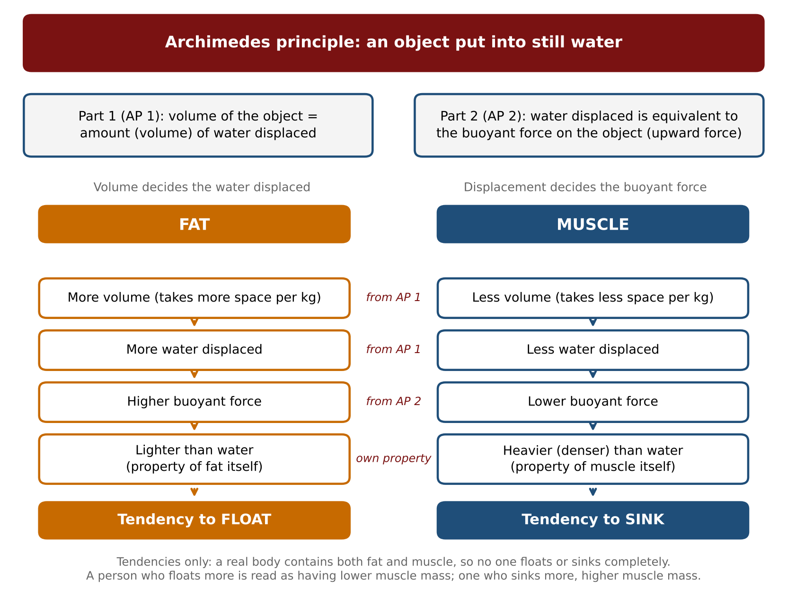

- It is a **densitometry** method: **body density = mass / volume**. Underwater weight is read on a scale connected to a seat, and volume comes from the water displaced. Body density goes into the **Siri equation** to give body fat percentage.
- **Archimedes part 1:** volume of the object underwater = volume of water displaced. **Part 2:** water displaced = buoyant force (the upward push).

| Point | Fat | Muscle |
|---|---|---|
| 1 Volume | More | Less |
| 2 Water displaced | More | Less |
| 3 Buoyant force | Higher | Lower |
| 4 Density compared with water | Lighter than water | Heavier than water |
| Result | Tends to float | Tends to sink |

- Points 1 to 3 follow Archimedes. Point 4 is a property of the tissues, not Archimedes.
- **Procedure:** water at neck level, **blow out all the air** (air also makes a person float), stay still, read when the bubbles stop, and repeat **several trials**.
- **Gold standard:** highest accuracy, and other tests are compared against it.
- **Disadvantages:** needs technical expertise, expensive, not available to the public and **not available in India**.

## 2. DEXA scan, test 2.3.4

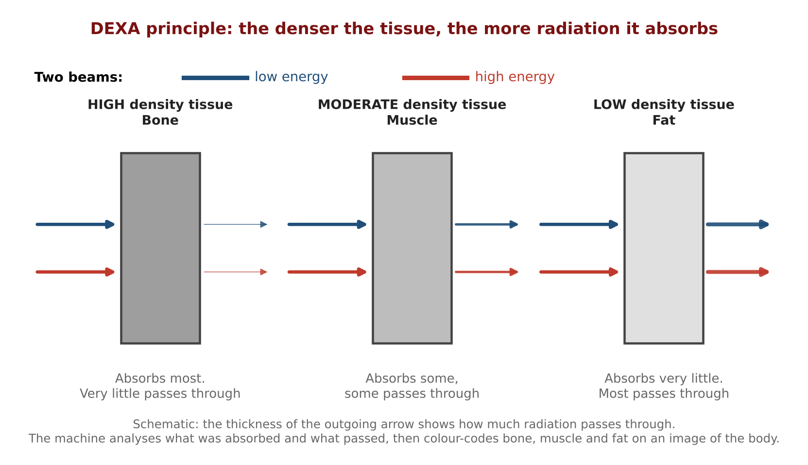

- **D**ual **E**nergy **X**-ray **A**bsorptiometry (spelling: absorptiom**e**try). Two beams, one high energy and one low energy, are sent into the body.
- **The denser the tissue, the more it absorbs.**

| Tissue | Density | Absorption |
|---|---|---|
| Bone | High | Very good |
| Muscle | Moderate | Some absorbed, some passes |
| Fat | Low | Poor |

- It reports **three categories**: **fat-free mass** (muscle, organs, fluid), **fat mass** (subcutaneous, visceral and essential fat) and **bone and mineral mass**.
- Originally used in **orthopaedics** to check bone density, now used for overall body composition.
- **Advantages:** low radiation risk, no special clothing or preparation, good accuracy, quick, no technical expertise needed for the user, suitable for all, available in India, in-depth analysis.
- **Disadvantage:** might be expensive for some (about 3,000 to 4,000 at a public facility, 12,000 to 15,000 at a premium hospital).
- **Gym BIA machine:** compare it with a DEXA reading (about plus or minus 5 percent) and repeat DEXA after about 6 months.

## 3. Choosing among the eight body composition tests

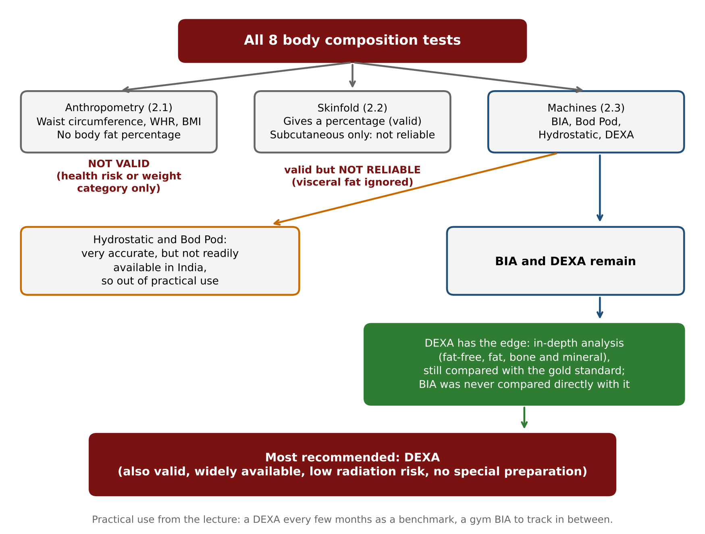

| Step | Group | Verdict |
|---|---|---|
| 1 | Waist circumference, WHR, BMI (anthropometry) | Not valid: no body fat percentage |
| 2 | Skinfold | Valid but not reliable: only subcutaneous fat |
| 3 | Hydrostatic weighing, Bod Pod | Not available in India |
| 4 | BIA versus DEXA | **DEXA** (in-depth analysis, accuracy compared with the gold standard) |

## 4. Cardiorespiratory tests (test 3)

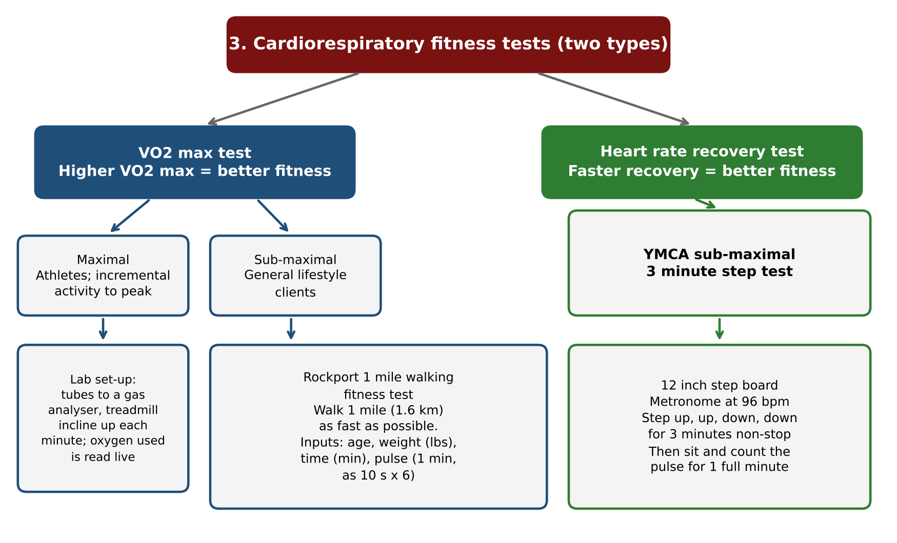

| Test | What it measures | Version used |
|---|---|---|
| VO2 max | Maximal oxygen consumption in incremental exercise (higher is better) | Maximal (athletes, laboratory) or sub-maximal (general clients) |
| Heart rate recovery | How quickly the heart returns toward normal (faster is better) | YMCA 3 minute step test |

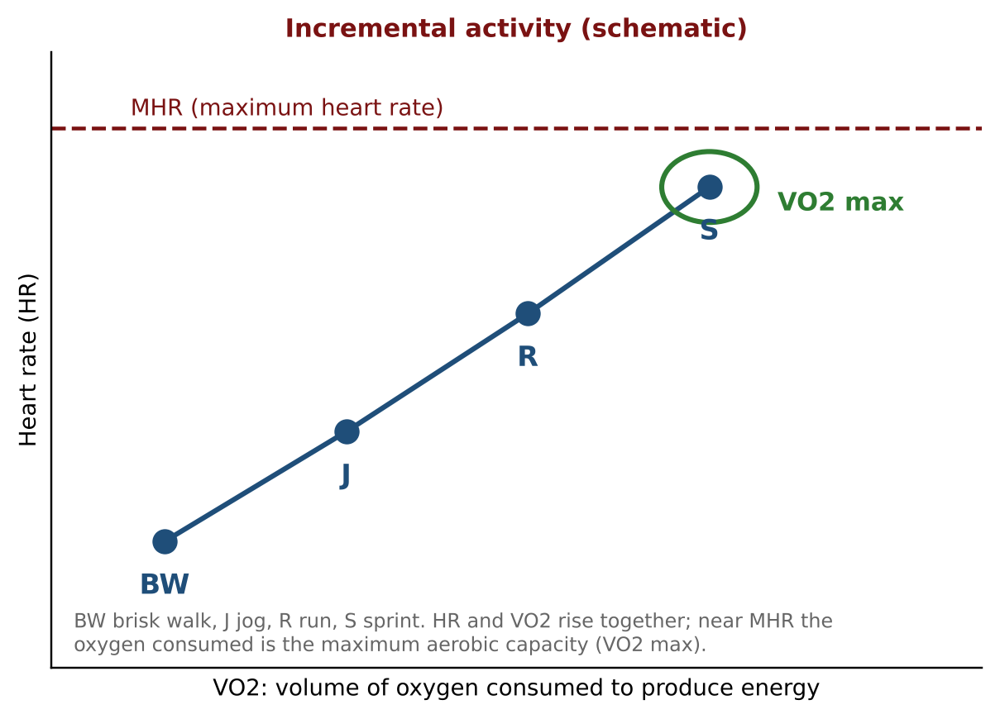

### 4.1 Rockport 1 mile walking test (sub-maximal VO2 max)

- Walk **1 mile (1.6 km) as fast as possible**, non-stop.
- **Four inputs:** time (minutes), pulse, age, weight in **pounds** (kg x 2.2).
- **Pulse:** counted for **10 seconds x 6**, immediately at the end, because the peak heart rate is needed.

| Sex | Formula (weight in lbs, time in min, pulse in bpm) |
|---|---|
| Female | 132.85 - 0.388 x age - 0.077 x weight - 3.265 x time - 0.156 x pulse |
| Male | 139.168 - 0.388 x age - 0.077 x weight - 3.265 x time - 0.156 x pulse |

- **Worked case (male):** age 50, 60 kg (132 lbs), 15 minutes, pulse 108. Subtract 19.400 + 10.164 + 48.975 + 16.848 = 95.387 from 139.168 to get 43.781 (the slide prints 43.79). In the age 50 male row, 44-40 is **Very good**.
- **Slide case (female):** age 38, 140 lbs, 21 minutes, pulse 146 gives 15.985, **Very poor**.

Rows used in the cases (VO2 max, ml/kg/min):

| Age | Sex | Superior | Excellent | Very good | Good | Fair | Poor | Very poor |
|---|---|---|---|---|---|---|---|---|
| 30 | M | 54+ | 53-49 | 48-44 | 43-39 | 38-34 | 33-29 | <29 |
| 30 | F | 51+ | 50-46 | 45-41 | 40-36 | 35-31 | 30-26 | <26 |
| 50 | M | 50+ | 49-45 | 44-40 | 39-35 | 34-30 | 29-25 | <25 |
| 50 | F | 47+ | 46-42 | 41-37 | 36-32 | 31-27 | 26-22 | <22 |

### 4.2 YMCA 3 minute step test (heart rate recovery)

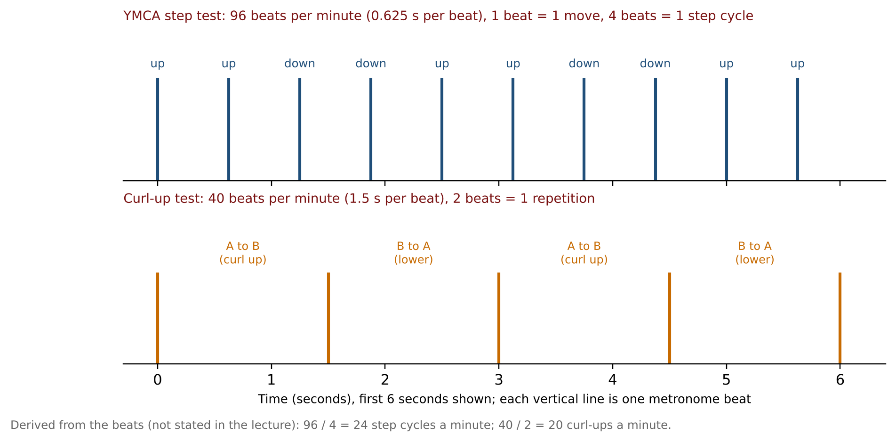

- **Standardised conditions:** board **12 inches**, metronome **96 bpm**, **3 minutes** non-stop.
- **One beat = one move:** up, up, down, down.
- Then the client sits and the pulse is counted for **one full minute** (recovery is the aim, so not 10 seconds x 6).
- **Case:** female, 30 years, 85 bpm: below 88 in the 26-35 column, so **Excellent**. Lower is better.

| Rating | Female 26-35 years |
|---|---|
| Excellent | < 88 |
| Good | 88-99 |
| Above average | 100-111 |
| Average | 112-119 |
| Below average | 120-126 |
| Poor | 127-138 |
| Very poor | > 138 |

| | Rockport walk | YMCA step test |
|---|---|---|
| Aim | Peak heart rate for VO2 max | Recovery of the heart |
| Pulse count | 10 s x 6, at once | Full minute after the test |
| Metronome | None | 96 bpm |

## 5. Muscular strength (test 4)

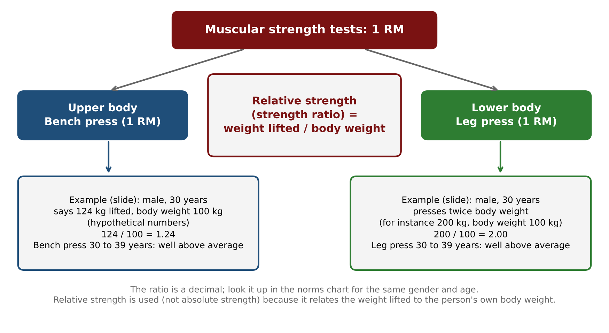

- **Muscular strength** is the force produced in one maximum effort, so the load is the **1 RM**.
- **Relative strength (strength ratio) = weight lifted / body weight.** Absolute strength is just the weight lifted.
- Tests: **bench press** (upper body) and **leg press** (lower body). The leg press is supported and does not depend on the core, unlike the squat.
- **Cases (male, 30 years):** bench press 1.24 (for example 124 / 100) and leg press 2.00 are both **Well above average**.
- **Beginners:** skip strength at the first test. The second test counts as the first strength test and the third test begins tracking progress.

## 6. Muscular endurance (test 5)

- Both tests are done **till failure** (no target number).

| | Push-up test | Curl-up test |
|---|---|---|
| Region | Upper body | Abdominal region (rectus abdominis, spine flexion) |
| Position | Males on toes, females on knees | Supine, **palms flat on the mat** |
| Range of motion | Chin to the floor, arms fully extended, no half repetitions | Fingertips travel from tape A to the far tape: **12 cm if under 45, 8 cm if over 45** (inside edge to inside edge, tape 2 cm wide) |
| Speed | Not set | Metronome **40 bpm**, **2 beats = 1 repetition** |
| Cases | Male 30 reps: Excellent. Female 27 reps: Excellent | Male 25 reps: Below average. Female 25 reps: Average |

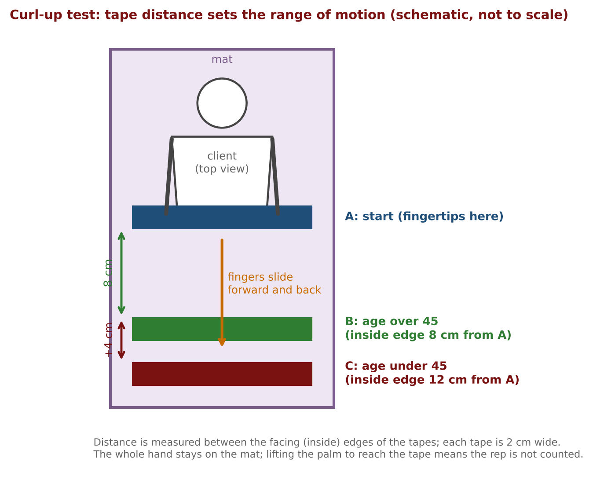

- A repetition does not count if the palm lifts off the mat.
- The chart is separate for males and females, so each client is compared like with like.

## 7. Flexibility (test 6)

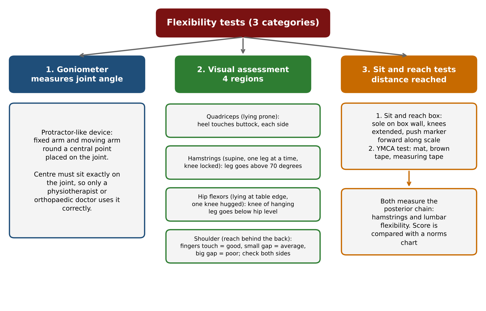

- Flexibility is the ability of the muscle to **lengthen passively** (the trainer helps), so **both sides** are tested.
- **Goniometer:** measures joint angle (fixed arm, moving arm, central point on the joint). Only a physiotherapist or orthopaedic doctor uses it.

| Region | Position | Criterion |
|---|---|---|
| Quadriceps | Prone | Heel touches the buttock |
| Hamstrings | Supine, locked knee, leg raised with help | Leg above 70 degrees |
| Hip flexors | Hips at the table edge, one knee hugged | Suspended leg: knee below hip level |
| Shoulder | Standing or sitting, one hand over and one under | Good (fingers touch), average (small gap) or poor (large gap) |

- **Sit and reach** measures hamstring and lumbar flexibility. The **box** version reads the marker on the scale. The **YMCA** version needs a mat, a brown tape (1 foot, heel to heel) and a measuring tape whose **15 inch mark lies at the brown tape** (the zero point).
- **Case:** male, 35 years, reaches 2 inches past the tape: 15 + 2 = 17 inches, which is **Good** (26-35 column).

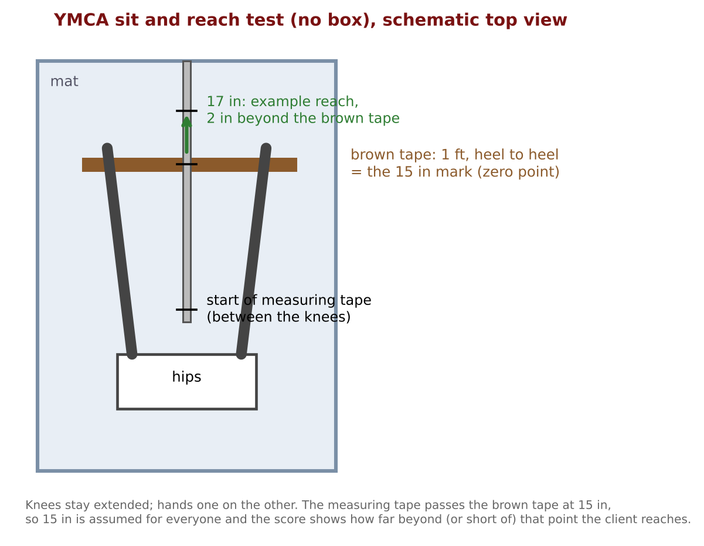

## 8. Using any norms chart

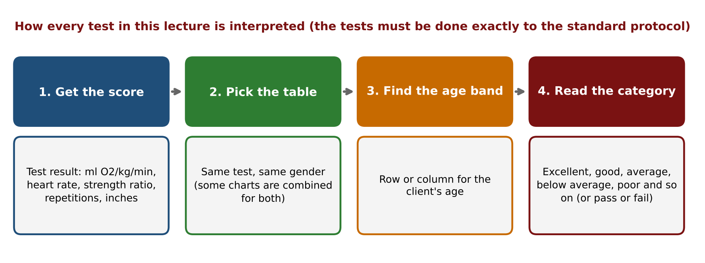

- Every chart is looked up by **gender, age and the result**. Only a **standardised** test gives a result that can be compared with the chart. A modified test gives a number that cannot be looked up.
- The lecture says the charts come from well-accepted research from several countries and are accepted globally.

## 9. Key terms

| Term | Meaning |
|---|---|
| Densitometry | Finding body fat from body density (mass / volume) |
| Archimedes principle | Displaced water volume equals the object volume, and equals the buoyant force |
| Buoyant force | Upward force on an object in water |
| Siri equation | Converts body density to body fat percentage |
| Gold standard | The most accurate reference test |
| DEXA | Dual energy X-ray absorptiometry |
| Validity | The test gives the body fat percentage |
| VO2 max | Maximal oxygen consumption (ml per kg per minute) |
| Maximal / sub-maximal test | Taken to the peak (athletes) or estimated from a lower effort (general clients) |
| Heart rate recovery | How quickly heart rate falls after activity |
| Standardised test | Every step, setting and condition fixed |
| Metronome | Device that ticks at set beats per minute |
| 1 RM | Heaviest weight lifted once with correct form and full range of motion |
| Relative strength | Weight lifted / body weight |
| Muscular endurance | Repeated contractions without fatigue (counted till failure) |
| Goniometer | Instrument that measures joint angle |
| Passive lengthening | Muscle lengthened with outside help (definition of flexibility used here) |

## 10. Where the sources differ

| Topic | Lecture | Slides / E-book |
|---|---|---|
| DEXA accuracy | Good accuracy compared to the gold standard | Slide: as accurate as hydrostatic weighing. E-book: more valid than a two-component model |
| Rockport case 1 | Not worked in detail | Recomputed 43.781, slide prints 43.79 (same category) |
| Rockport pace | As fast as possible | E-book: brisk pace, almost as fast as possible without jogging |
| Curl-up | Tapes 12 cm / 8 cm, 40 bpm, till failure | E-book: partial curl-up, tapes 10 cm apart, 50 bpm, one minute, maximum 25 |
| Hamstring angle | Above 70 degrees | Slide: 70-80 degrees. E-book: 80-85 degrees |
| Hip flexor test | Hanging-leg test | E-book: supine knee-to-chest test |
| YMCA sit and reach | 15 inch mark at the brown tape | E-book adds heel spacing, hold time and two trials |
| Beginner rule | Question says "endurance", explanation is about strength | E-book: strength testing not prescribed for those starting out |

The full list of 19 items is in "Points to Confirm" in the Detailed Notes.

## 11. Revision questions

1. State the two parts of Archimedes principle.
2. Give the four comparisons between fat and muscle, and say which tissue floats.
3. Why must the client blow out all the air in hydrostatic weighing?
4. Why is hydrostatic weighing called the gold standard, and why is it not chosen in India?
5. What does the "A" in DEXA stand for, and what is the principle behind the scan?
6. List the three categories DEXA reports.
7. Why do the eight body composition tests narrow down to DEXA? Give the verdict on anthropometry, skinfold and the two other machines.
8. What does a client with a gym BIA machine do, according to the lecture?
9. State the difference between maximal and sub-maximal VO2 max tests and who each is for.
10. What four inputs does the Rockport formula need, and how is the pulse counted?
11. Compute VO2 max for a male of age 50, weight 60 kg, time 15 minutes and pulse 108.
12. In the YMCA step test, what are the board height, metronome speed and duration, and how does one beat relate to one move?
13. Why is the pulse counted for one full minute in the step test but 10 seconds x 6 in the Rockport test?
14. A 30-year-old woman has a post-exercise pulse of 85 bpm. What is her category?
15. What is relative strength, and why is the leg press used instead of the squat?
16. A beginner joins. When is muscular strength tested for the first time and when does tracking begin?
17. How do males and females differ in the push-up test, and what counts as a full repetition?
18. In the curl-up test, what tape distance does a 47-year-old use, and how many metronome beats make one repetition?
19. Which leg is tested in the hip flexor test, and what is the pass criterion?
20. Describe the YMCA sit and reach set-up and the result for a 35-year-old male who reaches 2 inches beyond the brown tape.

## Answers

1. Part 1: the volume of the object underwater equals the volume of water displaced. Part 2: the water displaced equals the buoyant force on the object.
2. Fat has more volume, displaces more water, has a higher buoyant force and is lighter than water. Muscle is the opposite on each point. Fat floats and muscle sinks.
3. Air in the lungs makes a person float and would distort the underwater weight. The reading is taken when the bubbles stop.
4. It gives the highest accuracy, and other tests are compared with it. It needs technical expertise, is expensive and is not available in India.
5. Dual energy X-ray absorptiometry. Two X-ray beams are sent in, and denser tissue (bone) absorbs more than less dense tissue (fat).
6. Fat-free mass, fat mass (including essential fat) and bone and mineral mass.
7. Anthropometry is not valid (no body fat percentage). Skinfold is valid but not reliable (subcutaneous fat only). Hydrostatic weighing and the Bod Pod are not available in India. Of BIA and DEXA, DEXA gives the in-depth analysis and its accuracy is compared with the gold standard.
8. Get a DEXA, compare it with the BIA reading (about plus or minus 5 percent), keep that margin in mind, and repeat DEXA after about 6 months.
9. A maximal test takes the person to peak effort in a laboratory and is for athletes. A sub-maximal test estimates VO2 max from a lower effort and is for general clients.
10. Time, pulse, age and weight in pounds. The pulse is counted for 10 seconds and multiplied by 6, immediately at the end.
11. Weight 60 x 2.2 = 132 lbs. 139.168 - 19.400 - 10.164 - 48.975 - 16.848 = 43.781, which the slide prints as 43.79. This is Very good.
12. 12 inches, 96 beats per minute, 3 minutes non-stop. One beat is one move (up, up, down, down).
13. The Rockport test needs the peak heart rate, so a 10-second count is used. The step test measures recovery, so the full minute after exercise is counted.
14. Excellent, because 85 is below 88 in the 26-35 female column.
15. Relative strength = weight lifted / body weight (the strength ratio). The leg press is supported and does not depend on the core, but the squat is unsupported and depends on a strong core.
16. Strength is skipped at the first test, the second test is the first strength test, and from the third test progress is tracked.
17. Males use the toes and females use the knees. A full repetition has the chin touching the floor and the arms fully extended, with no half repetitions. The test is done till failure.
18. 8 cm (over 45). Two beats make one repetition (one up, one down).
19. The suspended leg is tested. It passes when the knee goes below the hip level.
20. A mat, a 1 foot brown tape heel to heel, and a measuring tape whose 15 inch mark lies at the brown tape. The client keeps the knees straight and reaches forward. The result is 15 + 2 = 17 inches, which is Good.

---

## Board photos

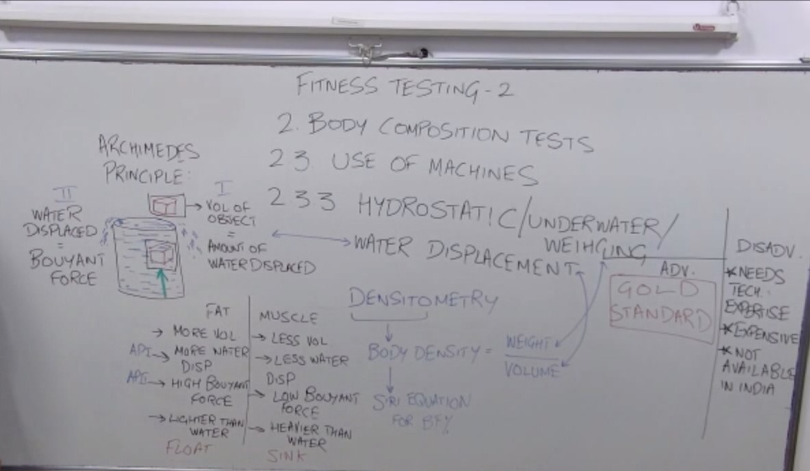

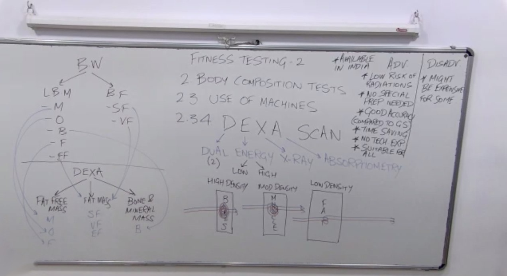

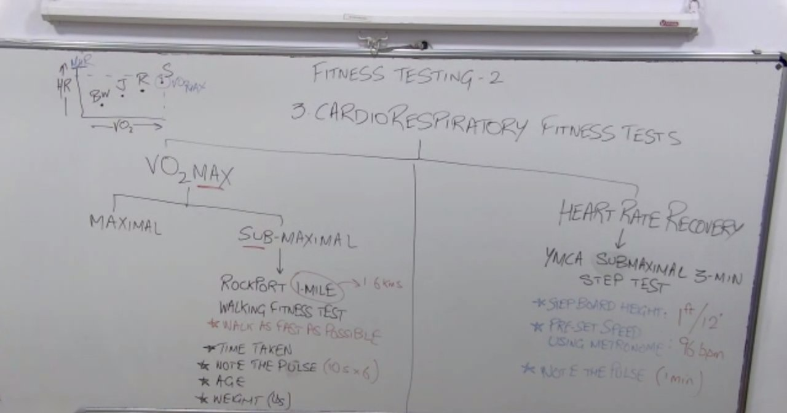

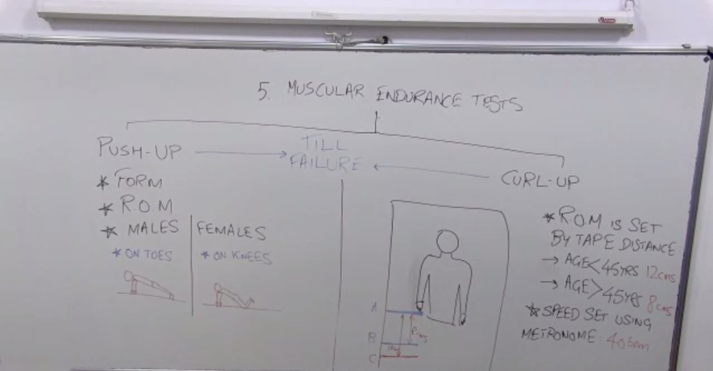

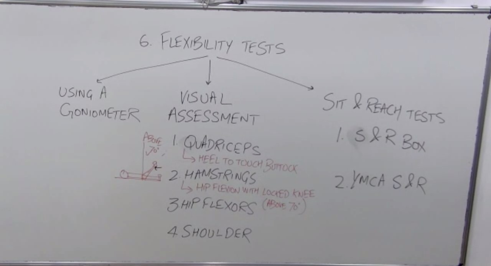
