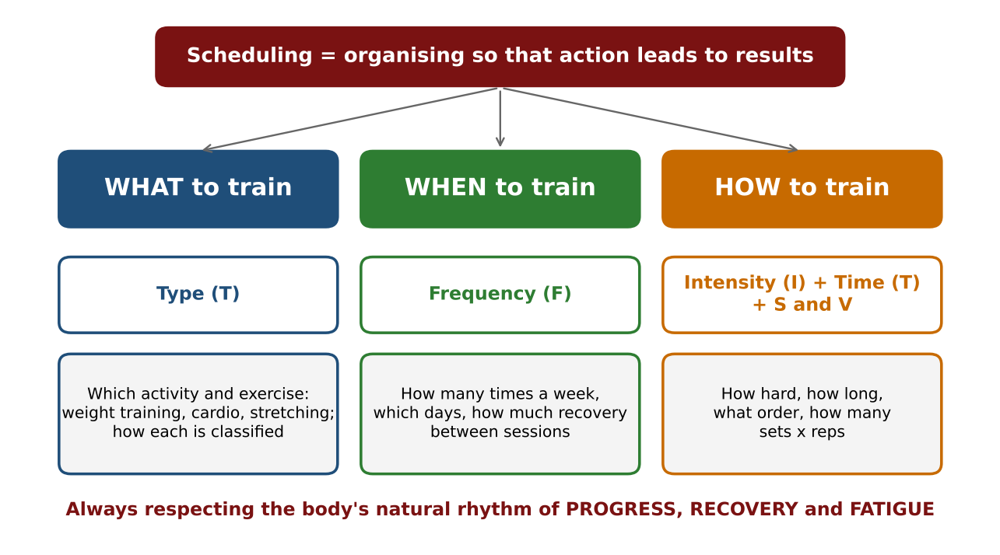
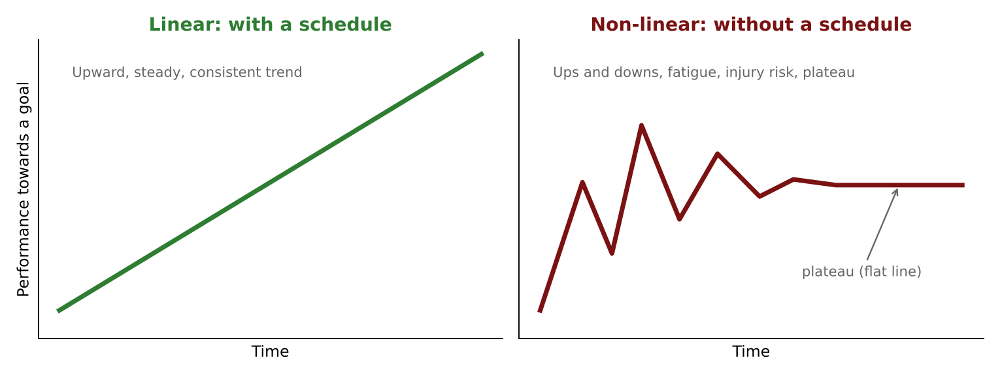
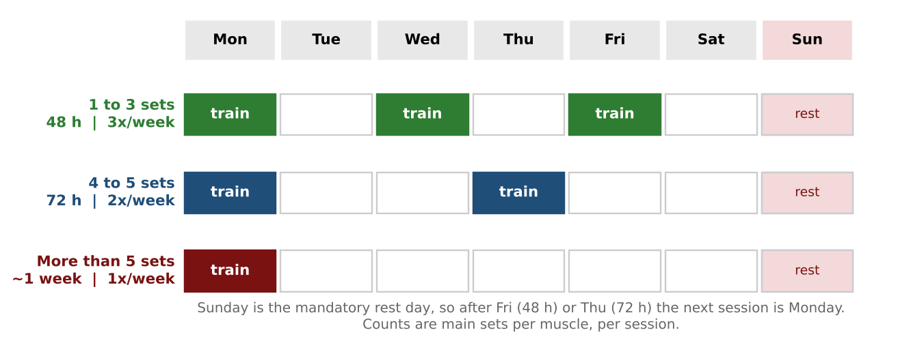
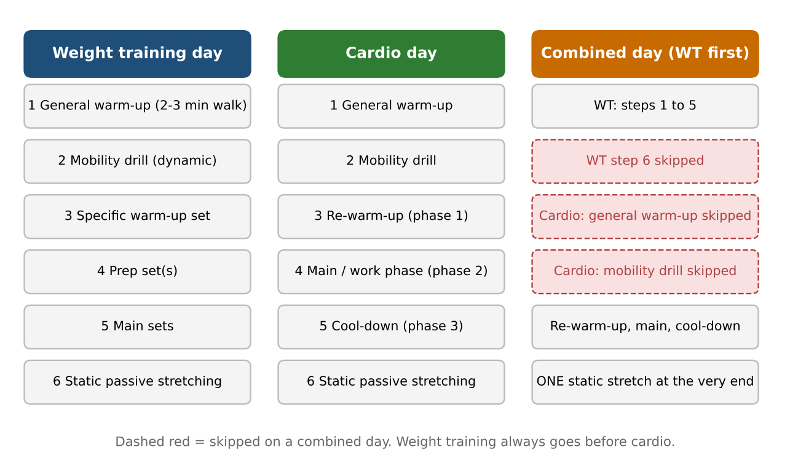
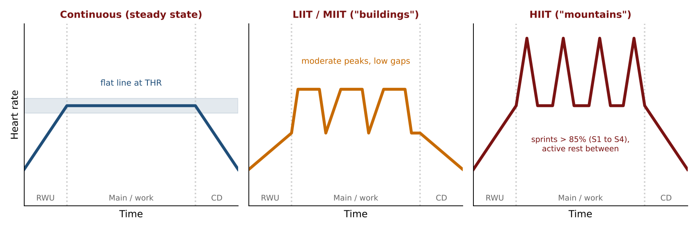
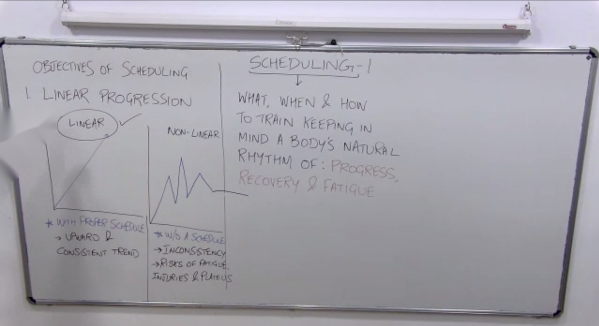
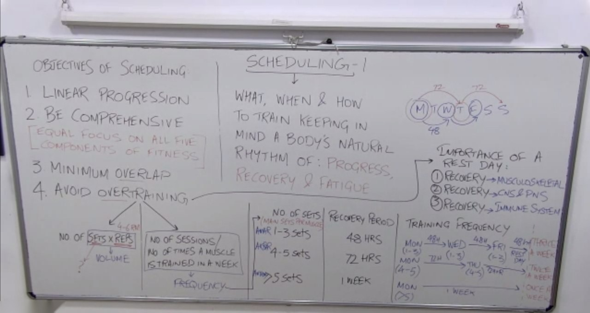
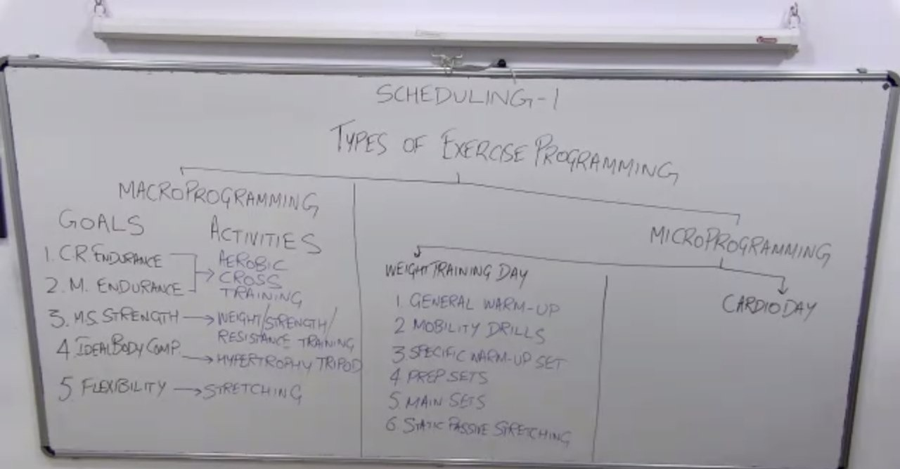
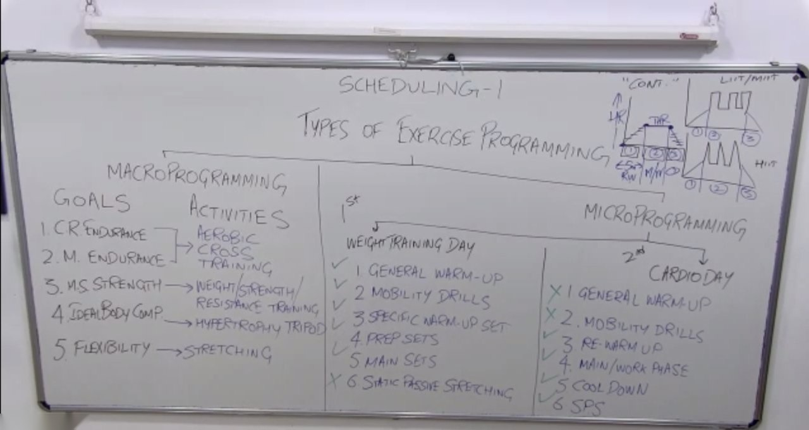
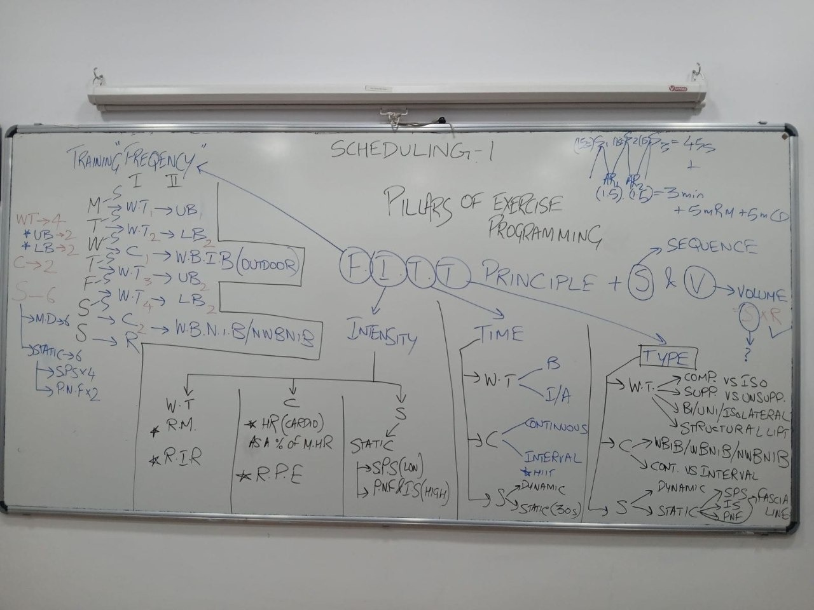

# Scheduling 1: Detailed Notes

**Course:** Personal Training Certification

**Topic:** Scheduling, part 1 of 2

**About these notes:** Detailed notes from the Scheduling 1 lecture, written so the whole lecture can be studied without watching the recording. Every concept, example, analogy and class question is covered. For a short revision version see the Study Notes.

---

## Abbreviations used in these notes

| Short form | Meaning |
|---|---|
| WT | Weight training |
| CR endurance | Cardiorespiratory endurance |
| M endurance | Muscular endurance |
| MS strength | Musculoskeletal strength |
| RM | Repetition maximum (for example 4 RM is the heaviest weight you can lift for 4 reps) |
| RI / RIR | Reps in reserve |
| RPE | Rating of perceived exertion (Borg scale, 0 to 10) |
| MHR / THR | Maximum heart rate / target heart rate |
| SPS | Static passive stretching |
| PNF | Proprioceptive neuromuscular facilitation |
| HIIT / MIIT / LIIT | High / moderate / low intensity interval training |
| WBIB | Weight-bearing, impact-based cardio (for example running) |
| WBNIB | Weight-bearing, non-impact-based (for example elliptical) |
| NWBNIB | Non-weight-bearing, non-impact-based (for example cycling, rowing, swimming) |
| CNS / PNS | Central / peripheral nervous system |
| UB / LB | Upper body / lower body |

## Before this lecture

This lecture uses ideas from earlier topics, which is why scheduling comes at the end of the course. You should already be familiar with: the five components of fitness and their interdependence, the hypertrophy tripod (progressive overload, nutrition, rest and recovery), workload and intensity (stimulating reps, the three types of sets, rest intervals), the cardio and stretching lectures, exercise classification and selection criteria, and the body part lectures.

## Outline of the lecture

| Part | Topic |
|---|---|
| 1 | Welcome, the cooking analogy, what is scheduling? |
| 2 | Objectives of scheduling (linear progression, comprehensive, minimum overlap, avoid overtraining, rest day) |
| 3 | Macro and micro programming (with a weight training day, a cardio day and a combined day) |
| 4 | Fundamentals of exercise programming |
| 5 | The four pillars (the FIT or FITT principle), with a frequency chart exercise |
| 6 | Finishing touches (S and V) and preview of Scheduling 2 |

---

# Part 1: Welcome and What Is Scheduling?

## 1.1 The cooking analogy

Scheduling is about designing and analysing workout splits, including some of the world's most popular and widely followed ones. Before that practical application, some key basics are needed.

Think of designing a workout split like **cooking a dish**. The first thing needed to prepare any dish is the **ingredients**. So Scheduling 1 is about arranging the ingredients. Scheduling 2 prepares the dish ("how to design and analyse a workout split").

Some ingredients are recollected from earlier lectures. Some are new: crucial data and research papers that have been tested and researched by some of the world's most trusted fitness research institutes and scientists. Step by step, these lead to a way of planning a client's workout split.

The lecture keeps using this analogy: each new topic is "another store" or "another aisle" where a different ingredient is collected.

## 1.2 What comes to mind when you hear "scheduling"?

The class was asked for keywords that come to mind. The answers were: **planning, timings, exercises and activities, assigning a task, organising things**. All of these are correct (the word "exercises" belongs to "exercise scheduling", but here the focus is on the word "scheduling" alone). The lecture merges them into one statement. There is **no official definition** of a workout schedule, so the course builds its own.

**Vocabulary note:** "programming" and "scheduling" are used interchangeably in this course. "Programming" also means schedule.

## 1.3 Scheduling is more than putting things in order

Scheduling is not just about putting things in order. It is **organising things in a way that the action leads to results**. It is not only about what you are training, how you are training and when you are training. It is also about the things that make those whats, hows and whens successful.

Scheduling appears in many areas of life.

**Example 1: A student preparing for an exam.** The student builds a study timetable: at this hour cover these topics, at that hour those topics. With a proper schedule, the student knows exactly how much time each topic gets, and the knowledge is retained for a long time. A student with no timetable panics and crams everything into the last few days. That knowledge is short term and lasts only until the exam. Someone who revises daily because of a schedule still remembers things after the certification is over.

**Example 2: Medicine.** A doctor writes a prescription: this medicine before breakfast, this one with lunch, this one before bed, with the dosage (two tablets, half a tablet). Suppose the patient becomes over-smart: "Why wait? I will take them all at once." Two things can happen: the medicines may not work properly, or they could be harmful. There was a reason the doctor gave a schedule.

**Key point:** A schedule is not just "some time, some day and some activity". There must be a logic behind everything: why something sits at a particular place. There should be a reason for each placement.

## 1.4 Building the statement

There is no official definition, but scheduling can be described in a short statement:

> **Scheduling is about WHAT, WHEN and HOW to train.**
> But that is not all. You have to keep in mind the body's natural rhythm of three things: **PROGRESS, RECOVERY and FATIGUE**.

The three question words relate to the four pillars covered later in Part 5:

| Question | Pillar that answers it |
|---|---|
| **WHAT** to train | **Type** (T) |
| **WHEN** to train | **Frequency** (F) |
| **HOW** to train | **Intensity** (I) and **Time** (T), plus **S** (sequence) and **V** (volume) |

This mapping is a study aid. The lecture wrote WHAT, WHEN and HOW on the board and taught the four pillars later, but did not draw an explicit one-to-one line between them.

**Why the second half matters.** Consider three different clients. None of them can progress in the same way. None can recover in the same way. None can experience fatigue in the same way. Each body responds differently. So a schedule has to be **personalised and customised**, keeping in mind each person's natural rhythm of progress, recovery and fatigue.

## 1.5 Why before what and how

A principle used throughout the course: understand the **why** before the what and the how. So the lecture starts with the objectives of scheduling. What is the purpose? Why make sure there is a schedule? What should be kept in mind?

---

# Part 2: Objectives of Scheduling

| # | Objective |
|---|---|
| 1 | Linear progression |
| 2 | Be comprehensive |
| 3 | Minimum overlap |
| 4 | Avoid overtraining |

## 2.1 Objective 1: Linear progression

A proper schedule makes sure that **linear progression** takes place. Linear progression means progress that is steady, uniform and consistent: the trend is always upward and there is no decline. It might be slow, but it keeps going up.

It is shown as a graph with time on the horizontal axis and performance towards a goal (strength, endurance, flexibility, any goal) on the vertical axis.

**Linear (with a schedule).** There is an upward and consistent trend, because the schedule respects the person's way of progressing, recovering and fatiguing.

**Non-linear (without a schedule).** This is best understood as a story.

The gym calendar: the maximum number of gym enrolments happens in January ("new year, new me, biggest comeback ever"). In January a highly motivated person says "I will prove it to the world", and the graph climbs dramatically. Then comes February. Before 14 February there is a breakup, and the graph goes down. Then something changes (the playlist changes), and the person is back, fully motivated. Then a festival in March sends diet and nutrition for a toss, and the graph falls again. Then a wedding in the family arrives ("we have to look good for that"), so the person is back on track. There is no proper schedule in place: the person is **driven by the calendar**.

Then a friend joins and says, "I feel like doing shoulders today", even though shoulders were trained yesterday. The person does shoulders again. That means growing fatigue, and deviation from their own schedule.

The result is a **zigzag** of ups and downs. That is **non-linear progression**. It has a lot of inconsistency and added risks: fatigue, injury and a **plateau**.

**Q: What does "plateau" mean?**

A: Flattening, a flat line. Think of a film scene where doctors say the patient has flat-lined. In the graph, progress stalls. That is what non-linear progression looks like.

The objective of scheduling is to achieve the linear pattern. This is one of the reasons scheduling is crucial.

## 2.2 Objective 2: Be comprehensive

A schedule must be **comprehensive**. A schedule makes sure no goal is left behind for a client: none of the **five components of fitness** is ignored.

The word comes up in the cardio lecture, where **task-specific** muscular endurance was contrasted with **comprehensive** muscular endurance. Task-specific is specific to a single task. Comprehensive is more holistic: the complete, 360 degree picture. In scheduling too, being comprehensive means every component of fitness is included in the journey and gets **equal focus**.

**The five components of fitness:** cardiorespiratory endurance, muscular endurance, ideal body composition, flexibility and musculoskeletal strength.

*Student answer and correction:* a student answered "cardiovascular endurance". The correct term is **cardiorespiratory** endurance. Cardiovascular is a system. For the endurance component, say cardiorespiratory.

**Comprehensive means equal focus on all five components of fitness.**

A schedule should not be only strength-heavy, revolving around weights, weights, weights. Recall the **interdependence of components**: they rely on each other. If stretching is ignored, flexibility is underdeveloped. Then the benefits of stretching are lacking: a higher chance of injury and a limited range of motion. If range of motion is affected, the full range cannot be completed in strength training. If the range of motion is incomplete, hypertrophy is affected. Everything is connected. That is why all components are covered from the very start of learning to prepare a schedule.

It is also not just about the one hour a client spends in the gym. It is about the other **23 hours**.

**Q: Besides progressive overload, what are the other two legs of the hypertrophy tripod?**

A: **Nutrition**, and **rest and recovery**.

Nutrition and recovery are equally important. A client will have no hesitation in blaming the trainer: "You promised I would reach this goal by this month." So be clear when building a programme and communicating with the client: it is not limited to the hour in the gym. It extends to whether they follow it with discipline through the day. Keeping a check on nutrition also keeps the ideal body composition goal in place, and when that component is in place, it supports the others too.

## 2.3 Objectives 3 and 4: Minimum overlap and avoid overtraining

The second word in objective 3 ("minimum **over**lap") and in objective 4 ("avoid **over**training") is the same word, "over". The difference between them:

**Q: What is the difference between overlap and overtraining?**

A student answered: "Overlap is repeated muscle training: the same muscle trained repeatedly." That is right.

**Overlap.** Think of the English word: if you put one thing on top of another, it overlaps. If shoulders are trained on Monday and, without giving that muscle any recovery period, trained again the very next day, that is overlap. The same muscle is being trained repeatedly. That does not necessarily mean overtraining. If the muscle is not trained again for the rest of the week, it is not overtrained, but there was no room (recovery) between the two sessions. That is overlap.

**Overtraining.** Doing **more than what is required** for a muscle.

| | Overlap | Overtraining |
|---|---|---|
| Meaning | Same muscle trained again with no recovery period in between | Doing more training than the muscle needs |
| Example | Shoulders Monday and again Tuesday | Too many sets (volume) or too many sessions per week (frequency) |

Overtraining can take place in two ways:

1. In terms of the **number of sets and reps**. Put in one word, this is **volume**.
2. In terms of the **number of times a muscle is trained in a week**. Put in one word, this is **frequency**.

**Overtraining: Volume (sets x reps) and Frequency (times per muscle per week).**

### Volume: stimulating reps

Volume is **sets multiplied by reps**. It is written in ready-made schedules as "5 x 5" (the popular 5 x 5 programme: five sets of five reps each), or "12 x 3", which means three sets of 12 reps.

The course does not simply follow ready-made schedules. Earlier lectures (workload and intensity) introduced **stimulating reps**: the reps in the range of **4 to 6 RM**. In this range motor unit recruitment is high and tension is high. Type II fibres are working and the large motor units are recruited. That is why this range is suggested.

Important: the stimulating reps concept is for **intermediate and advanced** trainees. For **beginners** the range is **15 to 20 RM**, and the recommended rep range is about **10 to 15**, because they are in a learning phase and have many things to learn. After the beginner phase, one should not stay with that higher rep range. Stimulating reps help reach hypertrophy goals in the most efficient and fastest way.

So the rep range question is answered: **4 to 6 RM**. The question of how many sets to do per muscle cannot be answered yet, because all ingredients must be collected first. Scheduling 2 gives published data that is recognised and followed worldwide, and compares the popular splits (push pull legs, full body, upper/lower and others) to discuss the ideal set range for each. For now, volume is kept in check by using stimulating reps.

(The slides show different rep ranges for the levels. See "Points to Confirm" at the end.)

### Frequency: sets and recovery period

Keeping volume in check partly avoids overtraining. Now frequency is kept in check, using research-backed data.

| Number of sets (main sets per muscle, per session) | Recovery period needed |
|---|---|
| 1 to 3 | 48 hours |
| 4 to 5 | 72 hours |
| More than 5 | About 1 week |

**Important point about "number of sets".** The brackets say "main sets per muscle" on purpose. When someone just says "1, 2, 3 sets", it is easy to think it is for one exercise, for example lat pulldown. It is not. It is for the **whole muscle**. If the back is trained that day, this is the number of main sets targeting the latissimus dorsi, which could be 1, 2 or 3 in total. How they are split is a choice: for example two main sets of lat pulldown and one main set of a supported row, a total of three for that muscle, not for an exercise. Warm-up sets and prep sets are not counted. Only **main sets** are counted.

The more sets done per muscle in a session, the longer the recovery needed. That is common sense. The recovery periods are suggested to protect performance, avoid fatigue and reduce injury risk.

### Weekly outlook: three people, three frequencies

Imagine three people, Person A, Person B and Person C, each following one row of the table. Write the days Monday to Sunday and see when each can train the muscle again. (The class used the names Amar, Akbar and Anthony, a pun on a well-known film title.)

**Person A: 1 to 3 sets per muscle, 48 hours recovery.** Trains the muscle on Monday.

**Q: After 48 hours, when can this person next train it?**

A: **Wednesday**, not Thursday. Tuesday is a full 24 hours, plus the remaining hours of Monday and the remaining hours of Wednesday add up to another 24. For example, if the muscle was trained at 2 pm on Monday and again at 2 pm on Wednesday, that is exactly 48 hours.

So Person A trains Monday, Wednesday, Friday. After Friday the 48 hours run through Saturday into Sunday, and Sunday is the mandatory rest day, so the next session is on Monday. **Training frequency: three times a week.** Someone following this set rule per muscle should train it thrice a week, not more and not less. (The rest day on Sunday is a "mandatory rest day"; section 2.4 explains why.)

**Person B: 4 to 5 sets, 72 hours.** Trains Monday, then 72 hours later it is Thursday (Tuesday and Wednesday are complete 48 hours, plus the remaining hours of Monday and Thursday). After Thursday, 72 hours would land on Sunday, but Sunday is the mandatory rest day, so the next session is Monday. **Frequency: twice a week, not more.** Doing more means entering overtraining. This is data-proven for optimal growth and performance.

**Person C: more than 5 sets (for example 6, 7, 8 or 9).** Needs one complete week. Trains on Monday and next on the following Monday. **Frequency: once a week**, so the muscle recovers well before it is trained again.

### The bro split

In a **bro split** a single body part is trained per day (it is back day, so everything focuses on the latissimus dorsi, with plenty of variety). That pattern fits the "more than 5 sets, once a week" row. Later lectures discuss for whom such splits are meaningful and whether they are the only option for advanced clients, because there is a lot of stereotyping in the industry. People say that an advanced trainee should not do a full body workout, that full body is for beginners. These myths are broken with data when the splits are covered in detail.

At a basic level, from the number of sets and the recovery period, a **suggested training frequency** can be worked out that avoids overtraining.

## 2.4 The importance of a rest day

Not giving a rest day is a way of overtraining, which is why this topic sits under objective 4. There are three reasons, and each is a different type of recovery.

**Rest day: three recoveries**

1. Musculoskeletal recovery
2. CNS and PNS recovery
3. Immune system recovery

### 1. Musculoskeletal recovery

"Musculoskeletal" is a combined word for the **soft tissues** and the **hard tissues**. The muscular part includes tendons, ligaments, muscles and fascia. The skeletal part is the bones.

When people build a workout split they ignore these other tissues and focus only on the main muscles they want to train. They forget the joints and bones that are common across many days. For example, a plan might have chest and shoulders one day, back and biceps another day, shoulders and arms on another. Is the shoulder joint not involved in more than one place? It is involved on back day (shoulder extension and adduction), on shoulder day, and on chest day (shoulder horizontal adduction). The same tendons and ligaments work across days. So all these tissues deserve at least one full rest day.

People say, "We can do cardio on Sunday" or "we can go and play a cricket match". But you cannot leave your femur and humerus at home and go play cricket. You cannot leave your muscles at home. That is why the full rest day, which people tend to underrate, is mandatory.

### 2. CNS and PNS recovery

The slides show only the **CNS**. The scheduling slides were still a work in progress when this lecture was given, so the lecture content (which includes the PNS) is the updated version.

Think of the **CNS** (central nervous system) as the **factory** where the signals for muscle contraction are produced. The **PNS** (peripheral nervous system) are the **truck drivers** who deliver those signals. Both the factory workers and the truck drivers deserve a rest day, so they are recharged and ready to give their best from Monday onwards. They work 24 hours a day, because they are used even outside gym hours in day to day tasks. They never get a chance to rest unless a complete rest day is given.

### 3. Immune system recovery

Immunity keeps you from falling ill. If you fall ill, performance and the workout split suffer anyway. Stress levels influence immunity: think of immunity as a **shield**, and stress as something that wears it down.

Stress can come from **non-controllable** factors that are not in your hands: financial stress (inflation, rising prices on a limited salary), relationship stress. It can also come from **controllable** factors, and this is where the rest day comes in. A full rest day helps control a very important stress hormone, **cortisol**. Cortisol, and with it bodily stress, can be kept in check by giving the body a complete rest day.

**Summary of the objectives:** linear progression, being comprehensive, minimum overlap and avoiding overtraining. The numbers seen so far are just a starter; Scheduling 2 adds a lot more, with graphs.

## 2.5 Student question: natural versus enhanced trainees

**Q: Is the recommended training frequency the same for natural and enhanced people?**

A: All the concepts discussed assume that **no artificial substance** is being taken. The course talks about the natural way, because that is what it preaches, practises and recommends. If someone is taking such substances, they get added capacity beyond normal levels and a different recovery pattern, so these recovery periods do not apply to them. All the studies behind these numbers, including the ones in Scheduling 2, were conducted and published on natural methods of training.

---

# Part 3: Macro Programming and Micro Programming

This is another "store" in the shopping analogy. The thing to collect here is: **the two major types of exercise programming** (exercise scheduling).

## 3.1 Macro versus micro

There are two broad categories of an exercise programme: **macro programming** and **micro programming**.

**Q: Leaving the word "programming" aside, what is the difference between "macro" and "micro"?**

A: Macro is high level, micro is low level. Put simply: big versus small, broad versus zoomed in. Think of the microscope used in laboratories. A pathologist zooms inside a blood cell to look for a viral infection. **Macro** is the broader level, the bigger picture, seen from the outside. **Micro** is the smallest level, zoomed in.

A student once summed it up: **"Macro is a forest, micro is a tree in that forest."** Very simple and very accurate.

The same applies to programming: there is a bigger picture, followed by a zoomed-in picture.

**Example 1: Designing a certification.** When the theory phase was designed, a **macro programme** was built first: three modules, with a unit test at the end of each. Module 1 has introductory and pure science lectures (anatomy and physiology, and technical lectures such as workload, intensity, resistance profile and exercise selection criteria). Module 2 is dedicated to the body parts, muscles and demo lectures. Module 3 covers the last topics: cardio, fitness testing and scheduling. That was the macro programme.

The **micro programme** goes down to a single lecture. Take a fitness testing lecture. There is a plan: first, a short recap of the previous lecture (like a warm-up on a gym floor); then the main content (like the main sets, the weight training); at the end, a quick quiz or Q&A followed by attendance (a cool-down, like static passive stretching).

**Example 2: A family wedding.** Both families sit together and plan the macro programme: in the second week of December there will be four functions: one devotional, one engagement party, the wedding day and the reception. That is macro. At micro level, for a single function: what time do both sides reach the venue? What time does the caterer serve the food, so that most guests are present? What time does the make-up team arrive? When does the DJ start? That is micro programming for that day.

## 3.2 Macro programming for exercise

In exercise programming, **macro** looks at the bigger picture: the client's **overall fitness journey**, not a single session. Under macro programming the **specific goals** and the **specific activities** that meet each goal are listed. This is where "being comprehensive" (objective 2) must be built in. If a component goes missing at the macro level, it cannot reach the micro level. For example, if flexibility is not included here, nothing ensures that a single session includes stretching. So the macro programme is in place first, like a blueprint, and then the daily structure is built from it.

| Goal (component of fitness) | Main activity (not a single exercise) |
|---|---|
| CR endurance (cardiorespiratory) and M endurance (muscular endurance) | Aerobic cross-training |
| MS strength (musculoskeletal strength) | Weight training / strength training / resistance training |
| Ideal body composition | The hypertrophy tripod: progressive overload (weight training), nutrition, rest and recovery |
| Flexibility | Stretching |

Points to understand in this table:

- Under **activity**, the **type of activity** is written, not the type of exercise. For strength it is not about how many sets of which exercise. It is the main activity that helps with that goal: weight training (also called strength training or resistance training; all three are the same).
- For the two endurance goals, one activity covers both: **aerobic cross-training**. From the cardio lecture: when a diverse pool of aerobic activities is done, cardiorespiratory endurance improves and **comprehensive** muscular endurance is built, not only task-specific endurance. Most clients are not people whose muscles move in the same pattern all day, so comprehensive endurance is what is needed.
- For **ideal body composition**, remember the three-legged tripod. If one leg is compromised, the structure falls, so for hypertrophy all three are equally important. When muscle mass is kept in mind, body composition is also kept in check. The ideal body fat percentage for males is **under 15 percent**. To keep lowering it, lean body mass (LBM) must keep increasing, which is why hypertrophy training is done. The last two lectures of Module 1 covered this.
- For **flexibility**, the activity is stretching.

**Key point:** if any item is missing from the goals or from the activities at the macro level, it will be missing at the micro level.

## 3.3 Micro programming: a weight training day

Imagine the certification is over: practical done, exams done. A group meets in any city, goes to the gym together and trains. One day is a weight training day and one is a cardio day. This shows how the micro programme of each should ideally look.

Say it is a lower body (leg) day. On walking into the gym:

**Q: What is the first thing to do?**

A: **Mobility drill.** Some people call this the general warm-up, and those who merge the two are also correct. But because micro programming is the detailed, zoomed-in planning of a single day, it is best to be explicit and keep them separate.

**1. General warm-up.** A 2 to 3 minute slow walk: waking up mentally and physically, alerting the CNS ("good morning"). It is like having just got out of bed and come to the gym.

**2. Mobility drill.** From the stretching lecture, this is **dynamic stretching**.

**Q: Should it be done before or after the workout?**

A: **Before.** It stimulates the CNS, improves blood flow to the muscles for better performance, and removes stiffness in the joints and lubricates them, among other benefits covered in the stretching lecture.

**Steps 3, 4 and 5: the three types of sets.** These come from the intensity lecture (rest interval between sets). This is not about the sequence of exercises (supported or unsupported, compound first, then isolation, then unilateral). Whatever exercises are chosen, the types of set for each exercise should follow this order:

3. **Specific warm-up set**
4. **Prep set(s)**
5. **Main set(s)** ("the final battle")

Recall the table from the training frequency topic (1 to 3, 4 to 5, more than 5). Those were **main sets** only. Specific warm-up and prep sets are not counted.

**Q: Why is it called a specific warm-up set, and not just a warm-up set?**

A: Because it is **specific to that exercise**. (A student answered "specific to that exercise", and it is exactly exercise, not muscle, where the difference lies.) A person may do a squat but warm up with leg extensions. The muscles involved may be the same, but "specific" means: if the main set is a squat, do a warm-up set of the **same exercise** as the main set. In the main set the weight will be heavier (4 to 6 RM). When the load is negligible (body weight or an empty bar), the same range of motion that will be used in the main set can be checked safely, without discomfort, pain or an issue in any joint. It is far better to find out under negligible weight than under heavy weight. Sometimes the mobility drill shows no problem, but the movement pattern of the squat does. That is why this specific set is added.

**Prep sets** prepare the soft tissues and hard tissues by **gradually increasing the weight**. For example, the first prep set at 40 percent of 1 RM, the next at 60, the next at 80. There is no rule that three are mandatory. It varies from person to person. The prep sets prepare the tissues for the main battle, and by the time the main sets arrive, the muscles and all involved tissues should be ready to show their best performance and generate the force needed.

**6. Static passive stretching (SPS).** Done at the end ("after the main set, take a selfie, hashtag post-workout, and go home"). It is static stretching.

**Q: Why is static stretching done at the end and not at the beginning?**

A: In a static stretch the muscle is held at a fixed length for roughly 25 to 30 seconds. That is what it takes for the stretch mechanism to complete: the **stretch reflex, followed by autogenic inhibition**. Once autogenic inhibition is complete, muscle tension is released and the muscle relaxes. If the muscle is relaxed at the start, it cannot contract and generate force in the sets planned for it. So it is relaxed at the end, because the person is going home anyway.

### Questions that came up on the weight training micro programme

**Q: Are the specific warm-up and prep set only for beginners?**

A: No. Recall the table in the intensity lecture (rest interval between sets), with three categories:

| Level | Sets used |
|---|---|
| Beginner | Only **learning sets**. No specific warm-up, no prep set, no main set. |
| Intermediate | Number 3 (specific warm-up set) and number 5 (main sets). No prep set needed. |
| Advanced | All three: 3, 4 and 5. |

The three-minute rest interval applies **only to main sets**, so it never applied to beginners, who have no main sets.

**Q: If someone is in the gym every day, their muscles are already in working condition. Is a specific warm-up still needed?**

A: First, break the mindset that a person who works out daily is doing a good thing. That person may be overtraining. That is why these two lectures exist. Understand the data and the concepts, and do not pick and choose bits to fit something you already believe is the worldwide accepted way. Come with a clean slate. The data discussed has been clinically researched. Also, the person was not training the whole day, only for one session. Overnight there is a gap, and there is no way to know whether the muscle will have any issue with that movement. Why take the risk of jumping straight to the main set?

**Q: Is a specific warm-up needed for every exercise?**

A: The specific warm-up set is important for the **main compound, complex lifts**. After the unsupported and supported compounds are finished, no specific warm-up or prep sets are needed for a biceps curl or a triceps extension. Those muscles have already worked. In a pull session, for example, the biceps are already working in every horizontal or vertical pull. So it depends on the muscle and the day.

## 3.4 Micro programming: a cardio day

**Q: Why is a warm-up needed on a cardio day? It is just cardio.**

A: The CNS still needs stimulating and the joints are still used. So even on a cardio day, the day starts with a **general warm-up** and a **mobility drill**: steps 1 and 2.

For steps 3, 4 and 5, recall the training-method graphs from the cardio lecture: continuous, LIIT, MIIT and HIIT. In all of them the phases share the same names. The graph is heart rate against time: an upward slope at the start (phase 1), a main phase that looks different for each method (phase 2), and a downward slope at the end (phase 3).

- **Phase 1 (step 3): Re-warm-up.** The prefix "re" is used because one warm-up was already done (the general warm-up). This warm-up is for a different purpose: taking the heart rate **step by step into the target heart rate (THR) zone**. It takes about five minutes.
- **Phase 2 (step 4): Main or work phase.** Also called main cardio. For continuous cardio this is a straight line (THR maintained, steady state). For LIIT and MIIT it looks like buildings, and for HIIT like mountains with peaks.
- **Phase 3 (step 5): Cool-down.** Say it is the 20th minute of the main phase and the heart rate is 150 to 160 (from the Karvonen calculation). The person does not go home like that. The heart rate has to be brought down step by step, not suddenly, to avoid dizziness. The blackout condition that this prevents is called **syncope**.
- **Step 6: Static passive stretching.** The muscles have still worked, some of them maximally, so they still deserve to be relaxed.

## 3.5 A combined (weight training plus cardio) day

This answers a question asked several lectures earlier: what if someone wants cardio and weight training on the **same day**?

**Weight training first, then cardio.** If cardio is done first, the muscles that will be worked are already fatigued, and in the main sets they cannot contract and generate the force needed to lift heavier.

The combined day order:

1. Weight training: general warm-up, mobility drill, specific warm-up set, prep sets, main sets. **Skip static stretching** (step 6), because the muscles should not be completely relaxed before cardio.
2. Cardio: **skip** the general warm-up and mobility drill (the muscles and CNS are already warmed up). **Keep the re-warm-up**, because it is specific to the cardio: the heart rate has to be taken to the target level. Then the main phase, then the **cool-down** (mandatory).
3. **Static stretching once, at the very end.** Never in the middle between the two.

**Exam hint:** this micro programming is a very likely multiple-choice question ("which of the following is the most practical, logical micro programme?"). The options will jumble the order: static stretching first, mobility drill at the end, and so on. If the weight training day, the cardio day and the combined day are clear, any version of the question can be answered.

**Q: On a strength training day, people do 10 minutes of cardio as a general warm-up. Is that required?**

A: Not recommended. It fatigues the muscles beforehand. The general warm-up is just a slow 2 to 3 minute walk on the treadmill or across the gym floor. The mobility drill is itself the warm-up. They are sometimes merged into one, which is also acceptable.

---

# Part 4: Fundamentals of Exercise Programming

This is another "aisle" for a different ingredient: the **fundamentals of exercise programming**. These are the key things to keep in mind while making an exercise programme.

1. Specificity
2. Adaptation
3. Overload
4. Progression (the slide wording; the lecture said "progress")
5. Intensity
6. Duration
7. Reversibility

All seven are **equally important**. The list is not a ranking.

**1. Specificity.** To achieve a particular goal, at macro or micro level, a **specific task** is needed. You cannot do anything random and expect the goal to be met. In macro programming each of the five goals had a specific activity. Going deeper into one goal: if the goal is lower body strength, and the person also wants to avoid much stress on the back because of some underlying cause, then the programme goes very specific: a lower body exercise that is **supported** and meets the goal. From the exercise selection lecture, remember the hypertrophy goal versus the functional strength goal: for a functional strength goal, those specific things are kept in mind. Do not do something that deviates from the goal.

Example from life: if a company announces that any employee who learns the latest AI tool will be promoted, people will learn that specific tool. They will not join a dance class to earn the title. They must do the specific training that leads to success.

**2. Adaptation.** Once a specific movement is added that the body was never used to, the body adapts to it. Suppose someone has never done a push-up in their life, and is challenged to do 10. They manage two or three: no hypertrophy, no technique, no experience. If they stop there and never do it again, they will stay there. For the body to adapt and learn, they must continue. After a month they may do 15, five more than expected at the start, because the body has adapted. First something specific was added. Then the body adapted to it.

**3. Overload.** Once adaptation has happened, recall from the muscular system lecture how **progressive overload** is important for hypertrophy. If the weight is never increased, the muscle is not challenged. If the tension does not increase inside the muscle, the CNS stays relaxed and the **mechanoreceptors**, whose job is to inform the CNS about tension, remain quiet. The current number of myofibrils and sarcomeres is enough, so why should the muscle cell grow in size? That growth is hypertrophy. So do not stop at adaptation: overloading is important.

**4. Progression.** All these points are related to each other. Specificity, adaptation and overload all go into a workout programme together, and that is why you see progress.

**5. Intensity.** Intensity had its own lectures, and the next topic (the FITT pillars) goes deeper. Unless one knows how intensity is determined in a weight training session, in cardio and even in stretching (which can be of different intensities), it cannot be applied to a client. Some ingredients for Scheduling 2 were taught in the past, and are simply placed on the work surface where the dish is cooked. Some are bought from the store, some brought from the past. Intensity is one of those.

**6. Duration.** Most relevant for cardio, where duration was one of the workload factors. It applies to weight training as well. The next topic shows how duration varies for beginners, intermediates and advanced trainees.

**7. Reversibility.**

**Q: What do you think reversibility means?**

A student answered: "If we do not follow progressive overload, it will reverse: reverse hypertrophy." That is correct. Reversibility applies to **any** achievement (fat loss, hypertrophy, anything). Imagine this is where your fitness journey began, and after six months or a year you have reached here. If you think you are on top of the world and start taking things for granted (you stop working out, or you start cheating on the diet, or you stop caring about rest and recovery), in no time you will be back where the journey started. That is reversibility.

**A study on reversibility.** In one popular study (the lecture used hypothetical numbers to illustrate), a sample of 100 people was trained for three months with their progressive overload, workout, rest and recovery, and nutrition closely monitored. Say they gained on average 5 kg of muscle. Some participants were then told to stop training while keeping nutrition and recovery exactly as before. The observation was that the muscle mass came down quickly: around half (2.5 kg) within about two weeks, and after about a month of not training, the 5 kg was essentially gone. The key finding: **growth is slower than the downfall.** The reverse action is much faster than the build-up.

The numbers and time points in this example are hypothetical and were not clearly stated in the recording. Do not quote them as research data.

**Q: Is reversibility the same rate for everyone?**

A: No, it is subjective. In the larger sample it was somewhat similar, but some factors play an important role:

- **Prior training experience.** Compare a newbie (never been in a gym) with a person who has six years of experience but took a six month break. Even if both gained the same amount, the experienced person's reversal will be slower. Their neural pathways are already in place and their proprioception was already trained, so the basics did not need to be learned.
- **Nutrition**, especially **protein**, which is key for growth and for muscle recovery. Even though nutrition was monitored in the sample, it matters for the pace of reversibility.

---

# Part 5: The Four Pillars: the FIT Principle

Besides the fundamentals, exercise programming has **pillars**. Think of building a house. For it to be durable, stable and long-lasting, a strong foundation and main pillars are needed. Exercise programming stands on **four pillars**, named after a principle called the **FIT principle**. (The slides write it as **FITT**. They are the same four pillars: Frequency, Intensity, Time and Type.)

Link back to the study aid in section 1.4 (the lecture did not draw this mapping itself): **F = WHEN**, **T (Type) = WHAT**, **I and T (Time) = HOW**.

**F** stands for **Frequency**. (Not "fitness".)

## 5.1 F: Frequency, and how to read a frequency chart

Frequency was discussed while talking about overtraining: depending on the number of sets and the recovery period, it can be three, two or one times a week. When real plans are built, one must know how to **lay down** a frequency chart, and how to **read** one too. Imagine looking at a client's existing workout diary. You did not make it; you are analysing their current plan.

There are **layers** (or levels) of frequency. Here is a hypothetical example. It is not something to copy, and everything is subjective: the right thing has to be picked for the right person. It simply shows how to look at frequency.

| Day | Mon | Tue | Wed | Thu | Fri | Sat | Sun |
|---|---|---|---|---|---|---|---|
| Layer 1 | WT | WT | Cardio | WT | WT | Cardio | Rest |
| Layer 2 | UB | LB | | UB | LB | | |

**Level 1 (type of activity).** The frequency of weight training sessions is **4** (WT1, WT2, WT3, WT4). The frequency of cardio sessions is **2** (C1, C2). Go layer by layer to build a summary.

**Level 2 (body region).** Monday is a weight training day for all the **upper body** muscles. The next day is the **lower body**. Then a cardio day. Then upper body again (WT3) and lower body (WT4), then cardio 2, then rest. Under WT, subcategories can be made: the upper body is trained **twice** (UB1, UB2) and the lower body **twice** (LB1, LB2).

**Level 3 (an individual muscle).** What is the training frequency of the latissimus dorsi for this client? The answer is **two** (Monday and Thursday). Do not look at the macro picture and say "four times". Two of those four sessions were leg days. This also connects to the 72 hour recovery discussed earlier.

**Going deeper: parts of the muscle.** Suppose the client does shoulder-extension-based exercises for the lats on UB1 (all rowing, close grip pulldown) and shoulder-adduction-based exercises on UB2. The lats have two types of fibres, horizontal and diagonal. Extension-based exercises focus on the **horizontal** fibres, and adduction-based exercises train the **diagonal** fibres. So it is possible to say how often each type of fibre is trained per week.

**Look for synergist work, not just dedicated exercises.** Recall the arms lecture: the best exercise for the **long head** of the triceps was the cable triceps extension (the lateral and medial heads already work in every triceps exercise, so the long head was the one that decided the choice). If a client's plan allows only one triceps exercise, do not assume the triceps frequency is only one. On UB1 there may be a bench press, in which the elbow extends, so the triceps are working as a synergist. They also work in shoulder vertical abduction (overhead pressing) and shoulder horizontal adduction. This is where non-technical people go wrong and end up **overtraining**: they only look for a "triceps exercise" on the chart. Frequency analysis has to be that detailed.

**Cardio frequency.** From a cardio perspective: on Wednesday this person runs outdoors. That is **WBIB** (weight-bearing, impact-based). On Saturday they choose to train indoors, which gives options: WBIB on a treadmill, WBNIB on an elliptical (no foot strike), or NWBNIB on an upright bike, rowing machine or swimming. A summary can be made of: outdoor frequency, indoor frequency, WBIB frequency, WBNIB frequency, and so on.

**Stretching frequency.** Beyond weight training and cardio, add **S for stretching**, which, as seen in micro programming, is mandatory on both weight training and cardio days. Here stretching happens six times, so the frequency is **six**. It can be broken down further:

- **Mobility drill (dynamic):** on all six days: six.
- **Static:** on all six days: six. Of those, four are SPS and two are PNF.

**Q: What is the full form of PNF?**

A: **Proprioceptive neuromuscular facilitation.** It is a high-intensity type of stretching. An isometric contraction (about 20 percent of muscle effort) is added to increase tension, which causes micro trauma. That is why the guideline is **no more than twice a week**. So if this person adds PNF, it appears as two sessions: **4 SPS + 2 PNF = 6 static sessions** in total.

**Q: Muscle training frequency uses 48 hours of recovery. Is stretching frequency also 48 hours?**

A: No. For each stretching type, the stretching lecture explains where it is needed, so refer back to those notes. Here the topic is how to arrange a training session overall. The body part lectures did not discuss how many sets, how many exercises and how many times per week a muscle should be trained. That was kept for scheduling, because cardio and stretching had their own dedicated lectures, but weight training arrangement never did.

## 5.2 I: Intensity

**I** stands for **Intensity**. This is revision: one must know how to determine intensity in all three types of activity.

**Weight training**

- **RM method.** The principle: the **lower the RM, the higher the intensity**, and the higher the RM, the lower the intensity. For beginners the RM range is higher (15 to 20), and as the RM goes lower the intensity rises. (Be careful with wording: "higher the RM, higher the intensity" is wrong.)
- **RIR (reps in reserve).** The person does not go to failure and keeps some reps in reserve. The **fewer reps kept in reserve, the higher the intensity**. A zero or one in reserve means going close to failure (high intensity). Keeping four or five in reserve ("I saw on social media I have to do four sets, so I was saving some strength") makes a low-intensity set, which is not the aim. The aim is stimulating reps. (The correct term is "reps in reserve", not "rest in reserve" or "rest in rhythm".)

**Cardio**

- **Target heart rate.** Intensity is the exercising heart rate expressed as a **percentage of MHR**: "HR during cardio as a percentage of MHR".
- When heart rate cannot be monitored or targeted (electronic devices cannot be used, or the person is, say, a patient or a pregnant woman), estimation methods are used:
  - **RPE** (rating of perceived exertion, by Gunnar Borg): a scale from 0 to 10, where 9 is **really, really hard** and 10 is **maximum effort**. The person self-rates, because nobody can tell them their safe spot better than they can. RPE can be used in weight training as well, not only in cardio.
  - **Talk test method (TTM):** the pattern of talking and breathing is observed.

**Stretching**

- SPS is a slightly lower intensity type.
- PNF and isometric stretching involve isometric contraction, causing micro trauma, so intensity is high. That is why there is a guideline of no more than twice a week.

## 5.3 T: Time

The next two letters are both **T**: **Time** and **Type**. Duration, from the fundamentals, is related to time.

**Weight training:** Time varies for beginners, intermediates and advanced trainees.

- **Beginners:** no three-minute rest interval, because there are no main sets. But the session can still be lengthy, because the number of repetitions is higher (10 to 15 rather than 4 to 6).
- **Intermediate and advanced:** the session can take more time because of the three-minute rest intervals, and less time because the sets have only 4 to 6 reps. So timing goes up and down.

**Cardio:** split into two types: continuous versus interval.

- **Continuous** (steady state) uses the aerobic pathway, for activities done longer than 3 minutes, up to hours. THR is maintained as a flat line for the whole duration.
- **Interval** (such as HIIT) is short-lived and high intensity, and uses the anaerobic system, as in sprinting.

**Worked example: timing a HIIT session.** A 5 minute re-warm-up, then sprints of 15 seconds each with 1.5 minute active recovery gaps. With 3 sprints of 15 seconds (45 seconds) and 2 active recovery gaps of 1.5 minutes (3 minutes), the work phase takes 3 minutes 45 seconds. Add 5 minutes of re-warm-up and 5 minutes of cool-down: **13 minutes 45 seconds in total.** Continuous cardio, by contrast, can go on for hours.

**Stretching:** dynamic versus static.

- **Static** is time-based: hold for about 25 to 30 seconds.
- **Dynamic** (mobility drill) is **repetition-based**: about 10 to 12 reps per drill is enough in a warm environment. In cold weather, two sets per drill may be done. (The recording was unclear on this remark.)

## 5.4 T: Type

Type has to be viewed from all three perspectives. A trainer should know the ways exercises are classified.

**Weight training**

- **Compound versus isolation:** compound involves multiple joints; isolation involves a single joint.
- **Supported versus unsupported:** supported means the hip and/or back is supported by a bench or seat; unsupported means no support to back and hip.

Then there is the classification by **number of sides involved**:

- **Bilateral:** both sides, the same object.
- **Isolateral:** both sides, different objects.
- **Unilateral:** one side at a time.

And whether the lift is **structural**. The eligibility criteria: it should be bilateral, compound and unsupported, with action loading (axial loading), and both the knee and hip should be involved. Then it qualifies as structural.

**Cardio:** two classifications. By joint stress: **WBIB**, **WBNIB** or **NWBNIB**. A trainer who is unaware of these categories cannot choose the right cardio for someone based on the level of joint stress. And by method: **continuous versus interval**; within interval there are many types: LIIT, MIIT, HIIT and **Fartlek**.

**Stretching:** dynamic versus static. Within static there is **SPS**, **isometric stretch**, **PNF** and **fascial line stretching**. (Refer to the stretching lecture for fascial line stretching.)

**Summary:** the four pillars are **F**requency, **I**ntensity, **T**ime and **T**ype.

---

# Part 6: Finishing Touches and Close

Apart from the four pillars, two more elements, **S** and **V**, work like the interior decor of a house. A house is not made only of pillars and walls: it also needs nice interiors. S and V are the finishing touches.

- **S = Sequence.** The correct order of exercises, discussed repeatedly in earlier lectures: **unsupported compound, then supported compound, then isolation, then unilateral**.
- **V = Volume.** Volume is **sets x reps** (S x R). The reps are already settled: **stimulating reps (4 to 6 RM)**. The number of **sets** is one of the outcomes of Scheduling 2, when the "dish" is prepared. The ideal set range will be found then.

**Summary:** all the "shopping" for the ingredients is done.

1. The big question: scheduling is about **WHAT, WHEN and HOW** to train, respecting progress, recovery and fatigue.
2. The **objectives of scheduling**: linear progression, comprehensive, minimum overlap, avoid overtraining (volume and frequency), and the importance of a rest day.
3. **Macro and micro programming**: goals and activities; micro programmes for a weight training day, a cardio day, and a combined day.
4. The **fundamentals**: specificity, adaptation, overload, progression, intensity, duration, reversibility.
5. The **four pillars (FIT)**: frequency, intensity, time, type; plus the finishing touches **S** (sequence) and **V** (volume).

Scheduling 2 prepares the dish: how to assemble a workout plan.

---

# Points to Confirm

These are places where the recording was unclear, inconsistent, or differs from the slides. Check them against your course slides.

1. **Static stretch hold time.** In one place the lecture mentioned 15 seconds (the time the stretch mechanism needs to complete) and elsewhere 25 to 30 seconds. The Scheduling slides say **30 seconds** for a static passive stretch (stretch to the point of mild discomfort, not severe pain). These notes use about 25 to 30 seconds for the hold and treat 15 seconds as the minimum for the stretch mechanism. The slides also list stretching frequency as 6 times a week, and mobility drills as done continuously for 5 to 10 minutes; the lecture described 10 to 12 repetitions per drill. Both can be true: repetitions per drill, and a total of 5 to 10 minutes for the routine. The cold weather remark (two sets per drill) was unclear; confirm it against the stretching lecture.
2. **HIIT example.** The recording mentions "four sprinting mountains and three active recovery gaps" but then calculates the duration using three sprints and two gaps. These notes use three sprints and two gaps (13 minutes 45 seconds in total).
3. **Reversibility study.** The numbers (5 kg gained, 2.5 kg lost, then zero) and the time points (one week, 15 days, one month) are hypothetical and were inconsistent in the recording. Quote the real study and figures if you have the source.
4. **Frequency table.** The table (1 to 3 sets: 48 hours; 4 to 5 sets: 72 hours; more than 5: about one week) is presented as recommended recovery. Check that it matches the research source in the Scheduling 2 slides.
5. **Beginner, intermediate and advanced set types.** This follows the intensity lecture table: beginners use learning sets only; intermediate uses a specific warm-up set and main sets; advanced uses all three.
6. **Example names.** The three example people in the frequency exercise (Person A, B and C) were named after a well-known film title in the original class. The names of individual students in the recording were unclear and are not used here.
7. **Slides versus lecture.** The scheduling slides were described as a work in progress, so these notes treat the lecture as the reference for content. The slides' outline matches the lecture (objectives, importance of rest day, macro and micro programming, fundamentals, FITT principle for stretching, cardio and weight training). The slides call it the **FITT** principle; the lecture called it the FIT principle with two Ts (Time and Type).
8. **Stimulating reps versus the slides.** The lecture teaches stimulating reps of **4 to 6 RM** for intermediate and advanced trainees. The slides show intermediate at **10 to 15 RM** and advanced at **6 to 8 RM**. These notes follow the lecture, which was described as the updated version. Confirm the intended range with your course team.
9. **Slide-only content.** The slides include a training and de-training diagram (breakdown, repair and supercompensation, training effect, de-training effect) and the weekly splits and periodisation tables. None of these were taught in this lecture; they belong to Scheduling 2.

---

# Board Photos from the Lecture

