# Scheduling 2: Detailed Notes

**Course:** Personal Training Certification

**Topic:** Scheduling, part 2 of 2 (analysing and designing a workout split)

**About these notes:** Detailed notes from the Scheduling 2 lecture, written so the whole lecture can be studied without watching the recording. Every concept, example, analogy and class question is covered. For a short revision version see the Study Notes. The recording ended early because of a power cut, so the last topics (the PPL and bro split samples, and the final training-level column) are marked as pending and completed from the course slides.

---

## Abbreviations used in these notes

| Short form | Meaning |
|---|---|
| WT | Weight training |
| FBW | Full body workout |
| U/L | Upper / lower split |
| PPL | Push, pull, legs split |
| F, I | Frequency, intensity (two pillars of the FITT principle) |
| TD | Training day |
| R | Rest day |
| SPS | Stimulus per set |
| RM | Repetition maximum |
| MyoPS | Myofibrillar protein synthesis |
| GAS | General adaptation syndrome |
| AU | Arbitrary unit (the lecture shows these as rupees, see Part 4) |
| B, I, A | Beginner, intermediate, advanced |

## Before this lecture

Scheduling 2 puts together everything from earlier lectures: the objectives of scheduling, the fundamentals of exercise programming, the FITT pillars (frequency, intensity, time, type), and sequence and volume (Scheduling 1). From earlier lectures you also need:

- **Sets are MAIN sets per muscle.** Warm-up sets are not counted. When a number of sets appears in this topic it means main sets for one muscle in one session, not the total sets of the whole workout.
- **Volume = sets x reps.** Reps are already decided (stimulating reps, taken from the intensity lecture). Sets were left as a question mark. This lecture answers it.
- **Frequency is counted per muscle.** It is the number of times a muscle is trained in a week, not the number of weight training days.
- The table of 1 to 3 sets (48 hours), 4 to 5 sets (72 hours) and more than 5 sets (1 week) from Scheduling 1.
- **Sunday is the mandatory rest day** in every example.

## Outline of the lecture

| Part | Topic |
|---|---|
| 1 | The goal and the master table (how to analyse or design a workout split) |
| 2 | Filling the table: sets, recovery, weekly outlook, frequency |
| 3 | What is a workout split? Upper/lower, push/pull/legs, bro split, full body |
| 4 | Training level and the F and I relationship (why beginners suit full body) |
| 5 | Factor 1: stimulus per set (law of diminishing returns) |
| 6 | Factor 2: stimulus retention per set |
| 7 | Combining the factors: why sets and frequency are linked, net weekly stimulus |
| 8 | Factor 3: determinants of frequency (hypertrophy and atrophy, the 48 hour rule) |
| 9 | Ideal set ranges |
| 10 | The published studies behind the factors |
| 11 | Sample programs (full body, upper/lower) |
| 12 | Training level conclusion (from the slides) and points still pending |

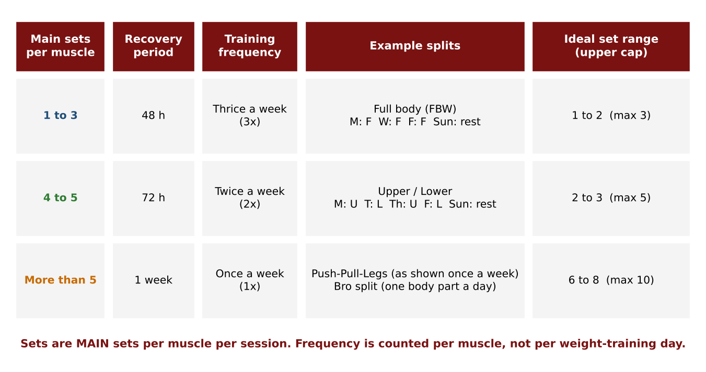

---

# Part 1: The goal and the master table

Using everything from the earlier lectures, the aim is to learn **how to analyse or design a workout split**. The board was divided in two. The left side holds the **master table**. The right side is for the **research studies**, which supply the **factors to consider while selecting or prescribing a workout split**. This mirrors the cardio lecture, which had "factors to consider while prescribing cardio intensity".

The discussion is about weight training. A day with no weight training (a non-WT day) is free room that can be used for cardio. It is not a rest day. Exactly one day a week, Sunday, is the mandatory rest day.

The master table has these columns, filled in this order:

1. **No. of sets** (main sets per muscle)
2. **Recovery period**
3. **Weekly outlook**
4. **Training frequency**
5. **Split types** (which splits line up with each scenario)
6. **Training level** (beginner, or intermediate and advanced)
7. **Ideal set range**

The last two columns are conclusions, so they are filled in at the end.

# Part 2: Filling the table

The three scenarios come straight from Scheduling 1. In the weekly outlook, a star marks a training day for that muscle.

| Main sets per muscle | Recovery period | Weekly outlook (Mon to Sun) | Training frequency |
|---|---|---|---|
| 1 to 3 | 48 hours | Train Mon, gap Tue, train Wed, gap Thu, train Fri, gap Sat, rest Sun | Thrice a week |
| 4 to 5 | 72 hours | Train Mon, gap, gap, train Thu, gap, gap, rest Sun | Twice a week |
| More than 5 | 1 week | Train Mon, gap for the whole week, rest Sun, train again next Mon | Once a week |

The repeated reminder: the number of sets is **main sets per muscle**, not the total for every exercise in the session. The same muscle can be trained by one exercise or by several (for example, two sets of lat pulldown, or one of lat pulldown and one of bent-over row). It is the muscle's total that counts.

# Part 3: What is a workout split?

A **workout split** is how your weight training sessions (your exercises) are arranged across the week, following some logic. Different splits follow different logic.

- **Full body workout (FBW).** Every session trains the whole body.
- **Upper/lower split.** Upper days train only upper body muscles (back, chest, shoulders, arms). Lower days train only lower body muscles. (Training anterior thigh muscles on one leg day and posterior on another is a variation, but upper body muscles are not trained on a lower day.)
- **Push, pull, legs (PPL).** Muscles are grouped by **movement pattern**. A *pull* day contains the pulling movements: rows, lat pulldowns, and also biceps curls (which is why back and biceps are trained together). A *push* day contains the pushing movements: bench press (chest), vertical push (anterior deltoid), and triceps (which is why chest, shoulders and triceps are trained together). The remaining day is legs.
- **Bro split (body part split).** One body part per day, for example back on Monday, chest on Tuesday, then a gap, then legs, shoulders, arms, and a cardio day. Shoulders and arms are kept away from back and chest days so the same joint is not used on back-to-back days.

## How each split lines up with the table

| Scenario | Split that fits | Weekly outlook | Why it fits |
|---|---|---|---|
| 1 to 3 sets, 48 h, thrice a week | **Full body** | Mon F, Tue non-WT, Wed F, Thu non-WT, Fri F, Sat non-WT, Sun R | Each muscle is trained every other day |
| 4 to 5 sets, 72 h, twice a week | **Upper/lower** | Mon U, Tue L, Wed non-WT, Thu U, Fri L, Sat non-WT (cardio), Sun R | Upper trained Mon and Thu, lower trained Tue and Fri, each with 72 hours between |
| More than 5 sets, 1 week, once a week | **PPL** and **bro split** | PPL: Mon P, Tue gap, Wed P(ull), Thu gap, Fri L, Sat cardio, Sun R. Bro: Mon back, Tue chest, gap, legs, shoulders, arms, a dedicated cardiorespiratory endurance day, R | Each muscle gets one session a week |

### Frequency is per muscle, not per WT day

In the upper/lower split there are **four** WT days, but ask how often the legs are trained: **twice**. Someone might answer "four" by counting WT days, which is exactly why the frequency pillar was taught first. The frequency of a muscle is still two. Upper muscles are trained on Monday and Thursday and lower muscles on Tuesday and Friday, and each gets its 72 hours.

In PPL, the latissimus dorsi is trained once (on pull day). In the bro split, the latissimus dorsi (on back day) and the pectoralis major (on chest day) are each trained once, and the shoulders once. Because the frequency is the same, everything learned from the studies applies the same way to both PPL and the bro split.

### A question about PPL done twice

Q: "We do PPL, then PPL again, six WT days. Is that not the usual way?"

A: In that version you do six WT sessions. You may be overtraining, and the overall hypertrophy stimulus may not be high enough to justify the risk of six days. A similar weekly stimulus can come from training three times a week with adequate recovery in between. The studies below explain why.

The numbers in the set-range column are not just "what scientists say". There is a logic behind them: why more than five sets once a week, and why fewer sets are enough when the muscle is trained thrice a week. That logic is the main content of this lecture.

## The aim: breaking a myth

The goal is **not** to criticise or demonise any split. The aim is to break the mindset that "full body is only for beginners, so why are you doing full body if you are advanced?" The point to prove: **any training level (intermediate or advanced too) can pick a split from any of the three scenarios, as long as they do the ideal number of sets**: not under, not over.

# Part 4: Training level and the F and I relationship

For beginners the options are limited, because there is a logical best choice. Two pillars of the FITT principle are linked:

**F is proportional to 1/I** (frequency is inversely proportional to intensity). When intensity goes up, frequency goes down; when intensity goes down, frequency can go up.

Reasoning:

- **Beginners use low intensity.** From the intensity lecture, beginners train at 15 to 20 RM (light weight, high reps, learning sets).
- Because intensity is low, the muscles do not reach major fatigue. High frequency is therefore not a problem for them. (If intensity were high, high frequency would pile on fatigue.)
- **Why frequency should be high for beginners:** beginners have a lot to learn.
  - **Neural pathways.** The gap between two motor neurons is a synapse. A new movement has a weak pathway. It becomes stronger the more often it is repeated. The lecture compared this with a person crossing a gap between two mountains on a bridge: the first crossing is the hardest, and each later crossing is more confident.
  - **The kinetic chain**, for example the arch of the body in the bench press while pressing into the floor.
  - **Proprioception**, with proprioceptors working efficiently for each exercise.
  - Grip and tightness.
  - **The Valsalva manoeuvre** and breathing: when to inhale and exhale in each movement.
- If a muscle (say the chest) is trained only once a week, bench press is practised only once a week. Neural pathways, the kinetic chain and technique take much longer to form.
- With full body training, three days a week (Monday, Wednesday, Friday), a beginner practises each movement often with light weights and low intensity. The usual **2 to 3 months beginner phase** is then used productively. With low frequency they would take months and months to finish the learning phase.

So the **best choice for beginners is full body**. Because beginners were taught this way, the industry created a stereotype that full body is only for beginners. The data in the next parts show that intermediate and advanced trainees can also make the most of full body, if the set range is followed.

# Part 5: Factor 1, stimulus per set (the law of diminishing returns)

Each study gives a takeaway, and the lecture names each takeaway so it can serve as a "factor". The first factor is **stimulus per set (SPS)**.

**Question:** if you do one set for a muscle, how much growth stimulus does that muscle get? This applies to every muscle (lats, pectoralis major, biceps, triceps, shoulders and so on). The stimulus here is the **hypertrophy stimulus**: "stimulus" comes from stimulation, meaning a change.

The researchers measured it in **arbitrary units (AU)**, not kg or grams. To make it easier to relate to, the lecture replaced the unit with a currency: **1 AU is shown as one rupee**. (The board uses the rupee sign. The idea is only an analogy.)

## The table

| Sets in a session | Net stimulus (total) | Stimulus per set (what this set added) |
|---|---|---|
| 1 | 1.00 | 1.00 |
| 2 | 1.39 | 0.39 |
| 3 | 1.61 | 0.22 |
| 4 | 1.77 | 0.16 |
| 5 | 1.90 | 0.13 |
| 6 | 2.00 | 0.10 |

How to read it:

- One set gives 1.00. If two sets doubled it, you would expect 2.00, but two sets give only **1.39**. Three sets give **1.61**, not 3.00.
- It takes **six sets to double** what the first set alone gave. That is five more sets to earn one more unit.
- The "stimulus per set" column is the **difference** between consecutive totals. For set 2: 1.39 minus 1.00 = 0.39. For set 3: 1.61 minus **1.39** (not minus 1) = 0.22. A common mistake is to subtract from 1.00 every time.
- Total net stimulus keeps rising, but **each set contributes less and less**. This is the **law of diminishing returns** (an idea from economics). "The more the merrier" is not always true.
- Sets 2 to 6 added together contribute about **1.00**, the same as the first set alone (0.39 + 0.22 + 0.16 + 0.13 + 0.10 = 1.00; 2.00 minus 1.00 = 1.00).

The published data goes beyond six sets: 7 sets about 2.09, 8 sets 2.16, 9 sets 2.23. The contributions keep shrinking (the 7th set about 0.09, the 8th about 0.07).

## The graph

Put the number of sets on the x-axis and stimulus on the y-axis. Plotted points: 1 set at 1.00, 2 sets at 1.39, 3 at 1.61, 4 at 1.77, 5 at 1.90, 6 at 2.00. If doubling held, the line would shoot up steeply (2 sets at 2.00). Instead the curve rises quickly at first and then flattens.

The curve will eventually take a **U-turn**. The more sets you do, the more **muscle damage** occurs, and damage is plotted as a second curve that stays near zero for the first few sets and then rises. When damage begins to matter, it pulls the net stimulus curve down. The two curves approach each other, giving an **inverted U** shape for net stimulus.

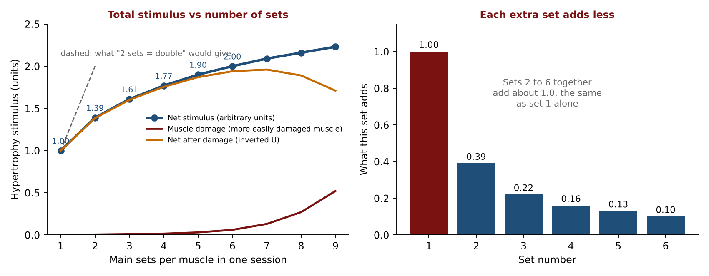

Notes on damage:

- Some muscles are **more easily damaged** and others **less easily damaged**. This varies by muscle and by person.
- In the published graph, a **more easily damaged muscle** (yellow net curve) gets about 1.77 at 4 sets, goes a little higher at 5 and 6 sets (1.9 to about 2.0), then turns back down to about 1.77 by 9 sets. The extra five sets add nothing, so the first four were enough for that muscle.
- A **less easily damaged muscle** (green net curve) rises to about 2.0 at 6 sets and returns to about 2.0 at 9 sets. The extra three sets are unnecessary, so stopping at six would have been enough.

This is why the **upper limits** (max 3, max 5, max 10) in the set-range column exist. In the third scenario ("more than five sets") the set range was left blank because "more than five" can be 20 or 25 sets. Five is the minimum, and an upper cap is needed.

# Part 6: Factor 2, stimulus retention per set

**Question:** once you earn a stimulus (1.00, 1.39, 1.61...), how long does the muscle keep it? The stimulus is **not a fixed deposit** that stays forever like money in a bank locker. If the muscle is not trained again in time, **atrophy** sets in and the stimulus falls to zero.

This factor is called **stimulus retention per set**.

Take the training day as **day 1**, then count the following days. The studies found:

| Sets | Net stimulus | Stimulus reaches zero on |
|---|---|---|
| 1 | 1.00 | Day 5 |
| 2 | 1.39 | Day 6 |
| 3 | 1.61 | Day 7 |
| 4 | 1.77 | Day 8 |
| 5 | 1.90 | Day 9 |
| 6 | 2.00 | Day 10 |

**Pattern: add 4 to the number of sets, and that is the day on which the stimulus reaches zero if the muscle is not trained again.** One set lasts until about day 5, and each extra set buys about **one more day**. The 0.39 from the second set bought one more day, and so did the 0.22 from the third set.

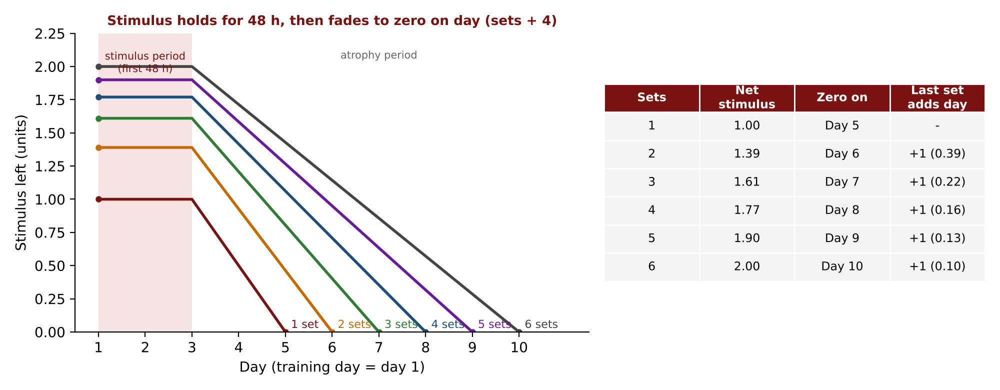

These are not fixed numbers. Some studies say four days and others five for one set. The lecture picked the middle of the range.

Q: Does this change with intensity (beginner, intermediate, advanced)?

A: No. It applies to every level, whatever weight is lifted. Reps are already set around stimulating reps. A 4 to 6 RM weight differs from person to person, but the stimulus each person earns at their own level stays for the same number of days.

# Part 7: Combining the two factors

The sets from the master table can now be linked to the weekly outlook. Take the latissimus dorsi as the example muscle. Everything applies to every muscle.

- **FBW (1 to 3 sets):** the lats are trained on all three full body days, so frequency is three.
- **Upper/lower (4 to 5 sets):** the lats are trained on Monday and Thursday, then next Monday.
- **PPL (more than 5 sets):** the lats are trained once, on Monday, and again next Monday.

## What goes wrong at low sets and low frequency

Suppose someone on a once a week split (PPL) does only one or two sets per muscle. One set (1.00) reaches zero on day 5, and two sets (1.39) on day 6. By the next Monday (day 8), everything earned has gone to zero. The muscle starts from scratch every week, with **nothing carried forward**. Then there is no point in weight training: gaining and losing, and starting again.

You do not have to carry all of the 1.77 (for example) into the next week, but you should carry **something** forward. That is how muscle size builds up.

## Why a thrice a week lifter can do fewer sets

Someone doing FBW with two sets per muscle: the 1.39 would take until day 6 to reach zero. But the muscle is trained again on Wednesday, and again on Friday, long before it reaches zero. They push it up again before it falls. So two sets per session is enough, as long as they train three times a week. That person **cannot** do two sets once a week.

## Why a once a week lifter must do more sets

Someone training once a week should do at least about **six sets**. Six sets (2.00) last until day 10, and the next session on day 8 happens before it reaches zero. In the lecture's example, about 0.4 of the stimulus was still left (an illustrative figure from the board). That balance is carried into the new session, on top of the new 2.00.

**Key takeaway:** **lower frequency means more sets per session; higher frequency can be managed with fewer sets per session.** Do not follow the crowd that says "only two sets, how will you get hypertrophy?" Two sets are enough when the muscle gets three chances a week. Do not choose the higher number of sets at high frequency either: the person would only be getting tired.

## Net weekly stimulus

For the same total of six sets in a week, how much stimulus does each split earn? Add up each session's net stimulus:

| Split (frequency) | Sets per session | Calculation | Net weekly stimulus |
|---|---|---|---|
| FBW, three times a week | 2 | 1.39 + 1.39 + 1.39 | **4.17** |
| Upper/lower, twice a week | 3 | 1.61 + 1.61 | **3.22** |
| PPL / bro, once a week | 6 | 2.00 | **2.00** |

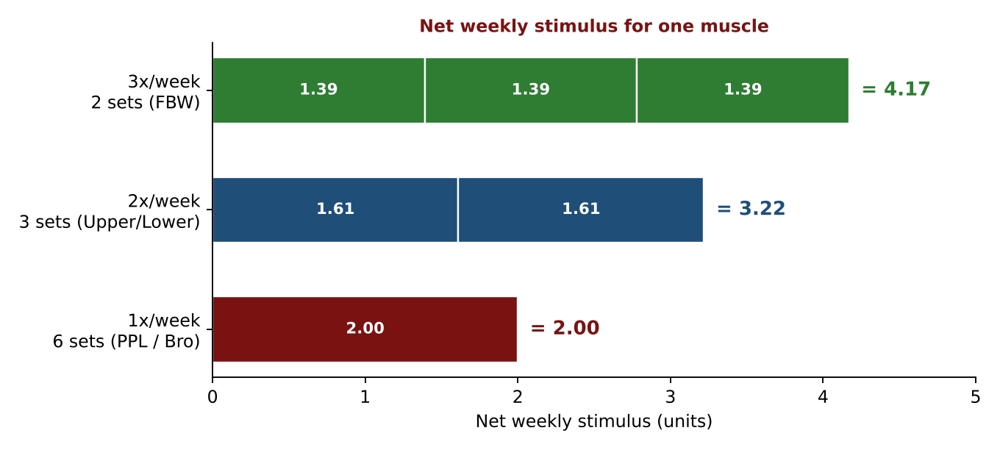

The weekly stimulus is highest when a muscle is trained **three times a week**. Full body workout is therefore not "underrated for no reason". Fewer sets per session is not a loss; at the end of the week the full body lifter has earned more than someone who trained the muscle once.

This does **not** mean PPL or the bro split is bad. There is an advantage too. People who want to become **professional bodybuilders** and win competitions must focus on every individual muscle. They need a training day with room to add many specific exercises for each muscle. In a full body session of about 10 to 12 exercises, you do not have room for niche exercises such as reverse shrugs for the lower fibres of trapezius for every muscle. When a whole day is dedicated to back, or to the upper body, there is more room. PPL and bro splits can also be used by intermediate and advanced trainees. Many factors decide the choice, including goals and training level. The lecture ranks nothing; it only shows how the three categories (thrice, twice, once a week) should be understood.

# Part 8: Factor 3, determinants of frequency (hypertrophy and atrophy)

After the break, the drop in stimulus was made more precise. There are two determinants of frequency:

- **Hypertrophy** is growth in the cell size of the muscle.
- **Atrophy** is reduction in the cell size of the muscle.

## The 48 hour rule

- **GAS** stands for **general adaptation syndrome**: how the body adapts in general.
- **MyoPS** stands for **myofibrillar protein synthesis**. "Myo" refers to muscle, and here specifically to the **myofibril**, an element inside the muscle. Inside a myofibril are sarcomeres with the proteins **myosin and actin** (thick and thin filaments, also called myofilaments). Hypertrophy here is the building of these contractile proteins.
- After training a muscle (whether one set or six), hypertrophy (MyoPS elevation) continues for the **first 48 hours**. After 48 hours **atrophy** begins.

## The ball analogy

Imagine a big rubber (Swiss) ball shot upwards by a gun. It rises, curves (a parabola) and starts to come back down. The goal is **not to let the ball (the hypertrophy curve) touch the ground**. Before it falls to the ground, shoot it up again. The 48 hours says the ball keeps going up for 48 hours and then begins to fall. The question for any program: do you shoot it again at the last minute, a little earlier, or at the exact moment the fall starts?

## Comparing three scenarios over two weeks

Three people are compared, each with six sets a week for the muscle: **6 sets once a week (PPL type), 3 + 3 sets twice a week (upper/lower type), and 2 sets three times a week (FBW type)**. Day 1 is a Monday training day.

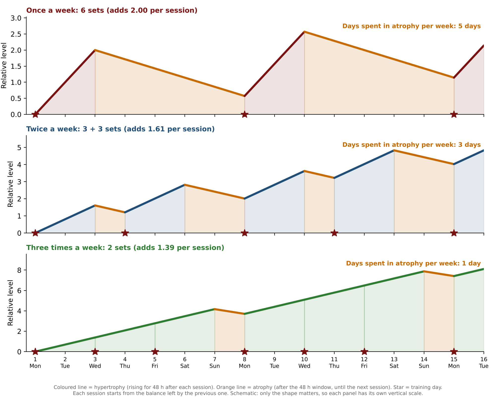

How to read the figure: the coloured line is hypertrophy (it rises for 48 hours after every session) and the orange line is atrophy (it starts when the 48 hour window ends and continues until the next session). Each session starts from whatever balance the previous one left, which is the "bank balance". Each panel has its own vertical scale, so compare the **shapes**: how many days each person spends on the orange (atrophy) line in a week. That is **5 days** for once a week, **3 days** for twice a week, and only **1 day** (the weekend) for three times a week.

**Once a week (6 sets, 2.00).**

- The 2.00 is not in the pocket straight after the gym. It builds up over the first **48 hours**, then the ball starts to fall.
- If he does nothing, it reaches zero on day **10** (6 + 4).
- He trains again on day 8 (next Monday). He avoided part of the atrophy, but still had to face a lot of it.
- The curve then goes higher than 2.00, because he is carrying a **bank balance** from the previous week. That is how muscle is built, and the logic behind designing a split.
- A limitation of the board: only two weeks fit. The following Monday would be day 15.

**Twice a week (3 + 3 sets, 1.61 each).**

- Peak at 48 hours (Wednesday). Zero would be on day **7** (3 + 4) with no more training.
- He trains again on **Thursday** (day 4), so he avoids more atrophy and faces less than the once a week lifter.
- The new session starts from the carried balance and rises again for 48 hours (to Saturday), then drops over the weekend. The drop here is slightly larger because of the extra rest day. Overall the curve stays higher than the black (once a week) curve.

**Three times a week (2 sets, 1.39 each).**

- 48 hours after Monday is Wednesday, which is the next training day. Atrophy was supposed to start, but he shoots the ball up again at exactly that moment. The 48 hour window after Wednesday ends on Friday, which is again a training day, and after Friday the window ends on Sunday.
- The "blessing in disguise" of full body: **the day atrophy would begin is the day of the next session**, so almost no atrophy occurs during the week. Only the weekend (rest day) brings some drop, and then a new cycle begins on Monday.

This is why the full body lifter, even with only two sets, always stays near the top of the curve.

# Part 9: Ideal set ranges

Putting the studies together, the ideal ranges per muscle per session, with an upper limit to avoid damage and fatigue, are:

| Frequency | Ideal main sets | Upper limit |
|---|---|---|
| Three times a week (FBW) | 1 to 2 | max 3 |
| Twice a week (U/L) | 2 to 3 | max 5 |
| Once a week (PPL, bro) | 6 to 8 | do not cross 10 |

If frequency is high, the number of sets can stay at the lower end. The upper limits come from the muscle damage curve (Part 5).

# Part 10: The published studies behind the factors

The lecture showed published graphs for each factor. They are **redrawn here at high resolution** from the numbers on the charts, so that every study has a clear figure next to its explanation. The original charts come from a members-only research review (Strength & Conditioning Research) and are copyrighted, so they are not copied into these notes. The chart titles and the study references printed on them are given below so you can find the original papers.

## Recovery against number of sets (supports the master table)

The chart shows, for each study, the day on which strength had fully returned to baseline after a workout of moderate loads (6 to 15 RM) taken to failure at least once, in strength-trained lifters. The relationship between sets and recovery time is **approximately linear**: more sets, more time.

| Study (as labelled on the chart) | Sets | Days to recover (approximate) |
|---|---|---|
| Farrow et al. 2020 | 2 | 1 |
| Moran-Navarro et al. 2017 | 3 | 3 |
| Haun et al. 2017 | 4 | 3 |
| Belcher et al. 2019 | 4 | 4 |
| Gonzalez-Hernandez et al. 2020 | 6 | 3 |
| Davies et al. 2018 | 6 | 4 |
| Ferreira et al. 2017 and Bartolomei et al. 2017 | 8 | 5 |
| Fernandes et al. 2019 | 10 | 4 |

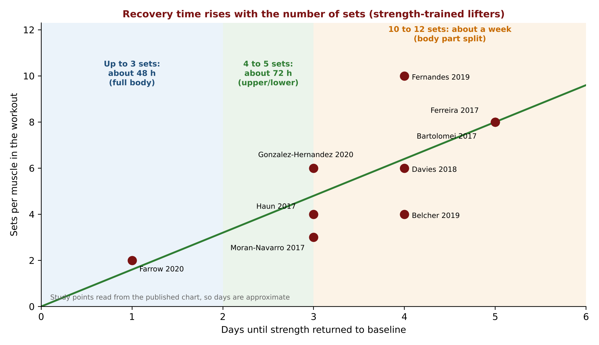

The chart's own conclusions are the three rows of the master table:

- "We can probably recover from **3 sets within 48 hours** to do full body workouts."
- "We can probably recover from **4 to 5 sets within 72 hours** to do upper/lower splits."
- "We can probably do **10 to 12 sets and recover within a week** for body part splits."

## Stimulus per set (the diminishing returns graph)

Based on a meta-analysis of resistance training volume and muscle growth (Schoenfeld, Ogborn and Krieger, 2017). The original meta-analysis found that to double the hypertrophy of one set per workout you need about **six sets**. The diminishing returns graph in Part 5 is the redrawn version of this chart (see the figure there). The graph expresses the first set as 1.0 AU and adds each later set with diminishing returns: 1.00, 1.39, 1.61, 1.77, 1.90, 2.00, 2.09, 2.16, 2.23 (at 9 sets). The inverted U shapes may be caused by muscle damage, which is deducted for more easily damaged and less easily damaged muscles.

## Recovery rates differ between muscles (why damage differs)

A study (Chen and colleagues, 2019) had young untrained males do the same workout of nine eccentric exercises (5 sets of 10 reps at 80% of maximum voluntary isometric contraction, with a 5 second lowering). Strength was measured by isometric contractions as a percentage of baseline over five days.

- Strength dropped the most for the **pectoralis major, biceps and triceps**, and these recovered slowest. At the end of five days the pectoralis major was still well short of full recovery.
- The drop was smallest for the **quadriceps** (and calves), which were closest to full recovery by day five.
- Since recovery of strength is an indicator of muscle damage (and associated central fatigue), the **best frequency may differ between muscle groups**.

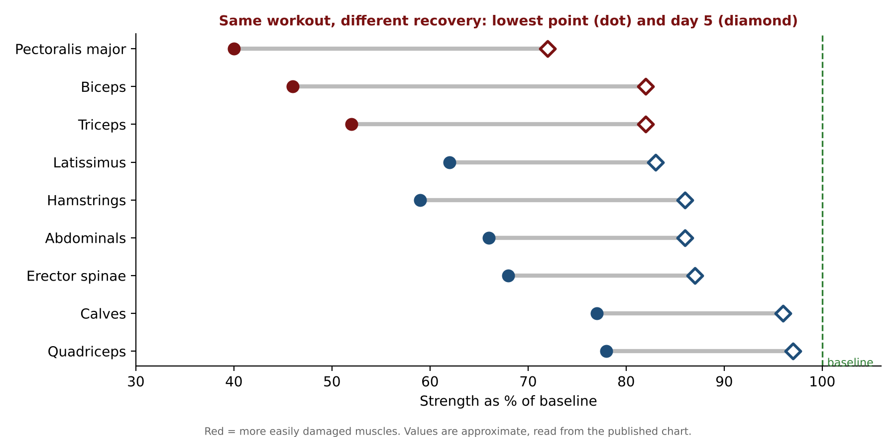

This is the "more easily damaged" (pectoralis major, biceps, triceps) and "less easily damaged" (quadriceps and others) distinction used in Part 5. The values in the figure are approximate, read from the published chart.

## Retention and atrophy (the maintenance studies)

The graph shows stimulus for 1, 2, 3 and 4 sets from day 1 to day 7, with a shaded **stimulus period** (the first 48 hours, supported by studies that correlate 48 hour MyoPS elevations with long-term hypertrophy) followed by the **atrophy period**.

- Maintenance research shows **3 sets once a week produces no gains and no losses** in muscle mass. The hypertrophy stimulus from the workout cancels the atrophy that follows.
- A stimulus of 1.61 (the value for 3 sets) disappears over the five days after the 48 hour stimulus period, so roughly **0.32 AU is lost per day** (1.61 divided by 5).
- **One set once a week** is expected to be insufficient for week-on-week hypertrophy.
- Conclusion: **frequency matters.**

The retention graph in Part 6 is the redrawn version of this chart: a stimulus period of 48 hours, then the atrophy period, with the zero day moving one day later for each extra set.

Sources named on the chart: Schoenfeld et al. (2017); Bickel et al. (2011), exercise dosing to retain adaptations; Damas et al. (2016), MyoPS and hypertrophy after attenuation of muscle damage.

# Part 11: Sample programs

All the programs are **samples only**, made to follow the studies of this lecture. Do not copy them. The statement shown with them: in the real world, effective programs are designed only after personally interacting with the client: their goals, strengths and weaknesses, likes and dislikes, available training time, preferred frequency, medical concerns and many other individual factors. **No program can be called "best" unless it is created with the specific client in mind.** This is where scheduling began: what, when and how to train, keeping in mind the body's natural rhythm of fatigue, progress and recovery.

**One or two warm-up sets are to be done before the main sets to prepare the body. The samples show only main sets.**

## Sample A: full body (three days a week, main sets per exercise)

| Exercise | Monday | Wednesday | Friday | Next Monday |
|---|---|---|---|---|
| Squats | 2 | | 2 | |
| Leg extension | | 2 | | 2 |
| Leg curl | 2 | | 2 | |
| Stiff-leg deadlift (SLDL) | | 2 | | 2 |
| Calf raise | 1 | 1 | 1 | 1 |
| Supported row | 3 | | (as Monday) | |
| Lat pulldown | | 3 | | (as Wednesday) |
| Flat chest press | 3 | | (as Monday) | |
| Incline chest press | | 3 | | (as Wednesday) |
| Lateral raise | 2 | | (as Monday) | |
| Shoulder press | | 2 | | (as Wednesday) |
| Biceps curl | 2 | | (as Monday) | |
| Triceps extension | | 2 | | (as Wednesday) |

The set numbers were shown only on the Monday and Wednesday columns. Friday repeats Monday and the next Monday repeats Wednesday. (The sets for those columns are taken as the same.)

Points explained about this sample:

- **Legs:** squats work the hip extensors and knee extensors. The knee extensors get an isolation exercise (leg extension) on Wednesday and the knee flexors get leg curl on Monday. On Wednesday the hamstrings get the SLDL (also a kind of isolation, with hip extension). Calves are trained on both days. There are many ways to build a sample.
- **Other muscles:** latissimus dorsi (row, pulldown), pectoralis major (presses), middle deltoid (lateral raise), and elbow flexors.
- **Count the synergists.** Triceps do not have a direct exercise on Monday, but they work in the presses. On Wednesday, triceps get an extension as the prime mover; the biceps work as synergists in the pulldown. So elbow flexors are not trained only once and the triceps are not forgotten.
- Frequency of a muscle is counted over **all** the exercises where it works, not only the exercise named after it.
- The Monday, Wednesday and Friday pattern repeats, with the exercises alternating.

## Sample B: upper/lower

Weekly outlook:

| Mon | Tue | Wed | Thu | Fri | Sat | Sun |
|---|---|---|---|---|---|---|
| Upper | Lower | Off or cardio | Upper | Lower | Off or cardio | Off |

Sunday is a mandatory rest day.

| # | Upper body exercise (main sets) | Lower body exercise (main sets) |
|---|---|---|
| 1 | Flat angle chest press, 1 | Squats, 1 |
| 2 | Incline press, 1 | Deadlifts, 1 |
| 3 | Pec deck fly, 1 | Lunges, 1 |
| 4 | Shoulder press, 1 | Leg extension, 2 |
| 5 | Supported row, 2 | Hip thrusts, 2 |
| 6 | Wide grip lat pulldown, 2 | Calf raises, 3 |
| 7 | High row, 1 | Leg curl, 3 |
| 8 | Shrugs, 1 | Toe raises, 2 |
| 9 | Lateral raises, 2 | |
| 10 | Preacher curl, 2 | |
| 11 | Triceps extension, 2 | |

What this sample shows:

- **A dedicated upper day gives room.** On Monday, Wednesday and Friday of a full body week you might target the pectoralis major with flat, incline and decline presses on different days (the flat press targets the sternocostal and abdominal heads, the incline the clavicular head). Now all heads can be trained on the same day, and isolation exercises (pec deck fly) can be added.
- **Deltoid.** Shoulder press for the anterior deltoid, the high row (a prone high row) for the posterior deltoid, and lateral raise for the middle deltoid. Counted together: 1 + 1 + 2 = **4 sets** for the deltoid overall.
- **Latissimus dorsi.** Supported row and wide grip lat pulldown (items 5 and 6) cover the diagonal and horizontal fibres (shoulder extension and shoulder adduction based exercises). Shrugs train the upper fibres of the trapezius.
- **Biceps and triceps.** A non-technical trainer sees one exercise for biceps (number 10) and one for triceps (number 11). A trainer who understands frequency knows that biceps also work in the high row (elbow flexion) and in the rows and pulldowns, and triceps work in the shoulder press and the two chest presses. Do not go overboard and do not ignore the other places where the muscle works.
- **Lower day.** There is room for tibialis anterior work (toe raises, ankle dorsiflexion) and many isolation exercises. Isolation exercises matter for some muscles when the goal is hypertrophy. The choice depends on the goal.

## Samples not covered

The lecture stopped (due to a power cut) before the samples for the PPL and bro split, and before the discussion of which split suits beginners, intermediates and advanced trainees. See Part 12.

# Part 12: Training level column and what was left pending

The master table's training level column ("B" for beginner, "I/A" for intermediate and advanced) was meant to be filled in at the end as a conclusion.

- **Beginner (B):** full body, because of the F and I relationship (low intensity, high frequency) and the need to learn technique. This is marked with a tick next to FBW on the board.
- **Intermediate and advanced (I/A):** from the logic of the lecture, they can choose a split from **any** of the three scenarios, provided they stay inside the ideal set range for that scenario. That is the conclusion the lecture was heading towards, and the column was not formally completed in the recording.

## What the course slides show (for the three levels)

| Level | Rep range (slides) | Split (slides) | Weekly layout (slides) |
|---|---|---|---|
| Beginner | 15 to 20 RM, no failure | Full body, no split | Mon, Wed, Fri full body weight training. Tue, Thu, Sat cardio + abs. Sun rest |
| Intermediate | 10 to 15 RM | Double split: upper body and lower body | Week 1: Mon lower, Wed upper, Fri lower. Week 2: Mon upper, Wed lower, Fri upper. Tue, Sat abs + cardio; Thu cardio; Sun rest |
| Advanced | 6 to 8 RM | Triple split (push, pull, lower body): Mon legs, Tue cardio, Wed pull, Thu abs + cardio, Fri push, Sat cardio, Sun rest | Also shown: a four-day split (Mon quadriceps and glutes; Tue calves, hamstrings, abs; Thu pull; Sat push, with cardio on Wed and Fri) and a six-day split for super advanced |

The slides also show a **linear periodisation** table (week 1: 80% of 1 RM, 5 x 5; week 2: 87%, 4 x 4; week 3: 92%, 3 x 3; week 4: 70%, 3 x 10, a de-loading week; week 5: test a new 1 RM) and a **training and de-training diagram** (breakdown, then repair and supercompensation, then the training effect, then the de-training effect). The last slide is a case-study assignment: design programs for a 30-year-old client case study at four levels: beginner (full body), intermediate (double split), and two advanced programs.

---

# Points to Confirm

These are places where the recording was unclear, inconsistent, or differs from the slides. Please check them against your course material.

1. **Stimulating reps.** The lecture says the weight is at "4 to 6 RM" for stimulating reps. The slides give 15 to 20 RM for beginners, 10 to 15 RM for intermediate, and 6 to 8 RM for advanced. These notes keep the lecture's version in the lecture text and show the slide values in Part 12.
2. **PPL as drawn on the board versus the common six-day PPL.** The board shows PPL once a week (push, pull, legs, three WT days), which matches the slides' triple split. The common six-day PPL repeated twice trains each muscle twice, which by this lecture's own rule would put it in the twice a week category. The lecture raised this question but did not resolve it; this reading is an inference.
3. **Total of the diminishing returns.** The lecture said the contributions of sets 2 to 6 total "roughly 1.02". The exact sum of 0.39 + 0.22 + 0.16 + 0.13 + 0.10 is 1.00 (rounding in the published numbers could explain 1.02).
4. **Zero day for six sets.** The recording gave day 10 for six sets, consistent with the "sets plus 4" rule. The 0.4 left at the second session is an illustrative figure from the board.
5. **The 7th set.** The recording was unclear on the contribution of the 7th set. These notes use about 0.09 for the 7th and 0.07 for the 8th, calculated from the published totals (2.00, 2.09, 2.16).
6. **Study names.** The recording was unclear on some names (one was heard as "Pharaoh 2020", which matches Farrow et al. 2020 on the chart). The study names and the sets/days table in Part 10 were read from the chart and the days are approximate.
7. **Redrawn charts.** The figures in Parts 5, 6 and 10 are redrawn from the published charts. Their numbers (for example the days in the recovery chart and the strength percentages by muscle) were read from the chart images, so treat them as approximate. The cycles figure in Part 8 is a simplified model of the board drawing, not published data.
8. **The currency analogy.** The units are arbitrary (AU). Only the idea of diminishing returns matters. Do not treat rupees as a real measurement.
9. **Sample A, Friday and next Monday.** The set numbers are shown only for Monday and Wednesday; the other two columns are taken to be the same.
10. **E-book samples.** The E-book (Chapter 16) has older sample programs and rep ranges that differ from this lecture. The lecture's version is used here.
11. **The lecture ended early.** The PPL and bro split samples and the final B/I/A conclusion were not delivered in the recording. The level column in Part 12 is completed from the slides and the lecture's logic. Check it with your course team.

---

# Board Photos from the Lecture

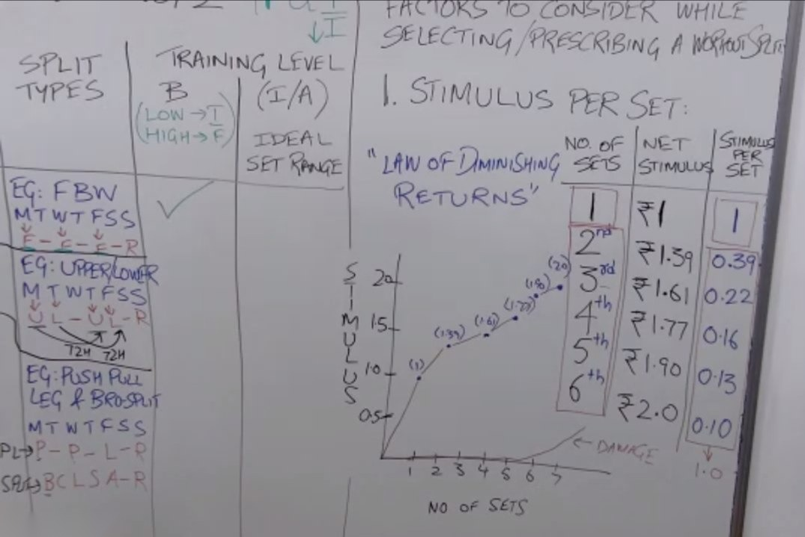

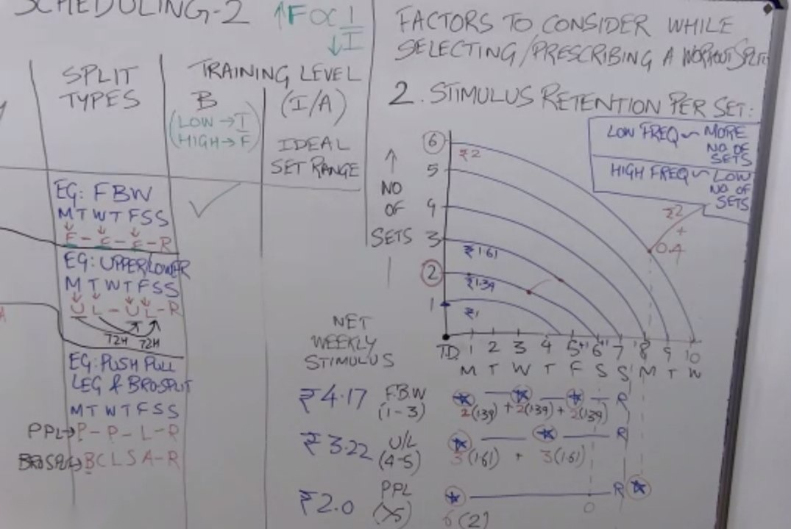

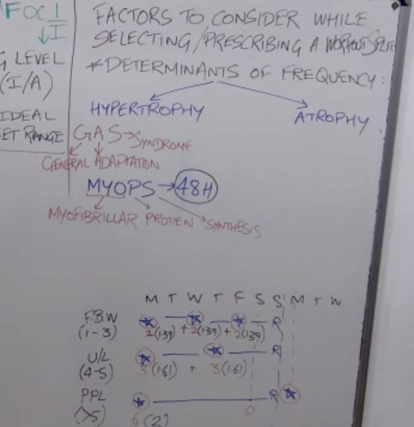

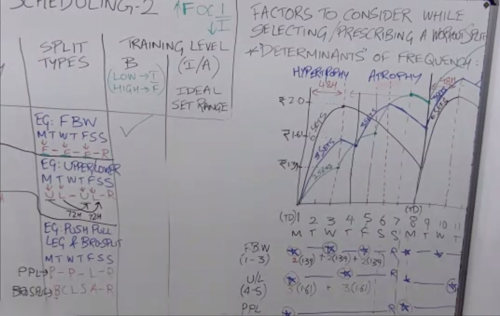

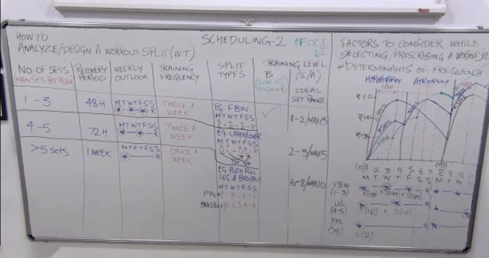
